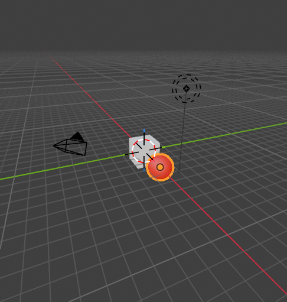

# Step 2: Add a primitive and give it a material

**Goal:** add a red sphere next to the cube.

**By hand**
1. Hover over the 3D viewport and press **Shift+A**, then *Mesh*, then *UV Sphere*.
2. Move it: press **G**, then **X**, type `3`, press **Enter**. (G = grab, X = lock to the X axis.)
3. Right-click the sphere and choose *Shade Smooth*.
4. Open the **Material Properties** tab (red sphere icon, bottom of the Properties editor) and click *New*.
5. Click the **Base Color** swatch and pick red.

**Python**
```python
import bpy
bpy.ops.mesh.primitive_uv_sphere_add(radius=1, location=(3, 0, 0))
s = bpy.context.active_object
s.name = "Red Sphere"
bpy.ops.object.shade_smooth()

mat = bpy.data.materials.new("Red")
mat.use_nodes = True
bsdf = next(n for n in mat.node_tree.nodes if n.type == "BSDF_PRINCIPLED")
bsdf.inputs["Base Color"].default_value = (0.8, 0.0, 0.0, 1)
s.data.materials.append(mat)
```



**Concepts**
- **Principled BSDF:** Blender's standard physically based shader. Its *Base Color* input is what you see as the surface color.
- We look the shader node up by **type** (`"BSDF_PRINCIPLED"`), not by name, because node names change with the interface language.
- Colors are RGBA, each value from 0 to 1.

---

[← Previous: Inspect the scene](01-inspect-the-scene.md) · [Contents](README.md) · [Next: Clear the scene →](03-clear-the-scene.md)
