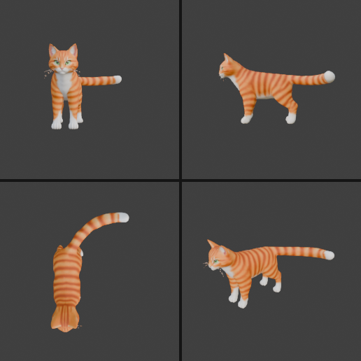

# Step 4: Import the cat (.glb)

**Goal:** bring in the cat model.

**By hand:** **File**, **Import**, **glTF 2.0 (.glb/.gltf)**, then pick the file.

**Python**
```python
import bpy
bpy.ops.import_scene.gltf(filepath="/Users/chris/Downloads/Meshy_AI_ginger_tabby_cat_model_20261031_character.glb")
```



**What arrived**

| Object | Type | Notes |
|---|---|---|
| `Mesh_0` | Mesh | The cat body, with the texture applied |
| `SmartRigArmature` | Armature | The skeleton |
| `Icosphere` | Mesh | Small unparented helper (42 vertices), probably an export leftover |

**Concepts**
- glTF/GLB is a common interchange format. It carries meshes, textures, and optionally rigs and animations.
- Imported models arrive at arbitrary scale. This cat is about 1.7 m wide and 2.6 m long, which is large for a cat.

---

[← Previous: Clear the scene](03-clear-the-scene.md) · [Contents](README.md) · [Next: Inspect the rig →](05-inspect-the-rig.md)
