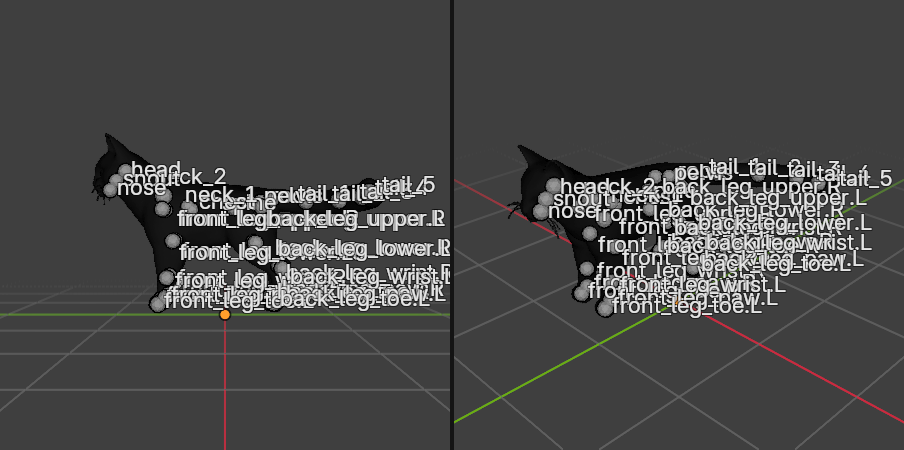
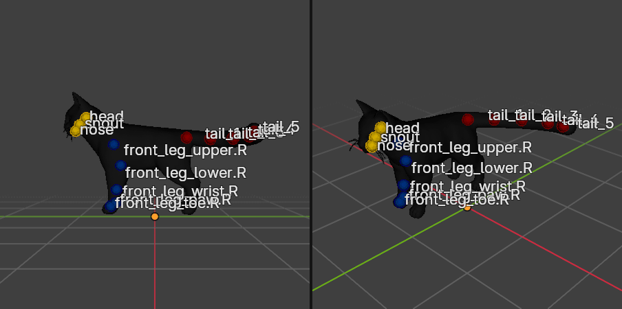

# Step 7: Rename the bones and highlight them

**Goal:** give the bones readable names, then check the labels visually.

**Naming scheme**
- `root`, `pelvis`, `spine`, `chest`
- `neck_1`, `neck_2`, `head`, `snout`, `nose`
- `front_leg_upper.R`, `front_leg_lower.R`, `front_leg_wrist.R`, `front_leg_paw.R`, `front_leg_toe.R` (and `.L` for the left side)
- `back_leg_upper.R` ... `back_leg_toe.R` (and `.L`)
- `tail_1` to `tail_5`

The `.L` and `.R` suffixes are a Blender convention. Tools like *Symmetrize* and pose mirroring recognize them, so keep them.

**By hand:** select the armature, enter **Pose Mode** (Ctrl+Tab), click a bone, then press **F2** to rename it. Or double-click the bone's name in the Outliner.

**Python**
```python
arm = bpy.data.objects["SmartRigArmature"]
arm.data.bones["Bone_018"].name = "tail_1"   # repeat for each bone
```

> **Correction:** later we found the cat's head is actually weighted to `neck_2`, not `head`. See [Step 9](09-idle-breathing-and-head.md) for how we found out and how to rename.

**Good to know:** renaming a bone this way also renames the matching vertex group on the skinned mesh, so the skinning keeps working. We confirmed no generic vertex group names were left.

**Showing the labels**
- Armature properties (green stick figure icon), then *Viewport Display*, then tick **Names** and **In Front**.
- Set the mesh to wireframe (Object properties, *Viewport Display*, *Display As: Wire*) so the bones are visible through it.
- Color a bone: in Pose Mode, Bone properties, *Viewport Display*, *Bone Color*.

**Python used for the highlight**
```python
arm.data.show_names = True
arm.show_in_front = True
arm.pose.bones["tail_1"].color.palette = 'THEME01'   # red
arm.data.bones["spine"].hide = True                    # hide a bone
```

**Common pitfall:** turning on **Names** shows the label of every visible bone at once, and they pile on top of each other. Hiding the bones you are not interested in fixes it.



After hiding the other bones and coloring the ones we care about:



**What the viewport now shows:** tail in red, right front leg in blue, head, snout and nose in yellow. All other bones are hidden so the labels do not overlap. To show everything again, press **Alt+H** in Pose Mode.

**Concepts**
- **Pose Mode:** where you move bones to pose or animate. Object Mode moves the whole object.
- **Hide vs. delete:** hiding a bone only changes what you see. It still deforms the mesh.

---

[← Previous: Identify the bones](06-identify-the-bones.md) · [Contents](README.md) · [Next: Animate a tail swish →](08-tail-swish.md)
