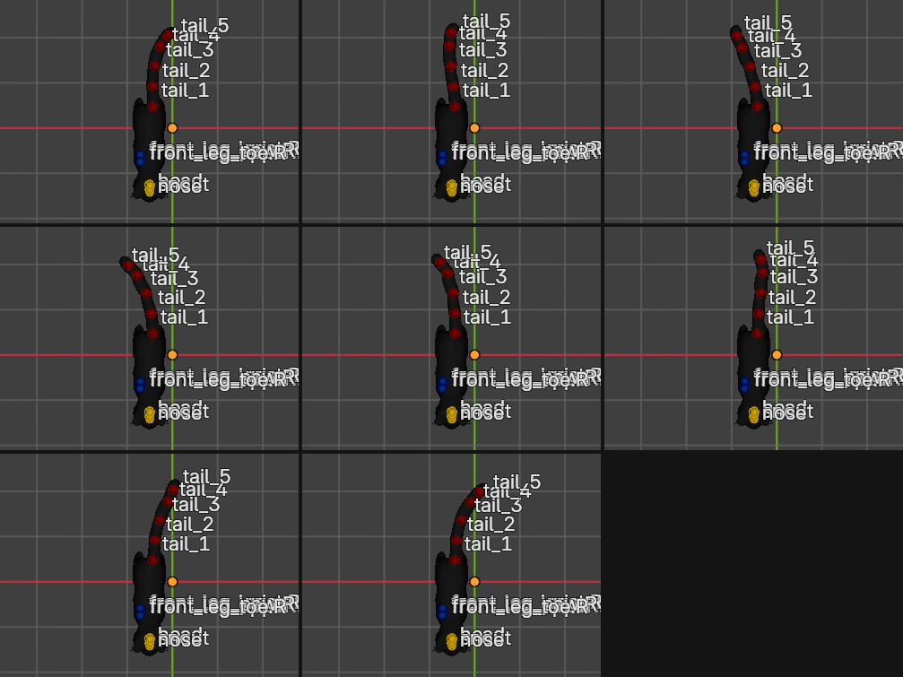

# Step 8: Animate a tail swish

**Goal:** a 2-second looping tail swish where the motion ripples down the tail like a wave.

**The idea**
- Animation in Blender means **keyframes**: you set a value at a frame, set another at a later frame, and Blender fills in the frames between.
- Each tail bone swings side to side. Two tricks make it look like a tail instead of a stiff stick:
  1. **Growing amplitude:** joints near the tip swing further (6, 10, 14, 18, 22 degrees from `tail_1` to `tail_5`).
  2. **Phase lag:** each joint is a little behind the one before it, so the wave travels from base to tip.
- The motion is a sine wave per joint: `angle = amplitude * sin(2*pi*t - joint_index * lag)`.
- **Straighten first (a lesson from our first attempt).** A swing is symmetric around the *rest pose*, and this cat's tail rests curled almost 90 degrees to one side. Our first version only rippled on that one side, and the tip never crossed the body's centerline. The fix is a per-joint **bias** rotation that straightens the tail, then the swing oscillates around straight-back, so it goes left and right.

**By hand**
1. Select the armature and enter **Pose Mode** (Ctrl+Tab).
2. Straighten the tail: click each tail bone and rotate it (**R**, **Z**) until the tail points straight back. Work from `tail_1` out to `tail_5`.
3. Go to frame 1. Rotate `tail_1` a little to one side and press **I** to insert a keyframe (choose *Rotation*).
4. Do the same for `tail_2` to `tail_5`, with bigger rotations toward the tip.
5. Move to frame 13 (or any later frame), pose the tail to the *other* side, and press **I** again.
6. Repeat to build the loop. Make the last pose match the first, so it repeats smoothly.
7. Press **Space** in the viewport to play.

Doing 5 bones at 9 key frames by hand is about 45 keyframes, which is why we script this part.

**Python**
```python
import bpy, math
from mathutils import Quaternion, Vector

arm = bpy.data.objects["SmartRigArmature"]
tail = [f"tail_{i}" for i in range(1, 6)]
amp  = [6, 10, 14, 18, 22]      # degrees
lag  = 0.5                       # delay per joint (radians)
start, period, step = 1, 48, 6   # 2 s at 24 fps, a key every 6 frames

# 1. How far is each rest bone turned away from "straight back" (+Y)?
def yaw(b):
    d = b.tail_local - b.head_local
    return math.atan2(-d.x, d.y)
rest_yaw = [yaw(arm.data.bones[n]) for n in tail]
# Each joint's rotation is relative to its parent, so undo the *difference*
# between this bone's turn and its parent's turn.
bias = [-(rest_yaw[i] - (rest_yaw[i-1] if i else 0.0)) for i in range(len(tail))]

# 2. Start a fresh action (remove any older one so old keys do not linger)
if arm.animation_data and arm.animation_data.action:
    old = arm.animation_data.action
    arm.animation_data.action = None
    bpy.data.actions.remove(old)
arm.animation_data_create()
arm.animation_data.action = bpy.data.actions.new("TailSwish")
for n in tail:
    arm.pose.bones[n].rotation_mode = 'QUATERNION'

# 3. Key the straightening (bias) plus the sine swing
for f in range(start, start + period + 1, step):
    t = (f - start) / period
    for i, n in enumerate(tail):
        pb = arm.pose.bones[n]
        # world "up" expressed in the bone's own frame -> swing sideways
        axis = (pb.bone.matrix_local.to_3x3().inverted() @ Vector((0, 0, 1))).normalized()
        swing = math.radians(amp[i]) * math.sin(2 * math.pi * t - i * lag)
        pb.rotation_quaternion = Quaternion(axis, bias[i] + swing)
        pb.keyframe_insert("rotation_quaternion", frame=f)

scene = bpy.context.scene
scene.frame_start, scene.frame_end = start, start + period - 1
```

**Result:** the tail seen from above at frames 1, 7, 13, 19, 25, 31, 37 and 43. It now sweeps to the left, then the right of the body's centerline, with the tip moving the most. We measured the tip: it travels from about 0.6 m on one side to 0.7 m on the other.



**Concepts**
- **Action:** the container for the keyframes (here `TailSwish`). Find it in the **Dope Sheet** or **Action Editor**.
- **Pose bone vs. bone:** `arm.data.bones` holds the rest pose (the skeleton as built). `arm.pose.bones` holds the current pose, which is what animation changes.
- **Quaternion rotation:** an alternative to Euler angles (X/Y/Z) that avoids gimbal lock. We rotate around the world's up axis, converted into each bone's local frame, because the bones' own axes are not aligned with the world.
- **Seamless loop:** the last key (frame 49) equals the first (frame 1), so the scene ends at frame 48. Playing frame 48 then frame 1 shows no jump.
- **Interpolation:** Blender smooths between keys with Bezier curves by default, which gives the easing in and out.

- **Rest pose matters:** an animation that oscillates around the rest pose inherits its shape. If the result looks lopsided, check the rest pose, and measure rather than guess. We printed the tip's distance from the body centerline at each frame, which is how we found the problem.

**Try it yourself**
- Change `amp` for a bigger or smaller swish.
- Keep a bit of the natural curl: multiply `bias[i]` by `0.5` to straighten the tail only halfway.
- Change `lag` (try 0.2 for a stiffer tail, 1.0 for a lazy ripple).
- Change `period` to 96 for a slower swish. Remember to change `scene.frame_end` too.

---

> **Note:** in [Step 9](09-idle-breathing-and-head.md) this animation is rebuilt on a 4 second loop (two swishes per loop), still in its own `TailSwish` action alongside separate `HeadLook` and `Breathing` actions. If you follow along, that script replaces the action built here.

---

[← Previous: Rename the bones and highlight them](07-rename-and-highlight-bones.md) · [Contents](README.md) · [Next: Idle breathing and head movement →](09-idle-breathing-and-head.md)
