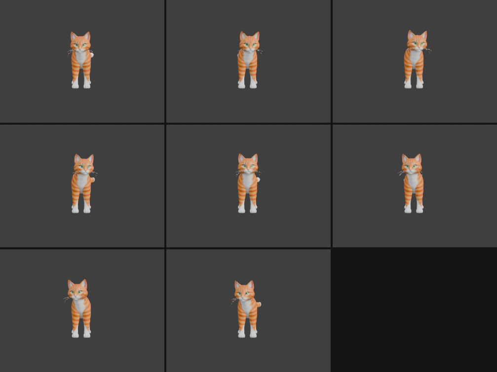
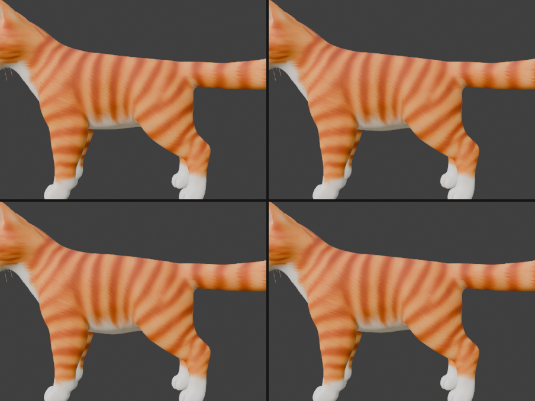

# Step 9: Idle breathing and head movement

**Goal:** make the cat feel alive when standing still: slow breathing and a head that looks around, on top of the tail swish. Each motion is its own **action**, so it can be played separately later (we want that for the web, see [Step 10](10-export-for-babylon.md)).

## Before we start: a correction and the plan

- **A bone-label correction.** In [Step 6](06-identify-the-bones.md) we labeled `Bone_022` as `neck_2` and `Bone_021` as `head`. Counting vertex weights shows the cat's head is weighted to `neck_2` (13,464 vertices), and `head` has none. So **`neck_2` is really the head bone**, and `neck_1` is the neck. The animation works either way, because we rotate both. If you want the names to match, rename `neck_2` to `head` and the old `head` to something like `jaw`, the same way as in [Step 7](07-rename-and-highlight-bones.md).
- **Three actions, not one.** The tail swish, head movement and breathing are each stored in their own action: `TailSwish`, `HeadLook` and `Breathing`. A glTF export turns each action into a separate animation, which a game or web app can start and stop on its own.
- **One loop length.** All three are **96 frames (4 seconds at 24 fps)** so they stay in sync. The tail swish runs twice per loop (a 2 second swish), breathing runs twice (2 seconds per breath), and the head look runs once.
- **Blender allows one active action per object.** So we build the actions one after another and keep each alive with a **fake user** (`use_fake_user = True`), otherwise Blender throws away actions nothing is using when you save.

## Finding out what each bone owns

Before animating, check which bones actually move which vertices. Do not trust a name.

```python
mesh = bpy.data.objects["Mesh_0"]
idx = {g.name: g.index for g in mesh.vertex_groups}
counts = {n: 0 for n in ["pelvis", "spine", "chest", "neck_1", "neck_2", "head"]}
for v in mesh.data.vertices:
    for g in v.groups:
        for n in counts:
            if g.group == idx[n] and g.weight > 0.5:
                counts[n] += 1
print(counts)
```

Result: `spine` owns 5,216 vertices (the torso), `neck_2` owns 13,464 (the head), and `chest` owns none.

**By hand:** select the mesh, go to **Weight Paint** mode, and pick a vertex group in the Object Data tab. Red areas are fully moved by that bone.

## The head movement (`HeadLook`)

**Idea:** a slow look left and right, plus a small nod a quarter-cycle behind it, so the head traces a lazy oval instead of a mechanical back-and-forth.

- **Look (yaw):** rotate around the world's up axis. `neck_1` turns 4 degrees and `neck_2` 8 degrees, so the head turns up to 12 degrees overall.
- **Nod (pitch):** rotate around the world's left-right axis, 1.5 and 3 degrees, shifted a quarter cycle with `+ math.pi/2`.
- **Lag:** the head follows the neck by a small delay (`neck_lag`), so it feels loose instead of stiff.

```python
look = math.radians(look_amp[i]) * math.sin(2*math.pi*t - i*neck_lag)
nod  = math.radians(nod_amp[i])  * math.sin(2*math.pi*t - i*neck_lag + math.pi/2)
q = Quaternion(axis_in_bone(pb, (0, 0, 1)), look) @ Quaternion(axis_in_bone(pb, (1, 0, 0)), nod)
pb.rotation_quaternion = q
```

`axis_in_bone` converts a world axis into the bone's own frame, the same trick as the tail:

```python
def axis_in_bone(pb, world_axis):
    return (pb.bone.matrix_local.to_3x3().inverted() @ Vector(world_axis)).normalized()
```

Two rotations are combined with `@`. Quaternion multiplication applies them one after the other.

**We measured it:** over the loop the nose swings from -0.14 m to +0.14 m to either side of the body's centerline and rises and falls by about 0.1 m.



## The breathing (`Breathing`)

**Idea:** the torso gets slightly bigger and smaller, a few percent for a cat at rest.

### Attempt 1: scale the `spine` bone (and why we dropped it)

The obvious approach is to scale the `spine` bone, since it owns the torso. Two problems came up:

1. **Scaling a bone scales its children.** The legs and neck hang off `chest`, a child of `spine`, so they swelled too. In Blender you can switch that off with **Inherit Scale: None** on `chest`.
2. **glTF cannot do that.** The glTF format has no "do not inherit scale" setting, so the fix would silently disappear in a web app, and the legs would swell there.

We tried the standard workaround, a counter-scale on `chest` (scale by `1/s` to cancel). **We measured it and it did not work:** the legs ended up stretched 4.7% along one axis and squashed 4.4% along another, and a paw drifted 4.1 cm. The reason is that `chest` is a tiny bone pitched about 37 degrees from `spine`, so their axes do not line up, and a scale on one cannot cancel a scale on the other.

**Lesson:** a bone scale can only cancel another bone's scale if their local axes line up. Otherwise it leaves stretching and shifting.

### Attempt 2: a shape key (what we use)

A **shape key** (also called a *morph target* or *blend shape*) stores an alternate version of the mesh and lets you blend toward it with a slider from 0 to 1. For breathing, the alternate version is a slightly fatter torso. It does not involve bones at all, so nothing else is affected, and glTF supports it directly.

How the "Breathe" shape is built: for every vertex the `spine` bone influences, push it **outward from the spine's axis**, by an amount proportional to its weight. The blended edges of the torso move less, so there are no hard seams.

```python
mesh.shape_key_add(name="Basis", from_mix=False)          # the original shape
kb = mesh.shape_key_add(name="Breathe", from_mix=False)    # the fat-torso shape

sp = arm.data.bones["spine"]
head = arm.matrix_world @ sp.head_local
tail = arm.matrix_world @ sp.tail_local
axis = (tail - head).normalized()
gi = mesh.vertex_groups["spine"].index

for v in mesh.data.vertices:
    w = next((g.weight for g in v.groups if g.group == gi), 0.0)   # spine weight, 0 if none
    if w <= 0:
        continue
    p = mesh.matrix_world @ v.co
    radial = (p - head) - axis * (p - head).dot(axis)             # from the axis to the vertex
    kb.data[v.index].co = v.co + mesh.matrix_world.to_3x3().inverted() @ (radial * 0.08 * w)
```

Then animate the key's **value** (not a bone) from 0 (breathed out) to 1 (breathed in) and back:

```python
sk = mesh.data.shape_keys
sk.animation_data_create()
act = bpy.data.actions.new("Breathing")
act.use_fake_user = True
sk.animation_data.action = act
kb.value = 0.5 * (1 - math.cos(2 * math.pi * 2 * t))   # t runs 0..1 over the loop; 2 breaths
kb.keyframe_insert("value", frame=f)
```

`1 - cos(...)` starts at 0, peaks at 1, and returns to 0, so the loop begins and ends in the same pose.

**We measured it:** at full inhale the torso grows from about 0.655 m to 0.670 m wide and from 0.496 m to 0.512 m tall, and the front legs stay at exactly 1.0 scale.



Compare the first frame (breathed out) with the third, bottom left (breathed in): the belly line drops slightly.

**By hand:** select the mesh, open **Object Data properties** (green triangle icon), add shape keys with the **+** button under *Shape Keys*, select the second one, enter **Edit Mode**, and move or scale vertices. Back in Object Mode, the slider blends them. Hover over the *Value* slider and press **I** to keyframe it.

## The tail swish (`TailSwish`)

Unchanged from [Step 8](08-tail-swish.md), except it now lives in its own action and swishes twice per 4 second loop.

## The full script

This rebuilds all three actions from scratch. It assumes the bones are already renamed (Step 7) and the `Breathe` shape key exists (code in the breathing section above).

```python
import bpy, math
from mathutils import Quaternion, Vector

arm = bpy.data.objects["SmartRigArmature"]
mesh = bpy.data.objects["Mesh_0"]
start, period, step = 1, 96, 6          # 4 s loop, a key every 6 frames

def axis_in_bone(pb, world_axis):
    return (pb.bone.matrix_local.to_3x3().inverted() @ Vector(world_axis)).normalized()

def fresh_action(name, owner):
    """Create an action, keep it alive with a fake user, and make it the owner's active action."""
    if name in bpy.data.actions:
        bpy.data.actions.remove(bpy.data.actions[name])
    a = bpy.data.actions.new(name)
    a.use_fake_user = True
    owner.animation_data_create()
    owner.animation_data.action = a
    return a

def finish(action):
    action.use_frame_range = True               # loop range: frames 1..96 (the key at 97 repeats frame 1)
    action.frame_start, action.frame_end = start, start + period - 1

# start from the rest pose
arm.animation_data_create()
arm.animation_data.action = None
for pb in arm.pose.bones:
    pb.rotation_mode = 'QUATERNION'
    pb.rotation_quaternion = (1, 0, 0, 0); pb.scale = (1, 1, 1); pb.location = (0, 0, 0)

# ---- TailSwish
tail = [f"tail_{i}" for i in range(1, 6)]
tail_amp, tail_lag, tail_cycles = [6, 10, 14, 18, 22], 0.5, 2
def yaw(b):
    d = b.tail_local - b.head_local
    return math.atan2(-d.x, d.y)
ry = [yaw(arm.data.bones[n]) for n in tail]
tail_bias = [-(ry[i] - (ry[i-1] if i else 0.0)) for i in range(len(tail))]

a = fresh_action("TailSwish", arm)
for f in range(start, start + period + 1, step):
    t = (f - start) / period
    for i, n in enumerate(tail):
        pb = arm.pose.bones[n]
        swing = math.radians(tail_amp[i]) * math.sin(2*math.pi*tail_cycles*t - i*tail_lag)
        pb.rotation_quaternion = Quaternion(axis_in_bone(pb, (0, 0, 1)), tail_bias[i] + swing)
        pb.keyframe_insert("rotation_quaternion", frame=f)
finish(a)

# ---- HeadLook
neck = ["neck_1", "neck_2"]
look_amp, nod_amp, neck_lag = [4, 8], [1.5, 3], 0.3
for pb in arm.pose.bones: pb.rotation_quaternion = (1, 0, 0, 0)     # clear the tail pose
a = fresh_action("HeadLook", arm)
for f in range(start, start + period + 1, step):
    t = (f - start) / period
    for i, n in enumerate(neck):
        pb = arm.pose.bones[n]
        look = math.radians(look_amp[i]) * math.sin(2*math.pi*t - i*neck_lag)
        nod  = math.radians(nod_amp[i])  * math.sin(2*math.pi*t - i*neck_lag + math.pi/2)
        pb.rotation_quaternion = (Quaternion(axis_in_bone(pb, (0, 0, 1)), look)
                                  @ Quaternion(axis_in_bone(pb, (1, 0, 0)), nod))
        pb.keyframe_insert("rotation_quaternion", frame=f)
finish(a)

# ---- Breathing (shape key "Breathe" must already exist)
kb = mesh.data.shape_keys.key_blocks["Breathe"]
a = fresh_action("Breathing", mesh.data.shape_keys)
for f in range(start, start + period + 1, step):
    t = (f - start) / period
    kb.value = 0.5 * (1 - math.cos(2 * math.pi * 2 * t))
    kb.keyframe_insert("value", frame=f)
finish(a)

bpy.context.scene.frame_start, bpy.context.scene.frame_end = start, start + period - 1
```

## Concepts

- **Action:** a named bundle of keyframes. An object has one *active* action at a time, but a file can hold many.
- **Fake user:** a flag that tells Blender "keep this even if nothing uses it". Without it, unused actions disappear on save.
- **Shape key / morph target:** a stored alternate mesh shape you blend to with a 0 to 1 value. Good for breathing, blinking and facial expressions.
- **Layering motion:** several simple motions at different speeds (tail 2 s, breathing 2 s, head 4 s) add up to something that looks organic.
- **Overlapping action / lag:** parts that follow (the head behind the neck, the tail tip behind the tail base) move a little later than the part that leads.
- **Measure, then look:** the numbers caught problems a picture would not (the breathing being too small, and the counter-scale drifting 4 cm). Use both.
- **Keep movement subtle:** idle motion should be felt, not noticed.
- **Know your target format early.** Inherit Scale worked in Blender but cannot be exported to glTF. If the model is going to the web, check what the format supports before building on a Blender-only feature.

## Try it yourself

- Change `0.08` in the shape key, or the `0.5 * (1 - cos(...))` value, to make the breath bigger or smaller.
- Make the head look further: raise `look_amp` to `[8, 14]`.
- Remove the nod (set `nod_amp = [0, 0]`) and compare how mechanical the head looks.
- Slow everything: change `period` to 192 and halve `tail_cycles` and the breath count.

---

[← Previous: Animate a tail swish](08-tail-swish.md) · [Contents](README.md) · [Next: Export for Babylon.js →](10-export-for-babylon.md)
