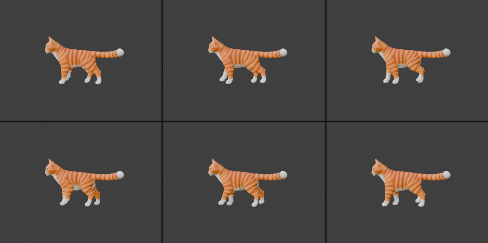

# Step 11: A walk cycle

**Goal:** a looping walk where the four paws plant on the ground and lift in the right order, as its own `Walk` action, so it can play alone or together with the tail, head and breathing animations.

> **Status:** the measurements and the export below were run and checked. The poses were checked visually from the side only. We have not loaded the file in Babylon.js.

## The idea: where the feet go matters more than how the joints bend

The tempting way to animate a leg is to swing the upper leg back and forth and bend the lower joints a bit. That makes **feet slide and float**. A leg swinging from the hip moves its foot along an arc, so at the ends of each step the foot rises off the ground, and in the middle it presses into it. It looks like skating.

A walk looks right when each foot is **planted and not moving** while it is on the ground. Relative to the body, a planted foot travels backward at a steady speed (the body is moving forward over it). Then the foot lifts, swings forward and plants again. So we:

1. **Decide where each foot should be** at every moment (a path).
2. **Solve for the joint angles** that put the foot there. This is **inverse kinematics** (IK). Forward kinematics goes from angles to a foot position, and IK goes the other way.

## The gait

- **Lateral-sequence walk:** the cat's natural walking order is hind right, front right, hind left, front left, each a quarter of a cycle after the last. At every moment at least two feet are on the ground, so it is stable and slow.
- **Duty factor `d = 0.6`:** each foot is on the ground for 60% of the cycle and in the air for 40%. Walking is above 0.5 (so there is always overlap). Running drops below.
- **Stride length `S = 0.45 m`:** how far each foot travels backward during its stance.
- **Foot lift `H = 0.10 m`:** how high the foot rises during its swing. The swing is eased and follows a sine arc.
- **Cycle length `T = 30 frames` (1.25 s at 24 fps).**

| Foot | Phase offset |
|---|---|
| Right hind (`RH`) | 0.00 |
| Right front (`RF`) | 0.25 |
| Left hind (`LH`) | 0.50 |
| Left front (`LF`) | 0.75 |

## Making IK from scratch

Blender has IK constraints, but they do not export to glTF (the file holds only bone rotations). So we solve the IK ourselves with a small calculation and then **bake** the answer into ordinary rotation keyframes. The result exports like any other animation.

Each leg is a chain of bones: upper leg, lower leg, wrist, paw and toe. The legs only swing forward and backward, so everything happens in one plane (Y up-down and forward-back), and each joint rotates around the same world X axis. That keeps it simple:

- A joint's world angle is the sum of its own rotation and all the joints above it.
- The foot tip's position is the hip position plus each bone's rest vector, rotated by its cumulative angle.

We then adjust four joint angles until the toe tip lands on its target, using a few steps of **Gauss-Newton** (a standard method for solving equations like this by repeated small corrections). Three extra goals keep the result natural:
- **Keep the paw flat:** the paw's total angle should stay near its rest angle (small weight `w_ori`).
- **Stay near rest:** a tiny penalty on large angles (`w_reg`), so the joints do not twist into odd shapes when several solutions exist.
- **Start from the previous frame:** each frame starts from the last solution, so the motion stays continuous. We solve the whole cycle twice so the loop's start matches its end.

## The script

```python
import bpy, math
import numpy as np
from mathutils import Quaternion, Vector

arm = bpy.data.objects["SmartRigArmature"]
scene = bpy.context.scene

# walk parameters
T, d, S, H, step = 30, 0.60, 0.45, 0.10, 2     # frames/stride, duty factor, stride m, lift m, key spacing
offset = {"RH": 0.00, "RF": 0.25, "LH": 0.50, "LF": 0.75}   # lateral-sequence walk
legs = {
    "RF": ["front_leg_upper.R", "front_leg_lower.R", "front_leg_wrist.R", "front_leg_paw.R", "front_leg_toe.R"],
    "LF": ["front_leg_upper.L", "front_leg_lower.L", "front_leg_wrist.L", "front_leg_paw.L", "front_leg_toe.L"],
    "RH": ["back_leg_upper.R",  "back_leg_lower.R",  "back_leg_wrist.R",  "back_leg_paw.R",  "back_leg_toe.R"],
    "LH": ["back_leg_upper.L",  "back_leg_lower.L",  "back_leg_wrist.L",  "back_leg_paw.L",  "back_leg_toe.L"],
}

def yz(v): return np.array([v.y, v.z])
def rot(a, v):                      # rotate a (y, z) vector by angle a about the world X axis
    c, s = math.cos(a), math.sin(a)
    return np.array([v[0]*c - v[1]*s, v[0]*s + v[1]*c])

# rest points of each chain in the y-z plane: hip, knee, wrist, paw, ball of foot, toe tip
rest = {}
for L, names in legs.items():
    b = [arm.data.bones[n] for n in names]
    rest[L] = [yz(b[0].head_local), yz(b[1].head_local), yz(b[2].head_local),
               yz(b[3].head_local), yz(b[4].head_local), yz(b[4].tail_local)]

def fk(delta, P):                   # forward kinematics: joint angles -> toe tip position
    s = [P[i+1] - P[i] for i in range(5)]
    A0 = delta[0]; A1 = A0 + delta[1]; A2 = A1 + delta[2]; A3 = A2 + delta[3]
    Q = P[0] + rot(A0, s[0]); Q = Q + rot(A1, s[1]); Q = Q + rot(A2, s[2]); Q = Q + rot(A3, s[3])
    return Q + rot(A3, s[4]), A3

def target(L, t):                   # where the toe tip should be at time t (0..1 over the cycle)
    y0, z0 = rest[L][5]
    ph = (t - offset[L]) % 1.0
    if ph < d:                      # stance: planted, moving backward (+Y) at constant speed
        return np.array([y0 - S/2 + S*(ph/d), z0])
    s = (ph - d) / (1 - d)          # swing: lift and move forward (-Y), eased
    return np.array([y0 + S/2 - S*(s*s*(3 - 2*s)), z0 + H*math.sin(math.pi*s)])

def solve(L, tgt, x0, w_ori=0.15, w_reg=0.03, iters=60):    # inverse kinematics
    P = rest[L]; x = x0.copy()
    def res(x):
        tip, A3 = fk(x, P)
        return np.concatenate([tip - tgt, [w_ori*A3], w_reg*x])
    for _ in range(iters):
        r = res(x); J = np.zeros((len(r), 4))
        for k in range(4):
            xe = x.copy(); xe[k] += 1e-5
            J[:, k] = (res(xe) - r) / 1e-5
        dx = np.linalg.solve(J.T @ J + 1e-3*np.eye(4), -J.T @ r)
        x = x + dx
        if np.linalg.norm(dx) < 1e-9: break
    return x

# solve one stride, twice, so the loop start matches the loop end
n_keys = T // step
frames = [1 + k*step for k in range(n_keys + 1)]
sol = {}
for L in legs:
    x = np.zeros(4)
    for warm in range(2):
        out = []
        for k in range(n_keys):
            x = solve(L, target(L, k / n_keys), x)
            out.append(x.copy())
    sol[L] = out + [out[0]]          # last key repeats the first: seamless loop

# bake into an action
def axis_in_bone(pb, world_axis):
    return (pb.bone.matrix_local.to_3x3().inverted() @ Vector(world_axis)).normalized()

arm.animation_data_create()
arm.animation_data.action = None
for pb in arm.pose.bones:
    pb.rotation_mode = 'QUATERNION'; pb.rotation_quaternion = (1, 0, 0, 0)
if "Walk" in bpy.data.actions: bpy.data.actions.remove(bpy.data.actions["Walk"])
act = bpy.data.actions.new("Walk"); act.use_fake_user = True
arm.animation_data.action = act
for ki, f in enumerate(frames):
    for L, names in legs.items():
        for j in range(4):                       # upper, lower, wrist, paw (the toe just follows)
            pb = arm.pose.bones[names[j]]
            pb.rotation_quaternion = Quaternion(axis_in_bone(pb, (1, 0, 0)), float(sol[L][ki][j]))
            pb.keyframe_insert("rotation_quaternion", frame=f)
act.use_frame_range = True; act.frame_start = 1; act.frame_end = T
scene.frame_start, scene.frame_end = 1, T
```

`numpy` ships with Blender's Python, so no install is needed.

## Check it by measuring, not just looking

IK can quietly produce nonsense if a sign is wrong, such as a foot reaching backward when it should reach forward. So after keying, we asked Blender where each toe tip really ended up and compared it to the plan:

```python
tip = arm.pose.bones["front_leg_toe.R"].tail      # where the toe tip really is, at the current frame
```

| Leg | Max error vs. plan | Tip height range | Stance height spread |
|---|---|---|---|
| Right front | 0.50 cm | 1.8 to 11.3 cm | 0.47 cm |
| Left front | 0.65 cm | -0.2 to 9.3 cm | 0.61 cm |
| Right hind | 0.56 cm | 5.8 to 15.6 cm | 0.41 cm |
| Left hind | 0.43 cm | 3.7 to 13.3 cm | 0.48 cm |

- **Error** is how far the real foot is from where we wanted it. Under 1 cm everywhere means the solver and the bone axes agree.
- **Stance height spread** is how much a foot rises or sinks while it should be planted. Under 0.7 cm means the feet stay on the ground, which is the whole point.
- **Joint angles** stayed moderate, from about -35 to +27 degrees, so no joint is bent into an odd shape.

The left and right hind feet rest at different heights (5.9 and 3.8 cm). That is how the original model's rest pose is, so each foot's "ground" is its own rest height.



## Exporting it

Same export as [Step 10](10-export-for-babylon.md). The new file is `exports/cat_all_animations.glb`, and its contents (checked with `tools/inspect_glb.py`) are:

```
animation 'Walk':      16 channels | 1.25 s -> rotation of the 4 bones in each of the 4 legs
animation 'TailSwish':  5 channels | 4.0 s
animation 'HeadLook':   2 channels | 4.0 s
animation 'Breathing':  1 channel  | 4.0 s (morph target)
```

The `Walk` animation touches only leg bones, and the others touch only tail, neck and the morph target, so all four can play at the same time without overwriting each other. This is why we kept the actions on separate bones.

## Things to know

- **It walks in place.** The cat does not travel anywhere. In your app you move the whole model forward. To keep the feet from sliding on the ground, match this speed: **0.60 m/s** (stride `0.45 m` divided by stance time `0.6 x 1.25 s`). Adjust by playing the animation faster or slower and scaling the speed to match.
- **Walking alone leaves the tail curled.** The straightening of the tail lives in `TailSwish` (Step 8). Without it, the tail is in the model's original sideways curl. Play `TailSwish` with `Walk` for a straight, swaying tail.
- **No body motion yet.** Real walks also have the body bobbing and rocking. We left it out here because moving the body would move the feet we just pinned to the ground. [Step 12](12-walk-body-motion.md) adds it by solving the legs again with the body moved. It also replaces the `Walk` action built here, and corrects the key spacing: the errors in the table above were measured only at key frames, so key every frame (`step = 1`) for real.
- **Verified from the side only.** We did not check the front and top views for the legs crossing or splaying.
- **Not tested in Babylon.** For a walk-to-idle blend in Babylon, you can fade the weights of two animation groups.

## Concepts

- **Gait:** the order and timing of footfalls. A walk, trot and gallop are different gaits.
- **Duty factor:** the fraction of the cycle a foot is on the ground.
- **Forward vs. inverse kinematics:** FK goes from joint angles to a position. IK goes from a wanted position to joint angles.
- **Baking:** computing an animation with code (or constraints) and storing the result as plain keyframes, so it works anywhere.
- **Foot sliding:** the most common walk-cycle flaw. It happens when the feet do not move at the speed the body moves.
- **Warm start:** starting each solve from the previous answer, which keeps motion smooth and helps the loop close.

## Try it yourself

- Make a trot: set `offset` to `{"RH": 0.0, "LF": 0.0, "LH": 0.5, "RF": 0.5}` (diagonal pairs move together) and lower `d` to about `0.45`.
- Change `S` and `H` for a longer stride or a high-stepping cat. Recompute the matching speed with `S / (d * T / 24)`.
- Slow it down by raising `T` (for example `T = 48`, `step = 3`).

---

[← Previous: Export for Babylon.js](10-export-for-babylon.md) · [Contents](README.md) · [Next: Body motion for the walk →](12-walk-body-motion.md)
