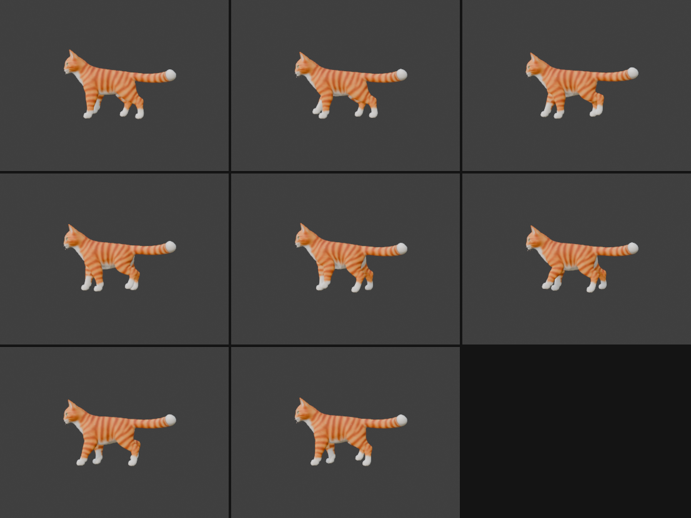

# Step 12: Body motion for the walk

**Goal:** make the walk feel weighty by letting the body dip and rock as the cat steps, without the feet sliding. This replaces the `Walk` action from [Step 11](11-walk-cycle.md).

> **Status:** the measurements and the export below were run and checked. The poses were checked visually from the side only. We have not loaded the file in Babylon.js.

## The problem: moving the body moves the feet

In Step 11 the body stood still and only the legs moved. Real walks have the body dip, rock and sway. But the legs hang from the body, so **if the body moves, every hip moves**. If we simply moved the body and left the leg animation alone, the planted feet would be dragged along with it and slide.

The fix is to move the body first, then **solve the legs again with the hips in their new positions**. The foot targets stay where they were. The leg joints do the extra work.

## The body motion we added

Both motions run twice per stride, through the `root` bone (the parent of everything, so the whole body, tail and neck follow):

- **Dip, 3 cm:** the body sinks, then returns to its normal height. It only dips down, never above the rest height, because the front legs are almost straight at rest and cannot stretch higher.
- **Rocking, 1.5 degrees:** the nose dips when a front foot lands, and the rump dips when a hind foot lands.

```python
def body(t):          # t runs 0..1 over one stride
    dip   = DIP * (1 + math.cos(4*math.pi*(t - 0.125))) / 2     # 0 .. 3 cm, lowest at t = 0.125 and 0.625
    pitch = -PITCH * math.cos(4*math.pi*t)                      # + = nose down
    return dip, pitch
```

The `4*pi` makes each cycle repeat twice per stride. The dip's `(1 + cos) / 2` form goes smoothly from 0 to 1 and back.

> **A judgment call, not a measurement.** The two-dips-per-stride rhythm and its timing are our choice, based on how walking quadrupeds are usually described. We did not measure a real cat. If it looks off to you, shift the `0.125`.

## Moving the hips in the solver

The only change to the IK from Step 11 is where each leg starts. The root bone rotates about its own head (the pivot) and has been moved down by the dip, so each hip's new position is:

```python
pivot = yz(arm.data.bones["root"].head_local)

def hip_world(L, t):
    dip, beta = body(t)
    return pivot + np.array([0.0, -dip]) + rot(beta, rest[L][0] - pivot), beta
```

`rot(beta, hip - pivot)` rotates the hip around the pivot, then the dip shifts it down. The forward-kinematics function now starts from that hip. The root's rocking angle `beta` also adds to every leg bone's angle, because the legs are carried by the body:

```python
def fk(delta, P, hip, beta):
    A0 = beta + delta[0]            # the leg inherits the body's rocking
    ...
```

The foot targets in `target(L, t)` are unchanged. They are in world space, and the foot-flat goal now also counts the body's rocking. The solver bends the legs to reach the same ground spots with the moved body.

## Writing the keys

The root bone gets a location key (the dip) and a rotation key (the rocking), alongside the leg rotations:

```python
root = arm.pose.bones["root"]
to_local = root.bone.matrix_local.to_3x3().inverted()
...
root.location = to_local @ Vector((0, 0, -dip))                        # world "down" in the root bone's own axes
root.rotation_quaternion = Quaternion(axis_in_bone(root, (1, 0, 0)), beta)
root.keyframe_insert("location", frame=f)
root.keyframe_insert("rotation_quaternion", frame=f)
```

The `to_local` line is needed because a bone's `location` is measured along the bone's own axes, not the world's, the same reason we use `axis_in_bone` for rotations.

## A bug we found by measuring: key every frame

The first run measured **errors up to 2 cm** and planted feet that moved up to 1.3 cm. That was worse than Step 11's 0.65 cm, and it looked like the body motion was to blame.

It was not. The cause was how we measured and keyed:
- In Step 11 we measured only at the **key frames**, where the solver's answer is exact.
- Here we measured **every frame**. Between keys Blender smooths a curve (interpolation) and does not solve the IK, so the foot drifts off the plan.

We tested the idea by putting a **key on every frame** (`step = 1` instead of `2`). The errors dropped from 2 cm to under half a centimeter. The cost is just more keyframes (30 instead of 15).

**Lesson:** if you bake IK into keyframes, key densely enough that interpolation cannot wander. And measure at the frames you will actually play, not only the keys.

## Result

Measured at all 30 frames, with a key on every frame:

| Leg | Max error vs. plan | Stance height spread |
|---|---|---|
| Right front | 0.43 cm | 0.54 cm |
| Left front | 0.43 cm | 0.54 cm |
| Right hind | 0.30 cm | 0.38 cm |
| Left hind | 0.30 cm | 0.37 cm |

The pelvis height swings by **3.0 cm** and the pitch from -1.5 to +1.5 degrees. The feet stay planted (stance height spread under 0.6 cm) even though the body moves.


**Reading the chart.** The top shows when each foot is on the ground. Right hind, right front, left hind and left front land one after another, a quarter cycle apart (frames 1, 9, 16 and 24), and each is planted for about 60% of the stride. At every moment at least two feet are down. The bottom shows the pelvis dipping twice per stride.

The chart is generated by `tools/make_gait_chart.py` from a JSON file of measured toe heights and pelvis heights. We dumped that file from Blender with a short loop that steps through the frames and reads each toe bone's position (`arm.pose.bones[name].tail`), the same measurement as the error table. That dump is not included here, so the script will not run as-is. The chart is a plain SVG file, so it adapts to light and dark mode.



## The export

Same as [Step 10](10-export-for-babylon.md), written over `exports/cat_all_animations.glb`. The `Walk` animation now has 18 channels: the 16 leg bones, plus the root's position and rotation. The other three animations are unchanged, and nothing else drives the root, so all four can still play at once:

```
animation 'Walk':      18 channels | 1.25 s -> translation + rotation of root, rotation of the 4 bones in each of the 4 legs
animation 'TailSwish':  5 channels | 4.0 s
animation 'HeadLook':   2 channels | 4.0 s
animation 'Breathing':  1 channel  | 4.0 s (morph target)
```

## Things to know

- **Still walking in place.** Move the model forward at about **0.60 m/s** so the feet do not slide.
- **No sideways sway or spine twist.** Real walks also shift the body from side to side and twist the spine. We left both out on purpose: our legs only swing forward and backward, so a sideways body shift would drag the planted feet sideways. Adding it needs a leg that can also swing outward (a hip joint with more than one direction of rotation, and a 3D version of the solver). That is a good next step.
- **Dip depth is limited by the rest pose.** The front legs are only about 8% longer than the standing distance from hip to ground, so the body can sink but not rise.
- **Verified from the side only.**
- **Not tested in Babylon.**

## Concepts

- **Root motion vs. in-place motion:** whether the animation moves the character through the world. Ours stays in place.
- **Why feet slide:** the body moves and the feet do not account for it. Solving the legs after the body motion fixes it.
- **Interpolation error:** the difference between a computed pose and the smooth curve Blender draws between keys.
- **Secondary motion:** motion that supports the main action (the body dip, the rocking). It is what makes a walk feel weighty.

## Try it yourself

- Change `DIP` (try 0.01 and 0.05) and `PITCH` and watch the stance spread stay small.
- Shift the dip's phase: replace `0.125` with `0.0` or `0.25` and see which timing looks natural.
- Set `step = 2` again and re-measure, to see the interpolation error for yourself.

---

[← Previous: A walk cycle](11-walk-cycle.md) · [Contents](README.md) · [Next: Sit down, look around, lick a paw →](13-sit-look-lick.md)
