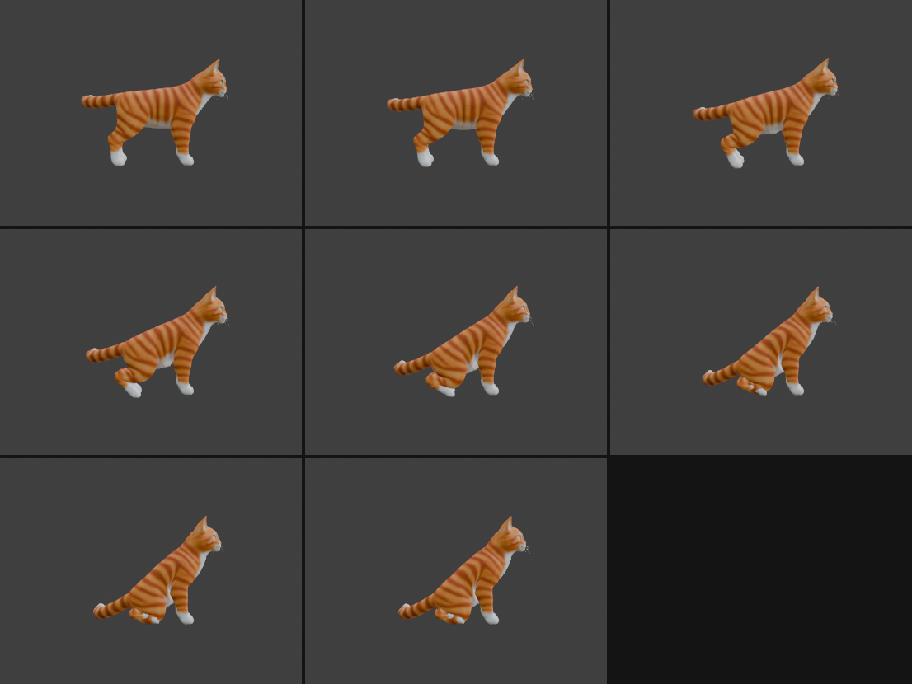
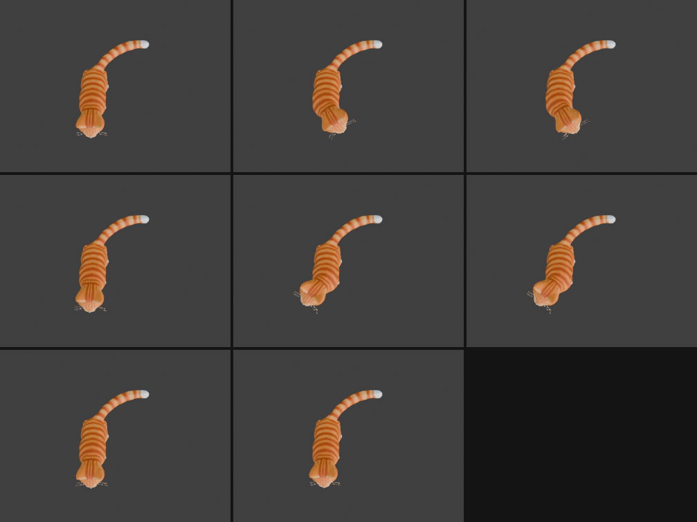
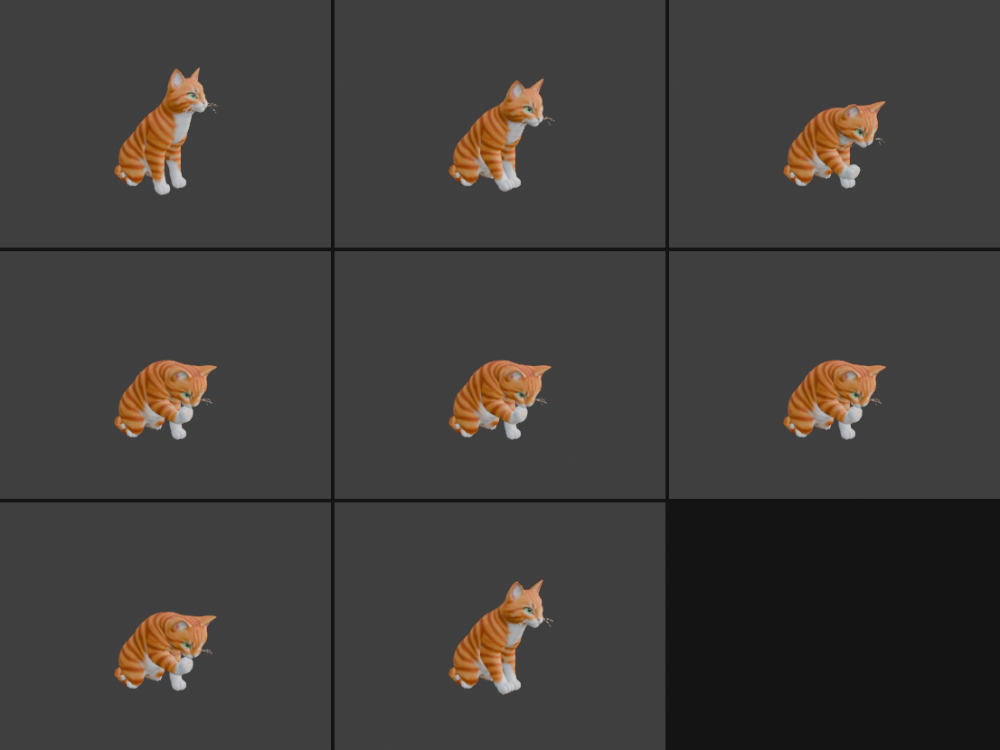

# Step 13: Sit down, look around, lick a paw

**Goal:** three separate actions that chain into a short scene: the cat sits down (`Sit`), looks left and right (`LookAround`), then lifts its right paw, licks it and puts it back down (`LickPaw`). It ends in the sitting pose.

> **Status:** the numbers and the export below were run and checked, and each action was viewed in Blender (side, top and front-right views). **We have not loaded the file in Babylon.js**, so the playback code at the end is untested. The code excerpts here are condensed from longer scripts and will not run as-is.

> **Update:** `Sit` was rebuilt in [Step 14](14-more-game-animations.md) so the tail is straightened as the cat sits, and its droop is now 19.5 degrees (the 25.9 below is the first version). Nothing else changed: `LookAround` and `LickPaw` still join `Sit` with a 0.0000 degree difference.

## Why three actions

Each can be started when you want. `Sit` plays once and holds its last frame. `LookAround` and `LickPaw` then each start from exactly where `Sit` ended, because each begins in the sitting pose. Separate actions also let you reuse them: `LookAround` could play many times between other actions.

## Part 1: Sit

Sitting is a big pose change. The whole body tips back, the hips drop to near the floor, the hind legs fold, and the front legs have to stay planted. We reused the idea from the walk: decide where things should end up, then solve the joints.

### Finding the pose before animating it

We solved the **final** sitting pose first and checked the numbers, before making any motion.

- **The body tips back by an angle `THETA`.** We rotate the whole skeleton about the `root` bone, as in Step 12.
- **The haunch (the rump) must touch the floor.** We lowered the root until the lowest haunch vertex was at floor height. That needed the root pivot at z of about 0.40, much higher than the 0.25 we first guessed. A good lesson: measure the mesh, do not assume where its bottom is.
- **The front legs set a limit on how steeply the cat can sit.** Tipping the body back raises the shoulders. The front legs are only 1.05 m long, so the shoulders cannot go above that:

| Body tilt | Shoulder height | Reachable? |
|---|---|---|
| 40 degrees | 1.02 m | just (legs fully straight) |
| 50 degrees | 1.14 m | no, legs too short |
| 60 degrees | 1.24 m | no |

  We chose **37 degrees**, which keeps the shoulders at 0.93 m, so the front legs are almost straight, as in a real sitting cat. This model has long front legs and a short body, so it sits more upright-ish than a typical cat would.

### Hind legs: a different goal than walking

For the walk, each foot had a target position. For sitting, the hind leg's goal is its **shape**:
- the **hock** (the heel joint, `back_leg_wrist`) comes down to the floor, just behind the hip
- the **metatarsus** (the long bone from the hock to the paw) lies **flat**, pointing forward
- the paw stays flat

Those become the targets for the same kind of solver as Step 11:

```python
# hind leg: heel to the ground, metatarsus laid flat
hock_target = np.array([hip_y + HOCK_BEHIND, HOCK_Z])
A2_target   = a_flat          # rotation that lays the metatarsus flat, pointing forward
res = np.concatenate([Q[2] - hock_target,        # where the heel is
                      [w_o * (A[2] - A2_target), # how the metatarsus is angled
                       w_o * A[3]],              # keep the paw flat
                      w_r * x])                  # stay near the rest pose
```

Front legs keep the Step 11 goal: toe tip stays at its standing position (planted), paw flat.

**The heel target is not 0.** We first set it near the floor (0.05 m) and measured the mesh: the hind foot poked **9.6 cm through the floor**, because the paw mesh hangs below its bones. We then adjusted the heel height until the lowest hind-foot vertex sat at floor level, which needed a heel target of **0.153 m**. All contacts were then within 1 cm of the floor: haunch +0.1 cm, hind foot -0.3 cm, front paws -0.8 cm.

### Getting there: interpolate the targets, not the angles

If you blend straight from standing angles to sitting angles, the legs pass through odd shapes and the planted front paws slide. Instead we **blend the targets** from standing to sitting (with an ease-in-ease-out curve) and solve the IK at every frame, each time starting from the previous frame's answer. This is called a **homotopy**: a gradual change that keeps the solution on one consistent branch. It also keeps the knees bending forward the whole way. A key on every frame (as in Step 12) avoids interpolation drift.

### The rest of the body

- **Neck:** tipping the body back would point the head at the ceiling. The neck pitches nose-down by `THETA - 15 degrees` to keep the head looking slightly upward.
- **Tail:** it would pitch down and go through the floor. The whole tail is drooped as one piece (a rigid rotation) by 25.9 degrees, found by trying angles until the lowest tail joint was just above the floor (z of 0.05). Our first version rotated the tail about the world X axis bone by bone, and left the tail 17 cm in the air, because the tail curls sideways in the rest pose and sideways bones do not droop under an X rotation. Rotating the tail as one piece is simpler and works.

### A tool to check ourselves: our own forward kinematics

To get exact bone positions without waiting for Blender to recompute the 79,000-vertex mesh, we wrote a small 3D forward-kinematics routine. It rebuilds each bone's position from the rest matrices and our rotations:

```python
# pose matrix = parent's pose matrix @ (parent rest ^-1 @ this bone's rest) @ pose rotation
M = parent_pose @ rel[bone] @ basis[bone]
tail_position = M @ Vector((0, bone.length, 0))     # a bone points along its own +Y axis
```

We checked it against Blender's real result. **The worst difference over five bones was 0.0000 m**, so we trusted it for the rest of this step.



**Measured:** while sitting down the front paws drift at most **0.53 cm**.

## Part 2: LookAround

A look to the left, a pause, a look to the right with a slight upward nod, a pause, then back to centre, over 5 seconds (120 frames). It drives only `neck_1` and `neck_2`, and starts exactly at `Sit`'s final neck pose (the rotation difference is 0.0).

**The catch: turning the head about the true vertical.** The body is tipped back 37 degrees, so the neck bones' own axes are tilted too. A plain rotation about "the world's up axis converted into the bone's frame" (the trick from Steps 8 and 9) would turn the head about a tilted axis, which makes the head dip as it turns. Fix: undo the parent's tilt first.

```python
# the neck's parent is pitched by -THETA; undo that to find the true vertical in the parent's frame
z1 = Matrix.Rotation(THETA, 3, 'X') @ Vector((0, 0, 1))
a1 = (bone_rest_inverse @ z1).normalized()
q1 = Quaternion(a1, 0.4 * yaw) @ Quaternion(x_axis_in_bone, pitch1)    # yaw first, then pitch
```

The yaw is shared 40% and 60% between the two neck bones. **We tested it:** with only a head turn, the nose swung from -0.134 m to -0.914 m sideways while its height stayed at exactly 1.141 m, which shows the turn is about the vertical.

| Yaw | Nod | Nose sideways | Nose height |
|---|---|---|---|
| 0 | 0 | -0.505 | 1.141 |
| +35 (left) | 0 | -0.134 | 1.141 |
| -40 (right) | -4 | -0.914 | 1.185 |



## Part 3: LickPaw

The head has to come down and turn toward the paw while the paw lifts to meet it. That is one problem with several joints, solved together.

**Unknowns (7):** four right-front-leg joint angles, two neck pitches, and one head yaw. The head must turn because the right paw is 18 cm to the side of the head's centre line.

**Goals:**
- the **nose touches the paw** (a 3D distance)
- the **paw rises to 0.62 m**
- the **head looks down** about 35 degrees
- stay close to the sitting pose (a small penalty)

```python
def res(v):
    pm = pose_from(v); nose = tailpos(pm, "nose"); toe = tailpos(pm, "front_leg_toe.R")
    return np.concatenate([np.array(nose - toe),                   # nose meets paw (3D)
                           [toe.z - ZP],                           # paw height
                           [0.4 * (head_world_pitch(v) - HEAD_DOWN)],   # head looks down
                           0.05 * (v - x0)])                       # stay near the sitting pose
```

**Result:** the nose ends up **0.68 cm** from the paw. The elbow folds the right way (the forearm swings forward and up), the head turns **19 degrees** toward the paw and pitches down about 33 degrees.

**The timeline (96 frames, 4 seconds):**
1. Frames 1 to 20: ease from the sitting pose to the contact pose.
2. Frames 21 to 72: six lick strokes, one every 8 frames. Each stroke bobs the head 5 degrees up and down (with a smaller opposite motion in the neck's first joint) and wobbles the paw slightly. Over the strokes the nose-to-paw gap stays between 0.7 and 3.3 cm.
3. Frames 73 to 96: ease back to the sitting pose. The first and last frames match the sitting pose exactly (0.0000 degrees of difference).



## The export

All animations are in `exports/cat_all_animations.glb` (30.5 MB, checked with `tools/inspect_glb.py`):

| Animation | Duration | Drives |
|---|---|---|
| `Sit` | 2.5 s | root (position and rotation), the 4 legs, neck, tail (25 channels) |
| `LookAround` | 5.0 s | `neck_1`, `neck_2` |
| `LickPaw` | 4.0 s | right front leg (4 bones), `neck_1`, `neck_2` |
| `Walk` | 1.25 s | root, 4 legs (18 channels) |
| `TailSwish` | 4.0 s | tail |
| `HeadLook` | 4.0 s | neck |
| `Breathing` | 4.0 s | morph target on the mesh |

## What can play together

Animations that drive the **same bones** cannot be layered: whichever is applied last wins. Here is what overlaps:

| | `Sit` | `LookAround` | `LickPaw` | `Walk` | `TailSwish` | `HeadLook` | `Breathing` |
|---|---|---|---|---|---|---|---|
| **Root / body** | yes | | | yes | | | |
| **Legs** | yes | | right front | yes | | | |
| **Neck** | yes | yes | yes | | | yes | |
| **Tail** | yes | | | | yes | | |
| **Morph** | | | | | | | yes |

- **`Breathing` plays with anything.**
- **`LookAround` and `LickPaw` are sequential**, not together (both drive the neck).
- **`TailSwish` and `HeadLook` are for standing.** Their rotations are absolute for the standing body. Played while sitting, they would override the sitting tail and neck and put them in the wrong place. A sitting tail swish would need its own version (a future step).
- **`LookAround` and `LickPaw` are made for the sitting pose.** They would look wrong from a standing pose.

## Playing the sequence in Babylon.js (untested)

```js
const g = Object.fromEntries(result.animationGroups.map(a => [a.name, a]));
result.animationGroups.forEach(a => a.stop());

g.Breathing.start(true);                       // always on, loops
g.Sit.start(false);                            // once; the last frame is held
g.Sit.onAnimationGroupEndObservable.addOnce(() => {
  g.LookAround.start(false);
  g.LookAround.onAnimationGroupEndObservable.addOnce(() => {
    g.LickPaw.start(false);                    // ends back in the sitting pose
  });
});
```

Things to check when you try it: that a finished group really holds its last pose (calling `stop()` may release it), that the start of each group matches the end of the one before it (it should, by construction), and that the morph-target breathing still shows. To stand up again you could try playing `Sit` backward (a negative speed ratio), but we have not tested that and the exact call may differ by version.

## Things to know

- **No standing-up action yet.** Reversing `Sit` is the simplest way.
- **Joints only bend in the forward-back plane.** Everything here rotates about one axis, so there is no sideways leg movement. The paw cannot reach the face on its own, which is why the head turns toward it.
- **Mesh pinching:** we measured the floor contact and checked the poses from the side and front, but did not inspect the folded hind legs up close for skin pinching.
- **The lick is a head bob.** There is no tongue in the model.
- **The sit posture is fairly upright** (37 degrees), set by the long front legs.
- **Not tested in Babylon.**

## Concepts

- **Homotopy / blending the targets:** change the goal gradually and solve at each step, so the solution stays continuous.
- **Contact:** measure where the mesh actually touches, not where the bones are. The mesh hangs below its bones.
- **Rigid vs. per-bone rotation:** rotating the whole tail as one piece is simpler than rotating bone by bone when the bones point in different directions.
- **Undoing a parent's rotation:** to rotate about a world axis through a tilted parent, first find that axis in the parent's frame.
- **Verification tools:** a small hand-made forward-kinematics routine, checked against Blender, lets you measure poses quickly without evaluating the mesh.

## Try it yourself

- Change `THETA` to 33 or 40 degrees. 40 is about as steep as the front legs allow.
- Change the look angles in the waypoints list: `(frame, yaw, nod)`.
- Make the head bob faster by lowering `STROKE` from 8 to 6 frames, or make the strokes bigger with `AMP`.
- Lick the left paw instead: mirror the leg bones to `.L` and flip the yaw sign.

---

[← Previous: Body motion for the walk](12-walk-body-motion.md) · [Contents](README.md) · [Next: More game animations →](14-more-game-animations.md)
