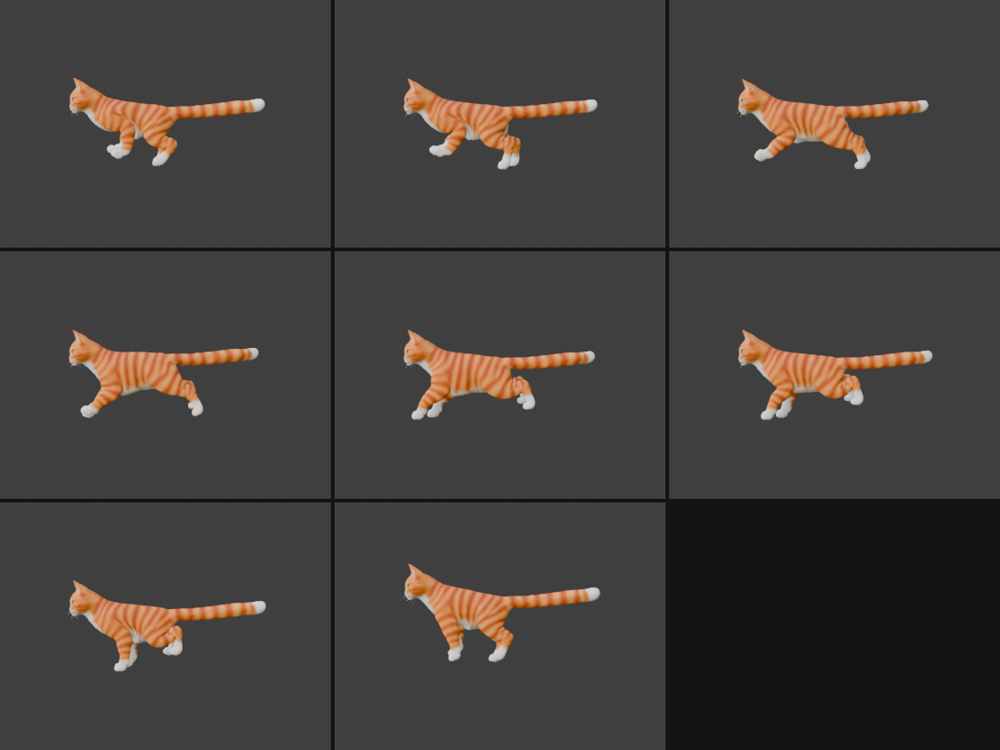
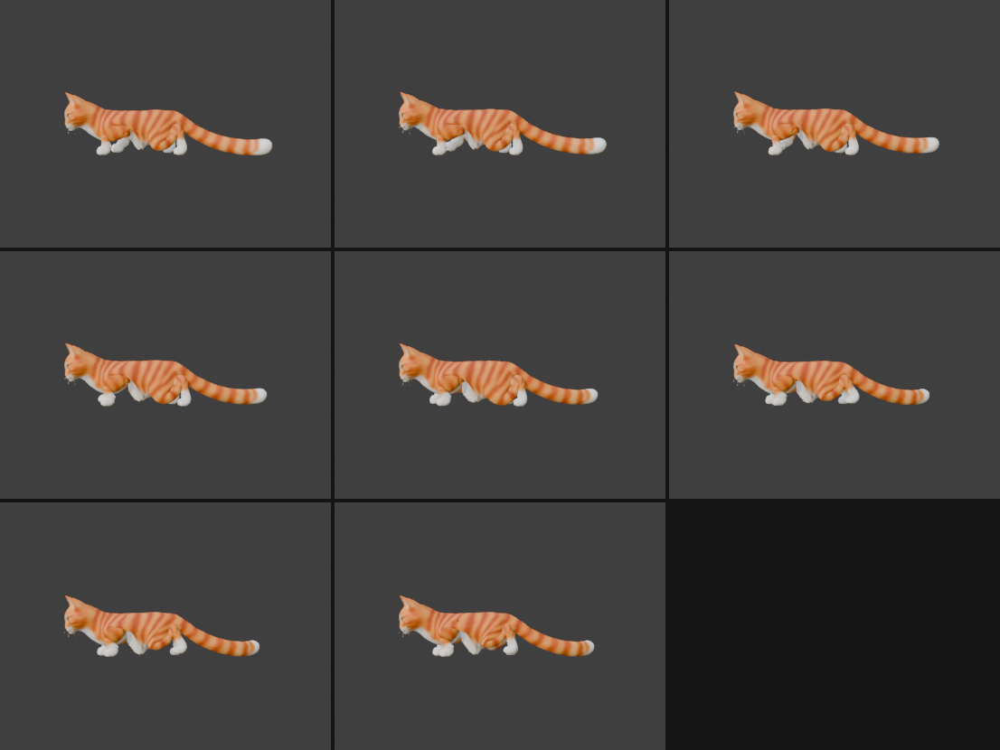
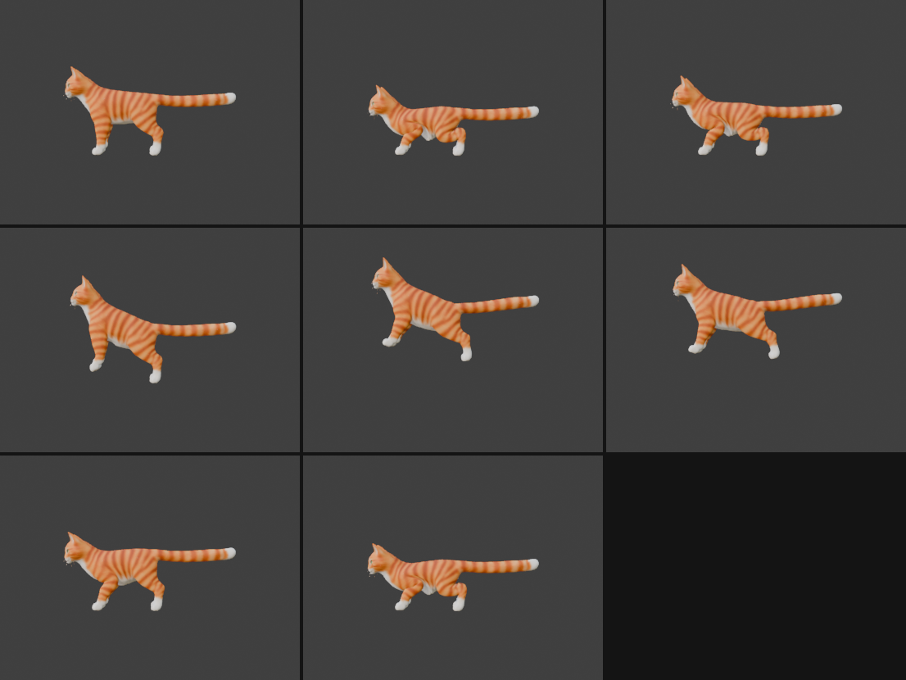
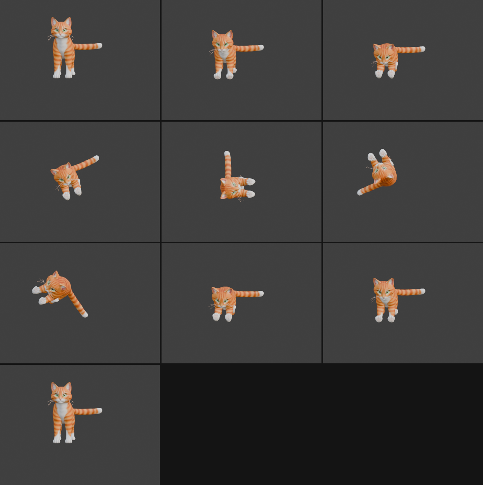
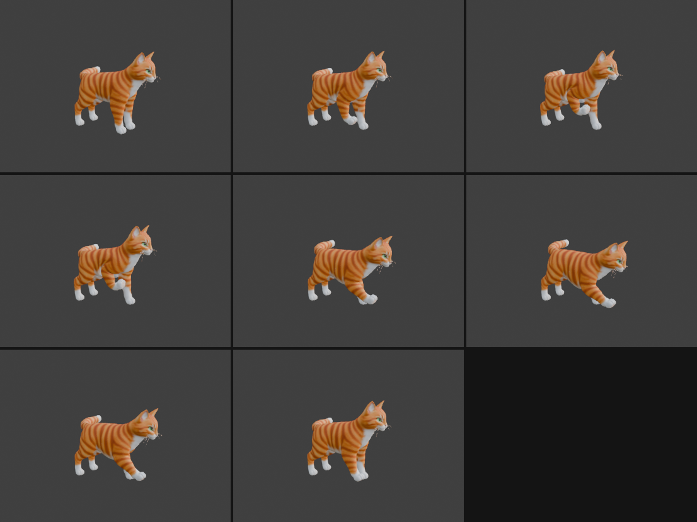
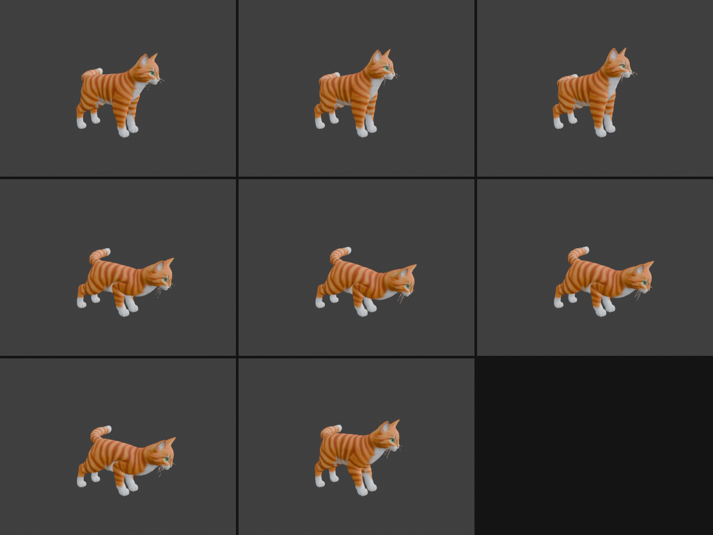
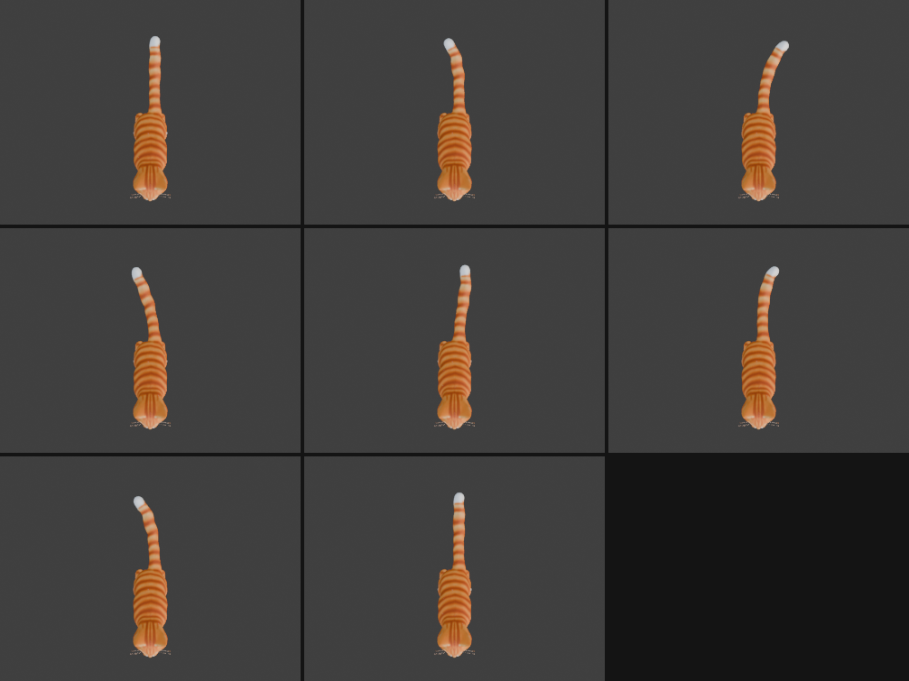

# Step 14: More game animations

**Goal:** fill out the set for a game: `Run`, `Crawl`, `Jump`, `RollLeft`, `RollRight`, `PawSwipe`, `Bite` and `SitTailSwish`.

> **Status:** every number below was measured in Blender, and each animation was viewed from at least one angle. **None of this has been loaded in Babylon.js.** The code excerpts are condensed from the scripts in `tools/` and will not run on their own.

## What we chose to build (and how we read the request)

| Animation | What it is | Length |
|---|---|---|
| `Run` | a gallop, in place | 0.83 s |
| `Crawl` | a low, slow stalking creep, in place. (We read "crawl" as a cat creeping low, not a baby crawl.) | 2.0 s |
| `Jump` | crouch, launch, flight, landing, recover. The vertical arc is baked in | 2.0 s |
| `RollLeft` / `RollRight` | a full 360 degree barrel roll in place that ends standing. Left side goes down first, or right. (We read "rolling to the left side, back to standing" as a dodge roll, not just lying down.) | 2.0 s |
| `PawSwipe` | wind up and swat forward with the right paw | 1.25 s |
| `Bite` | crouch, lunge, snap and shake of the head | 1.5 s |
| `SitTailSwish` | the tail sweeps side to side along the floor while sitting | 4.0 s |

If any of those readings is wrong, say so: each is one script to change.

## Making it reusable: a small script library

Instead of one long throwaway script per animation, the shared pieces now live in `tools/`:

| File | What it holds |
|---|---|
| `cat_anim_core.py` | forward kinematics, the leg solver, foot paths, pose building, baking, and measuring |
| `cat_anim_sit.py` | `Sit`, `SitTailSwish` |
| `cat_anim_gaits.py` | `Run`, `Crawl` |
| `cat_anim_jump.py` | `Jump` |
| `cat_anim_roll.py` | `RollLeft`, `RollRight` |
| `cat_anim_combat.py` | `PawSwipe`, `Bite` |

The same scripts are stored inside the `.blend` file (see [Step 15](15-the-blend-file.md)).

Every animation follows the same recipe, which you have already seen in Steps 11 to 13:
1. **Describe the body and foot goals** at each moment (where the body is, where each paw should be).
2. **Solve the leg joints** (IK) from the moved hips.
3. **Bake** a key on every frame.
4. **Measure** the result and fix what the numbers show.

## Bugs in our own tools, found by measuring

Three problems came from the tooling, not the animations. They are worth knowing about because the numbers looked plausible until we checked.

- **`set_pose` was silently overridden.** To measure a pose we set the bones by hand. But when an action was assigned, Blender re-evaluates the action on the next update and overwrites the hand-set pose. Some of our "lowest point of the mesh" readings were of the wrong pose. Fix: clear the active action first, or use `scene.frame_set(frame)` to read a baked frame.
- **The mesh hangs below its bones.** The tail's bones were 9 cm above the floor, yet its mesh went 3 cm through. The tail tube is about 12 cm thick around its bones. Clearance has to be measured on the mesh.
- **A sign error in the roll direction.** See `RollLeft` below.

## Run

A cat's run is a **gallop**: the hind feet land, then the front feet, with two moments where no foot touches the ground.

| Foot | Lands at (fraction of the stride) |
|---|---|
| Right hind | 0.00 |
| Left hind | 0.07 |
| Right front | 0.42 |
| Left front | 0.50 |

Each foot is down for 28% of the time. That leaves a short **gathered** flight (feet under the body) and a long **extended** flight (legs stretched). The body is low while feet are down and rises in each flight, and the spine flexes when gathered and extends when stretched. The head stays steady and the tail streams out behind.

```python
RUN_CFG = dict(offset=dict(RH=0.00, LH=0.07, RF=0.42, LF=0.50),
               duty={L: 0.28 for L in LEGS}, stride={L: 0.70 for L in LEGS}, lift={L: 0.30 for L in LEGS},
               shift=dict(RF=-0.05, LF=-0.05, RH=0.10, LH=0.10))
z = RUN_DZ + 0.22*_arc(t, 0.78, 1.0) + 0.08*_arc(t, 0.35, 0.42)         # low in contact, up in the two flights
spine = radians(7)*bump(t, 0.385, 0.06) - radians(7)*bump(t, 0.89, 0.09)    # flexed when gathered, extended when stretched
```

**A reach bug.** Our first run used a stride of 0.80 m and the left legs missed their targets by up to **9 cm**. At the extremes of the stride the planned foot was beyond the leg's reach (about 1.05 m for the front legs). We shortened the stride to 0.70 m and lowered the body by 12 cm. Rule of thumb: a planned foot must be within the leg's length of its hip, so check reach before blaming the solver.

**Measured:** toe tips within **1.0 cm** of the plan, planted feet within **1.1 cm** of ground height, mesh within **0.6 cm** of the floor.

**Speed:** the model does not travel. To stop the feet sliding, move it at **3.0 m/s**.



## Crawl

The same gait builder as the walk, in a deep crouch: the body is lowered 50 cm, each foot is down for 75% of the stride (slow), the head is held low and forward, and the tail trails near the floor.

Two things needed care:
- **The legs fold a lot** (the elbow bends to about -144 degrees), so we ease into the crouch gradually before the gait starts. This keeps the elbow bending the correct way instead of flipping.
- **The paw and wrist went through the floor.** The solver only knew about the toe tip, so a folded leg pushed its wrist and paw about **8 cm** below the ground. We added a **floor guard**: an extra goal that penalizes the wrist and paw joints for sitting lower than their standing height.

```python
def floor_guard(L, margin=0.01, k=3.0):
    zw, zp = REST[L][2][1] - margin, REST[L][3][1] - margin           # standing heights of the wrist and the paw joint
    def extra(Q, A):
        return np.array([k*max(0.0, zw - Q[2][1]), k*max(0.0, zp - Q[3][1])])   # zero unless a joint is too low
    return extra
```

**Measured:** toe tips within **1.2 cm** of plan, planted feet within **1.3 cm**, mesh within **1.3 cm** of the floor. **Speed to match the feet: 0.17 m/s.**



## Jump

Five phases over 2 seconds: crouch (0.44 s), launch, flight (0.58 s), landing dip, recover. The root carries the vertical arc: the body sinks 32 cm, rises about **0.45 m** above standing, then sinks 25 cm on landing. The pelvis goes from 1.03 m to **1.50 m**, and the paws are **0.54 m** off the ground at the top.

**The hard part: feet in the air.** On the ground, feet have world positions. In the air they should move *with the body*. Our first attempt kept planning the airborne feet in world coordinates and failed badly: the front errors reached **31 and 40 cm**. The reason: nose-up tilt and the rising body lifted the front hips to 1.10 to 1.33 m, but the front legs are only 1.05 m long.

Two fixes:
1. **Hip-relative targets.** In the air, the foot target is an offset from the hip. It blends back to a ground position at takeoff and landing:

```python
def resolve_tip(tg, hip):                       # tg['tip'] is a world position, tg['rel'] = (offset, w)
    base = tg["tip"]
    if "rel" in tg:
        off, w = tg["rel"]; return (1 - w)*base + w*(hip + off)      # w = 0 on the ground, 1 in mid-air
    return base
```

2. **Take off the front feet earlier** (at 0.27 of the jump instead of 0.30), before the nose-up tilt raises the shoulders out of reach.

**Measured:** planted feet within **0.5 cm**. A few airborne frames are still up to **6 cm** from their plan (a foot in mid-air is hard to notice), and the mesh stays within **0.5 cm** of the floor.

> **Using it in a game:** if your engine handles the jump arc with physics, ignore the `Jump` animation's root translation channel and keep the rest.



## RollLeft and RollRight

A full barrel roll needs a different method, because the legs tuck and the whole body rotates about its long axis.

1. **Tuck pose.** The paws are solved to sit close under the body (front paws under the chin, hind paws under the hips), then reused for the whole roll.
2. **Rotate the root about the world Y axis** (the long axis of the body) from 0 to 360 degrees, eased.
3. **Keep the body rolling along the floor.** The lowest point of the body changes with the roll angle (belly, then side, then back). We measured the real deformed mesh at 16 roll angles and lowered or raised the root to match, then interpolated. The root height needed ranges from **-0.85 m** (lying belly-down on the floor) to **+0.34 m** (on its back or side).
4. **Blend in and out.** The tuck blends in over the first 20% and out over the last 20%, so the roll starts and ends in the standing pose exactly (the final root rotation differs from the start by 0.000000).

```python
for i in range(17):                              # 16 steps round the circle
    rho = sign*2*pi*i/16
    set_pose(pose with roll=rho, tucked legs)
    dz[i] = -mesh_min_z()                        # how far to move the root so the lowest mesh point touches the floor
```

**Measured:** the mesh stays within **2.1 cm** of the floor for the whole roll.

### The direction mistake we caught

We first reasoned that a *negative* rotation about +Y puts the left side down. **We had it backwards.** We only found out because we measured the paws. The numbers showed `RollLeft` putting the *right* side down first.

Even the check needed care. A full roll passes both sides, so asking "which side is lowest overall" gave the wrong answer for both. The roll's direction is the first side to go down, so we read the paws at a quarter turn:

| Action | Left paws (z) | Right paws (z) | First side down |
|---|---|---|---|
| `RollLeft` | 0.25 | 0.36 | **left** |
| `RollRight` | 0.35 | 0.25 | **right** |

**Lesson:** a mental picture of left and right is easy to get wrong in 3D. Check direction with measured positions of left and right parts, at the right moment.



## PawSwipe

The right paw winds up high and back (0.63 m off the ground), strikes forward and down (0.55 m ahead of its standing spot), holds briefly, then returns. The other three paws stay planted. The body leans back during the wind-up and into the strike, and the head follows the paw.

```python
P_up  = [y0 + 0.10, z0 + 0.62]         # wind-up: raised, a little back
P_hit = [y0 - 0.55, z0 + 0.22]         # strike end: forward and low
# wind-up 0-0.28, strike 0.28-0.40 (fast), hold to 0.48, recover to 1.0
```

**A reach bug again.** The first version leaned the body backwards in the wind-up. A nose-up lean lifts the shoulders, and the *planted* left paw then missed its spot by **12 cm**. Fix: a much smaller backward lean (2 degrees instead of 6) plus a small crouch.

**Measured:** all four feet within **0.6 cm** of their goals. The animation leaves the tail channels alone, so `TailSwish` can play over it. `PawSwipeLeft` can be made with `build_swipe("left")`.



## Bite

A lunge, not a visible bite. **The model's head has no jaw bone and no jaw weighting**, so the mouth cannot open. The animation is: a small crouch back, a quick lunge forward over the planted feet (the body moves 0.32 m forward, the nose goes **0.26 m forward and 0.62 m down**), a hold with three quick head shakes (the nose swings 0.15 m side to side), then recovery.

The head shake has to turn about the true vertical even though the body is pitched, so it uses the same helper as `LookAround` (`neck_quats_vertical`).

**Measured:** feet within **0.4 cm**. To show an open mouth you would need to add a jaw: either a jaw bone with weights, or a `MouthOpen` shape key. We have not done this.



## SitTailSwish, and a change to Sit

A sitting cat's tail swishes along the floor, side to side. Two changes made it work:

- **`Sit` was rebuilt** so the tail is already straightened when the cat settles. Before, the tail stayed in its curled rest pose, and a swish that straightened it would have popped at the start.
- **The swish is eased in and out.** The first and last 16 frames fade the swing to zero, so the animation starts and ends exactly in the `Sit` pose. It sweeps 3 times in between, and can loop or play once.

Turning every tail joint about the *vertical* never changes the tail's height, so the swish cannot push the tail through the floor. (The tail height was fixed when we set the droop.)

The droop is now **19.5 degrees** (it was 25.9). The tail is thick (about 12 cm), so we keep the joints 12.5 cm above the floor and the mesh just touches it.

**Measured:** the lowest tail joint stays at 12.5 cm over the whole swish, and its first frame matches the `Sit` pose (0.000000 radians of difference).



## The export, and what can play together

`exports/cat_all_animations.glb` now has **15 animations**. We read the file to check that each drives only its own bones. The glTF files are 30.7 MB (almost all texture).

Animations that drive the **same bones** cannot be layered. Here is what each one touches:

| Animation | Body (root, spine) | Legs | Neck | Tail | Morph |
|---|---|---|---|---|---|
| `Breathing` | | | | | yes |
| `TailSwish` | | | | yes | |
| `SitTailSwish` | | | | yes | |
| `HeadLook` | | | yes | | |
| `LookAround` | | | yes | | |
| `LickPaw` | | right front | yes | | |
| `Walk` | yes | yes | | | |
| `PawSwipe` | yes | yes | yes | | |
| `Bite` | yes | yes | yes | | |
| `Run`, `Crawl`, `Jump` | yes | yes | yes | yes | |
| `Sit` | yes | yes | yes | yes | |
| `RollLeft`, `RollRight` | yes | yes | yes | yes (constant) | |

How to use that table:
- **Always on:** `Breathing`, and `TailSwish` (standing) or `SitTailSwish` (sitting).
- **Base idle:** `HeadLook` in the standing pose, `LookAround` in the sitting pose.
- **One body action at a time:** only one of `Walk`, `Run`, `Crawl`, `Jump`, `Sit`, `PawSwipe`, `Bite` or a roll should play, since they all drive the legs and body.
- **`PawSwipe` and `Bite` leave the tail free**, so `TailSwish` can play over them.
- **Standing animations vs. sitting animations:** `TailSwish`, `HeadLook` and the walk are authored for the standing pose. Do not layer them over `Sit`. Use `SitTailSwish` and `LookAround` there.

## Things to know

- **In place:** `Walk`, `Run` and `Crawl` do not move the model. Speeds for no sliding: walk 0.60 m/s, run 3.0 m/s, crawl 0.17 m/s.
- **Transitions are the game's job.** Each action starts and ends in a defined pose (standing for most, sitting for the sit family). Cross-fading between actions is done in the game (for example with Babylon's animation-group weights), and we have not tested it.
- **Gait cycles loop but do not start from standing.** `Run` and `Crawl` begin mid-gait. Fade into them.
- **Tail consistency.** `Run`, `Jump` and `Sit` hold the tail straight. `Walk` and the rolls leave it in the original curl. A standing idle with `TailSwish` also straightens it, so the straight tail is the one to expect.
- **Joint angles only bend in the forward-back plane.** The legs cannot splay sideways.
- **Mesh pinching:** we measured floor contact but did not inspect folded joints (the crawl's elbows, the tucked roll) up close.
- **No jaw, so no visible bite.**
- **Not tested in Babylon.**

## Concepts

- **Reach:** a foot can only be placed where the leg is long enough to go. Check it before you solve.
- **Hip-relative targets:** in the air a foot follows the body, so plan it relative to the hip.
- **Contact against the mesh, not the bones.**
- **Measure the thing you care about**, at the moment that matters: the first side down in a roll, not the overall lowest side.
- **Check your tools:** a measuring helper can be wrong too (the `set_pose` override).

---

[← Previous: Sit down, look around, lick a paw](13-sit-look-lick.md) · [Contents](README.md) · [Next: The Blender file →](15-the-blend-file.md)
