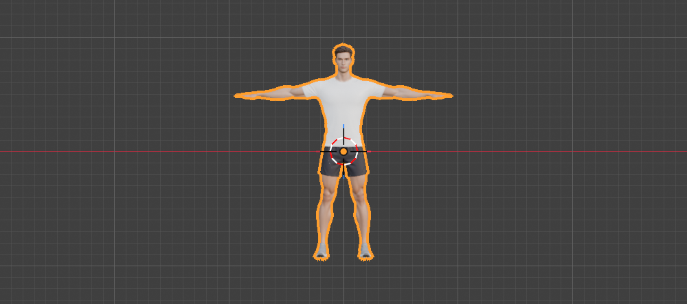

# Step 1: Inspect the model

**Goal:** find out what the model is, and what is missing, before changing anything.

**By hand:** start from the default scene, delete the Cube, then **File**, **Import**, **glTF 2.0 (.glb/.gltf)** and pick the file. Look at the **Outliner** (top right) and the status bar statistics (right-click the status bar, enable **Scene Statistics**).

**Python**
```python
import bpy
bpy.ops.import_scene.gltf(filepath="/Users/chris/Downloads/Meshy_AI_Athletic_Male_Gym_Mod_1109211931_image-to-3d-texture.glb")
for o in bpy.context.scene.objects:
    print(o.name, o.type, tuple(round(d, 3) for d in o.dimensions))
    if o.type == "MESH":
        print("  verts", len(o.data.vertices), "| tris", sum(len(p.vertices) - 2 for p in o.data.polygons),
              "| vertex groups", len(o.vertex_groups), "| modifiers", len(o.modifiers))
```



**What arrived** (confirmed in Blender)

| Object | Type | Notes |
|---|---|---|
| `Mesh_0` | Mesh | The whole man: 94,690 vertices, 172,636 triangles, one material (`Material_0`) |

- **No armature, no vertex groups, no modifiers.** Unlike the cat, there is no rig to reuse, so we build one in Part 2.
- **Size:** 1.899 m wide (fingertip to fingertip), 0.331 m deep, 1.887 m tall. A real T-pose: a good starting pose for rigging.
- **Origin problem:** the object origin sits at the waist, at world (0, 0, 0). The mesh spans z = -0.947 to +0.940, so the feet are about 0.95 m *below* the floor. Step 2 fixes this.
- **Hands:** the fingers are straight and slightly apart, which suits finger bones. They are small, so the finger bones will be tiny.
- **Clothing:** T-shirt, shorts and sneakers are part of the one mesh (baked into the texture and shape), so they cannot be hidden separately.

**Concepts**
- **Armature:** a skeleton object made of bones. A mesh moves only if it is bound to one.
- **Vertex group:** a named set of vertices with weights. Each bone deforms the group that shares its name.
- **T-pose / A-pose:** arms straight out, or angled down. Rigging is easiest from one of these.

---

[Contents](README.md) · [Next: Fix the origin, scale and orientation →](02-fix-scale-origin-orientation.md)
