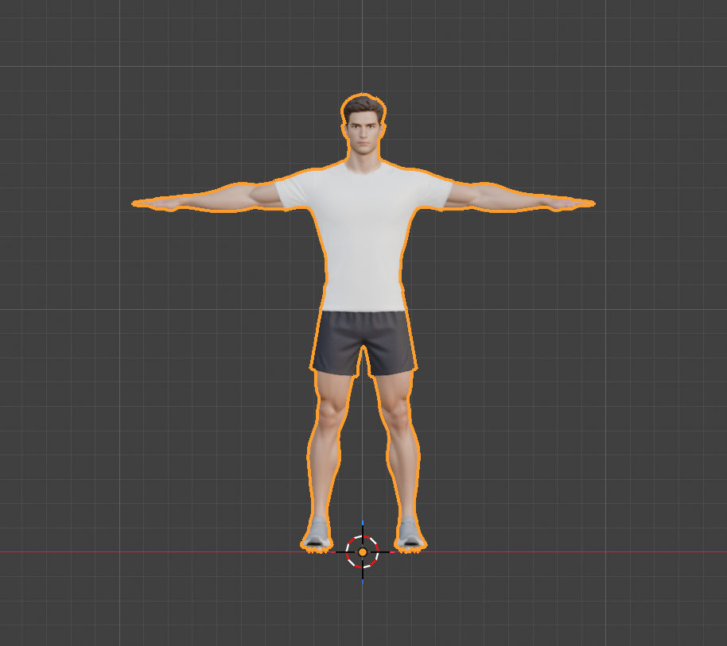

# Step 2: Fix the origin, scale and orientation

**Goal:** put the model on the floor, centered, facing the right way, with clean transforms. A rig and every animation after this assume the character stands at the world origin with his feet at z = 0. For exercises it matters even more: a push-up or a pull-up only looks right if the hands and the floor (or bar) agree on where the ground is.

**What we checked first**

| Check | Result | Action |
|---|---|---|
| Scale | 1.887 m tall: a believable adult | none, leave scale at 1 |
| Facing | looks toward **-Y** (seen in the Right view, where +Y is screen right and he faces left) | none: -Y is Blender's "front" |
| Up | head toward +Z | none |
| Feet | soles at z = -0.947, so 0.95 m under the floor | move up |
| Centre | midway between the feet, x = -0.004 and y = 0.002 | nudge to 0 |

**By hand**
1. Select the model, switch to the **Right** view (numpad **3**) and look at which way he faces.
2. Move him so the soles sit on the red/green axis line: **G**, **Z**, type the height, **Enter**. (The sidebar's *Item* tab, **N**, shows Location Z.)
3. **Object**, **Apply**, **All Transforms** (**Ctrl+A**). This bakes location, rotation and scale into the mesh, so the object reads location 0, rotation 0, scale 1.

**Python**
```python
import bpy
obj = bpy.data.objects["Mesh_0"]
world = [obj.matrix_world @ v.co for v in obj.data.vertices]
zmin = min(v.z for v in world)
feet = [v for v in world if v.z < zmin + 0.03]          # the soles of both shoes
cx = sum(v.x for v in feet) / len(feet)
cy = sum(v.y for v in feet) / len(feet)

obj.location -= type(obj.location)((cx, cy, zmin))       # soles on z=0, centred between the feet
bpy.ops.object.select_all(action='DESELECT')
obj.select_set(True); bpy.context.view_layer.objects.active = obj
bpy.ops.object.transform_apply(location=True, rotation=True, scale=True)
```



**Result (measured after applying)**
- Location (0, 0, 0), rotation (0, 0, 0), scale (1, 1, 1).
- Mesh spans z = 0.000 to 1.887 m, y = -0.166 to 0.164 m. The dimensions are unchanged (1.899 x 0.331 x 1.887 m).

**Concepts**
- **Object origin:** the point an object rotates and scales about, and the pivot for its bones later. A good character origin is on the floor, between the feet.
- **Apply transforms:** turns the object's location, rotation and scale into plain vertex positions. A leftover scale of, say, 100 makes bones, IK and exports behave strangely, so always apply before rigging.
- **Blender's axes:** +Z is up, and a character faces **-Y** by default. glTF exporters convert to their own convention (+Y up, facing +Z) automatically, so we keep Blender's.

**Gotchas**
- We measure the *soles* (the lowest 3 cm of vertices), not the bounding box center, because the box center sits at the waist.
- The arms are 7 mm off symmetric (x = -0.946 to 0.953). That is a feature of the source mesh, too small to matter for a rig.

---

[← Previous: Inspect the model](01-inspect-the-model.md) · [Contents](README.md) · [Next: Reduce the polygon count →](03-reduce-the-polygon-count.md)
