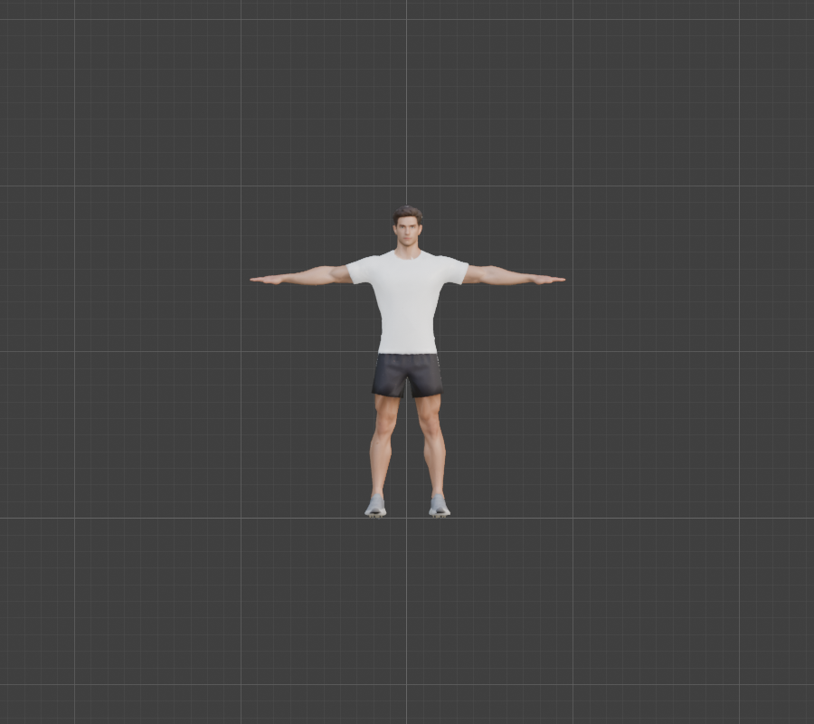
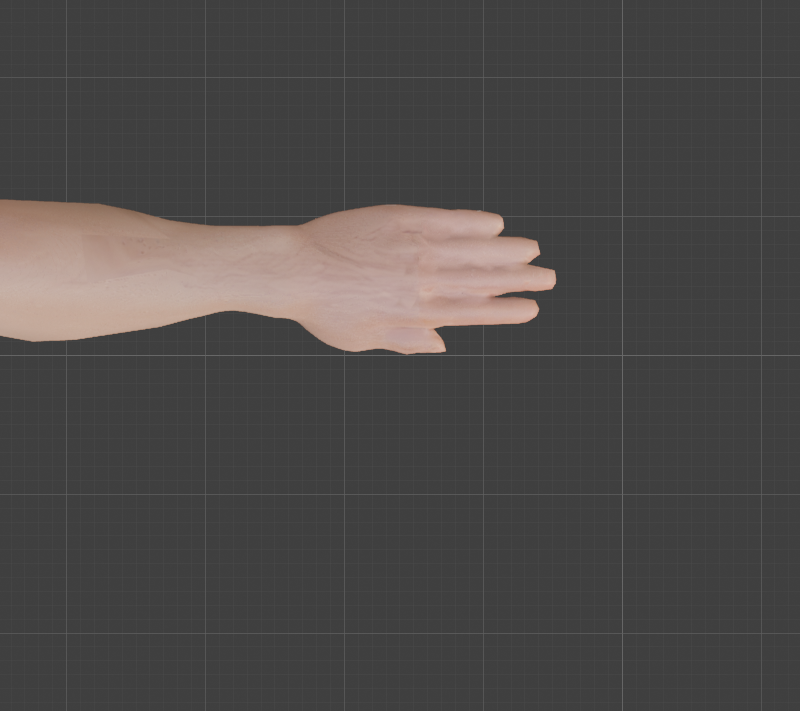
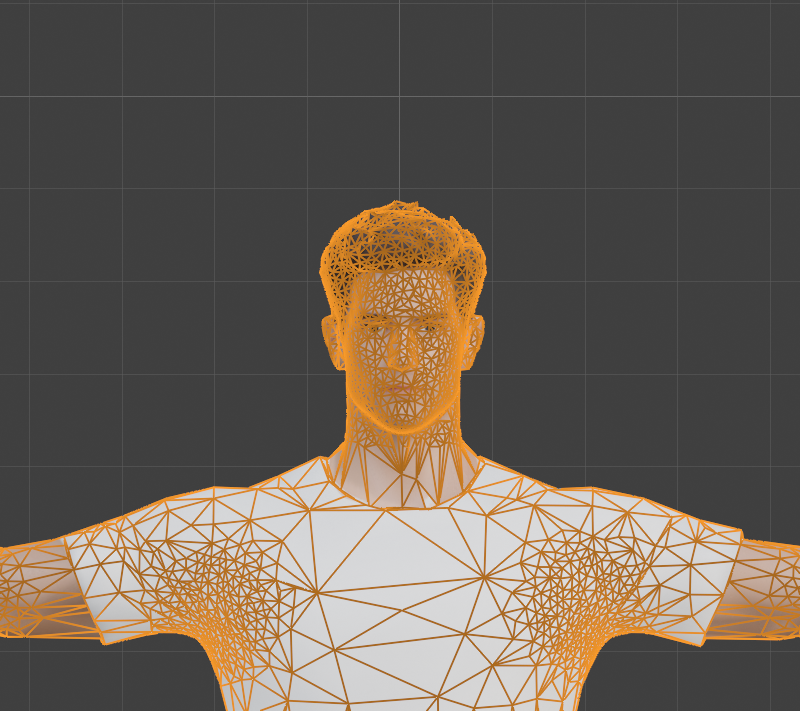
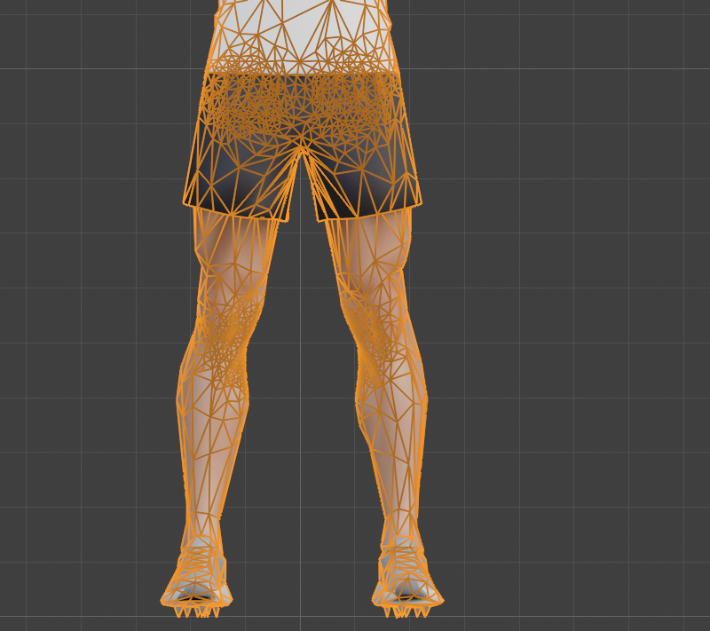

# Step 3: Reduce the polygon count (hybrid)

**Goal:** turn 172,636 triangles into a light, stylized body of about 15,000, without losing the hands, the face or the joints that will bend.

**The hybrid idea:** do the bulk of the reduction automatically with the **Decimate** modifier, but use a **vertex group mask** so the hands, face and joints keep more triangles than the flat parts (torso, thighs, shins). The detail we lose is baked into the 4096-pixel color and normal-map textures, so the shape can be simple.

The hand-cleaning half of the hybrid (fingers, soles, edge flow at the joints) is [Step 4](04-clean-up-the-mesh.md).

**By hand**
1. Select the model, **Shift+D**, **Esc** to duplicate it in place. Name the copy `Body`. Move the original into a hidden collection named `Reference`: we keep it for weight transfer and comparisons later.
2. On `Body`: **Edit Mode** (Tab), select all (**A**), then **Mesh**, **Clean Up**, **Merge by Distance** (**M**), distance `0.00001`. **Do this before decimating** (see "What went wrong first").
3. Make the mask. Still in Edit Mode, select the hands, **Ctrl+G**, **Assign to New Group**, name it `keep_detail`. Weight values come from the *Item* tab's **Vertex Weights** panel, or from Weight Paint mode. We paint hands strongest, the face and the joints (shoulders, elbows, hips, knees) a little less.
4. Back in Object Mode, **Add Modifier**, **Generate**, **Decimate**: type **Collapse**, **Ratio** 0.09, **Vertex Group** `keep_detail`, tick the **Invert** button next to it, tick **Triangulate**. Check the triangle count in the statistics overlay, then **Apply** (**Ctrl+A** over the modifier).

**Python** (the whole thing is in [`tools/decimate_body.py`](tools/decimate_body.py); the heart of it is below)
```python
import bpy, bmesh
work = bpy.data.objects["Body"]

bm = bmesh.new(); bm.from_mesh(work.data)
bmesh.ops.remove_doubles(bm, verts=bm.verts, dist=1e-5)       # Merge by Distance
bm.to_mesh(work.data); bm.free()

# ... paint the "keep_detail" vertex group by region (see the script) ...

d = work.modifiers.new("Decimate", 'DECIMATE')
d.decimate_type = 'COLLAPSE'; d.ratio = 0.09
d.vertex_group = "keep_detail"; d.invert_vertex_group = True; d.vertex_group_factor = 1.0
d.use_collapse_triangulate = True
bpy.ops.object.modifier_apply(modifier="Decimate")
```



**Result (measured)**

| | Before | After |
|---|---|---|
| Vertices | 94,690 | **7,770** |
| Triangles | 172,636 | **15,536** |
| Of those: both hands / head | | 3,632 / 3,851 |
| Separate pieces | 203 | **1** |
| Boundary edges / loose edges / edges with 3+ faces | 16,338 / 0 / 0 | **0 / 0 / 0** |
| Dimensions (m) | 1.899 x 0.331 x 1.887 | 1.899 x 0.332 x 1.890 |

The result is a single closed mesh, the same size and shape as before, with the original UV map and material.

| Hand from above | Face | Legs |
|---|---|---|
|  |  |  |

The hand wireframe is in `step3-hand-top-wire.png`. All five digits are still separate shapes. The face keeps its features, and the knees and hips are denser than the thighs and shins.

**What went wrong first** (kept here because each one is a trap)

1. **The mask works backwards.** Blender's Decimate treats the vertex group as "the vertices to decimate". Our first run collapsed the hands to **0 triangles** and the head to about 100. The **Invert** button turns it into "protect these".
2. **A weight near 1.0 means untouchable.** With the hands at 1.0 they kept about 13,400 triangles, which left the whole rest of the body about 2,000. We scaled every weight by 0.3 so the hands are simplified *less* than the body, not exempt.
3. **Decimating before merging cracks the seams.** The glTF importer splits vertices along UV seams, so the mesh arrived as 203 loose pieces. Decimate simplified each piece separately, the seams drifted apart, and we got a visible step across the forearm, 159 loose edges and 180 pieces. **Merge by Distance first** (94,690 down to 86,320 vertices) and the problem disappears. The texture mapping survives because UVs are stored per face corner, not per vertex.
4. **A modifier preview can lie.** Our triangle counts did not change between ratios until we forced an update. Always check the numbers actually move.

**Concepts**
- **Decimate (Collapse):** repeatedly merges the edge whose removal changes the shape least, until the target ratio is reached.
- **Vertex group:** here a mask. With **Invert**, higher weight means "collapse this less".
- **Merge by Distance:** welds vertices that sit at (almost) the same place. Required before decimating a model that came from glTF.
- **Normal map:** stores fine surface detail in an image so a low-poly surface can still shade like a detailed one. It is what lets us drop 90% of the triangles.

**Caveats**
- The triangulation is the decimator's, not ours. It is fine for a character at this budget, but it is not clean quad loops. Bends at the elbows and knees will be acceptable, not perfect.
- The fingers **touch each other** in the source model. We will need to handle that when we weight the hands.
- The lowest point is 3 mm *below* the floor now (a sole vertex). [Step 4](04-clean-up-the-mesh.md) nudges it back.

---

[← Previous: Fix the origin, scale and orientation](02-fix-scale-origin-orientation.md) · [Contents](README.md) · [Next: Clean up the mesh →](04-clean-up-the-mesh.md)
