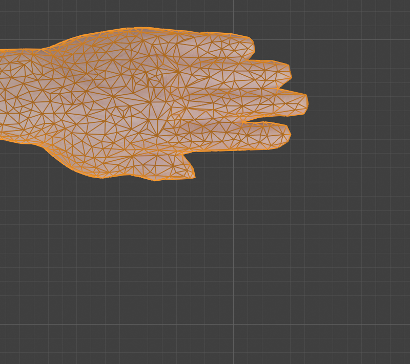

# Step 4: Clean up the mesh

**Goal:** check the decimated body for faults before we build a skeleton on it, fix the cheap ones, and find out what we cannot fix cheaply.

**Honest scope.** This is the "hand" half of the hybrid, but we did **not** retopologize the joints by hand. At 15k triangles the decimator's mesh is acceptable, and whether the elbows and knees bend well is something we can only judge by posing the finished rig ([Step 9](README.md)). What we did here is a set of checks, two fixes, and one important finding about the fingers.

**By hand**
- **Normals:** Edit Mode, select all, **Shift+N** (Recalculate Outside). Turn on **Face Orientation** in the viewport overlays: everything should be blue.
- **Below the floor:** in the front view, select the lowest vertices of the shoes and press **S**, **Z**, **0**, **Enter** to flatten them to z = 0.
- **Fingers:** Edit Mode, vertex select, **L** over a fingertip selects everything connected to it. If it selects the whole hand, the fingers are joined.

**Python:** [`tools/clean_body.py`](tools/clean_body.py) runs all of the checks and fixes below.
```python
bmesh.ops.recalc_face_normals(bm, faces=bm.faces)
for v in bm.verts:
    if v.co.z < 0: v.co.z = 0.0
```

**Results (measured)**

| Check | Found | Action |
|---|---|---|
| Smooth shading | 15,534 of 15,536 faces smooth | none |
| Normals pointing the wrong way | 0 | none (recalculated anyway) |
| Loose / boundary / non-manifold edges | 0 / 0 / 0 (from Step 3) | none |
| Sliver triangles (corner under 5 degrees) | 54, only 1 under 1 degree | left alone: too few to matter |
| Vertices below the floor | 16, lowest at z = -0.0029 | **moved to z = 0** |
| Dimensions | 1.899 x 0.332 x 1.890 m | unchanged |

**The fingers are fused**



We cut each hand at five distances from the body and counted how many separate pieces remain (1 means the fingers are joined at that distance):

| Cut at |x| (m) | 0.80 | 0.84 | 0.88 | 0.91 | 0.93 |
|---|---|---|---|---|---|
| Pieces, original (after merge) | 1 | 1 | 1 | 2 | 3 |
| Pieces, our low-poly body | 1 | 1 | 1 | 3 | 2 |

The original model is *also* fused: the four fingers are a flat mitten joined along nearly their whole length, and only the tips separate. So this is how the model came, and our decimation did not cause it. (Counting pieces on the unmerged original gives misleading numbers, 11 or more, because the UV seams split the mesh. We learned that in Step 3.)

**What it means for the rig**
- Finger bones will still work, but automatic weights will make a curling finger drag its neighbours with it. In Step 8 we assign each finger's vertices by hand to its own bone, and accept a little webbing stretch between fingers.
- Our exercises mostly *grip*: a bar, a kettlebell handle, a mace handle. All four fingers close together, so the fused look will hurt less than it would for typing or pointing.
- If it still looks wrong in Step 9, the fix is to cut slits between the fingers and rebuild the finger sides, a manual Edit Mode job. We decided not to do that yet.

**Concepts**
- **Face orientation:** every face has a front side. Wrong-facing faces shade black or break lighting and exports.
- **Sliver triangle:** a long, thin triangle. Too many cause shading and deformation artifacts.
- **Select Linked (L):** selects every vertex connected by edges, a quick test for "is this one piece?"

---

[← Previous: Reduce the polygon count](03-reduce-the-polygon-count.md) · [Contents](README.md) · [Next: Plan the bone layout →](05-plan-the-bone-layout.md)
