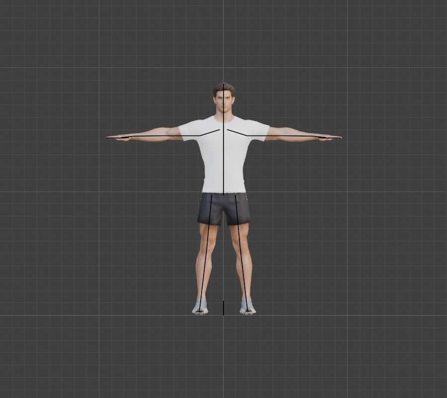
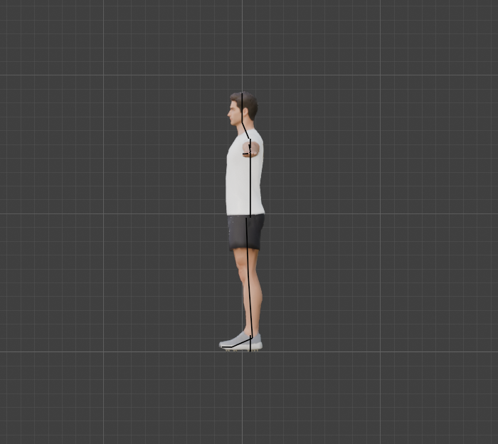
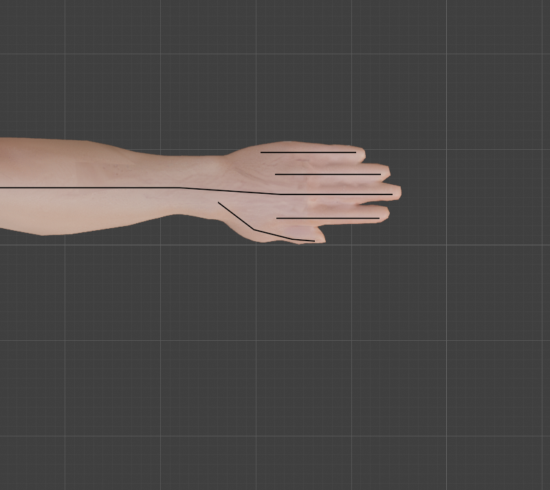

# Step 5: Plan the bone layout

**Goal:** decide every bone, its name, its parent and its exact position *before* building anything, and check that the positions fit this particular body.

**Why plan first:** a rig can be rebuilt, but every weight, pose and animation depends on its bones. Moving a joint later means redoing them all. So we measure first, write the layout down as data in [`tools/rig_landmarks.py`](tools/rig_landmarks.py), and let [Step 6](README.md) build from that file.

## What the exercises ask of the skeleton

| Exercise | What must be able to move |
|---|---|
| Squat, lunge | hips, knees, ankles, and the toes (heels lift in a lunge) |
| Push-up | wrists bend back, elbows, shoulder blades (**clavicle** bones), toes |
| Sit-up | the spine curling, so **three spine bones**, plus the neck |
| Pull-up, chin-up | arms overhead, a grip that closes (finger bones), the forearm turning (overhand versus underhand) |
| Kettlebell, mace | a grip on a handle, wrists, a full-body swing |

## The bones (53 in all: 52 deform bones and the Root)

```
Root                              the whole character moves with this; sits on the floor
└─ Hips                           the pelvis
   ├─ Spine → Spine1 → Spine2     lower back, mid back, upper back
   │   ├─ Neck → Head
   │   ├─ Clavicle.L/R → UpperArm → ForeArm → Hand
   │   │                                         ├─ Index1 → 2 → 3
   │   │                                         ├─ Middle1 → 2 → 3
   │   │                                         ├─ Ring1 → 2 → 3
   │   │                                         ├─ Pinky1 → 2 → 3
   │   │                                         └─ Thumb1 → 2 → 3
   └─ Thigh.L/R → Shin → Foot → Toes
```

| Group | Bones | Count |
|---|---|---|
| Centre line | Root, Hips, Spine, Spine1, Spine2, Neck, Head | 7 |
| Per side, arm | Clavicle, UpperArm, ForeArm, Hand | 4 x 2 |
| Per side, fingers | 3 each for index, middle, ring, pinky, and 3 for the thumb | 15 x 2 |
| Per side, leg | Thigh, Shin, Foot, Toes | 4 x 2 |
| **Total** | | **53** (52 deform; `Root` only moves the whole character) |

**Naming:** `.L` and `.R` suffixes, because Blender's **Symmetrize** and pose-mirroring understand them. **`.L` is the character's left, which is world +X** (he faces -Y, so his left hand is on the +X side).

**Deliberately left out (for now)**
- **Jaw, eyes, face bones:** none of the exercises need them.
- **Palm (metacarpal) bones and forearm twist bones:** the single `Hand` bone covers the palm. If the forearm looks wrong when turning from an overhand to an underhand grip in [Step 9](README.md), we add twist bones then.
- **Control bones** (IK targets, pole targets, finger curl controls, prop handles): these come in Part 3, on top of this skeleton.

## How the positions were measured

Everything was measured on the **high-poly reference**, because slicing the 15k-triangle mesh by its vertices is unreliable: large flat triangles have few vertices, and we got nonsense (a leg 5 mm wide) until we switched.

| Landmark | How it was found | Result |
|---|---|---|
| Arm line | centre of the arm's height and depth along x | z = 1.45, y = 0.06, straight along x (a true T-pose) |
| Wrist | narrowest point of the arm before the hand widens | x = 0.72 |
| Shoulder joint | inside the deltoid, about 0.19 m from the centre line | x = 0.19 |
| Elbow | upper arm about 60% of the arm to the wrist | x = 0.49 (an estimate, see the caveats) |
| Hand and fingers | profiled the hand along y to find where each tip peaks | lanes at y = 0.004 (thumb), 0.028, 0.053, 0.074, 0.097 |
| Ankle | narrowest part of the leg is z = 0.16, so the joint sits a little below | z = 0.10 |
| Knee | the calf is widest at z = 0.40, which puts the knee at about 1/3 of the shin higher | z = 0.55 (standard proportions agree: 0.54) |
| Neck and head | narrowest slice is z = 1.64 to 1.68; the head runs from about 1.70 to the crown | head about 0.19 m tall, so the body is **10 heads tall** |
| Legs | centre line drifts outward going down | x = 0.10 at the hip to 0.19 at the ankle |

Two things surprised us:
- **The legs splay outward** by about 5 degrees. The thigh and shin bones follow the real leg and are not vertical.
- **The spine is not at y = 0.** Anatomically it lies in the back third of the torso, so the spine bones sit at y = 0.06, and the neck leans forward from there to the head.

## Checking the plan against the body

We drew the layout as temporary lines over the model and tested each bone with a ray-inside test against the watertight mesh (then deleted the lines).



| Side view | Left hand from above |
|---|---|
|  |  |

**What the first check found** (all fixed in the data file)
- The **thumb base** started on the edge of the wrist, outside the mesh. Moved inward.
- **Bone tips sat on the surface**, so 8 bones poked out by up to 11 mm. A bone should end a little *inside* the skin. We pulled the fingertips in by about 8 mm, the head by 17 mm and the toes by 13 mm.
- **The model is not perfectly symmetric.** The right hand is about 7 mm shorter than the left, and the feet are 7 mm apart in x. A mirrored rig is standard, because pose-mirroring and re-using animations depend on it, and 7 mm is small enough for the weights to absorb. So we keep the rig symmetric and use the shorter hand's fingertip length for both.

**Final check:** all 52 bones other than Root are inside the skin or within 4 mm of it (0 over the limit). Root is on the floor by design.

**Caveats**
- **Update from [Step 10](10-ik-for-arms-and-legs.md):** the elbow joint was later moved 1.5 cm backward (y = 0.075) to give the IK solver a bend direction. The table above shows the original straight-arm layout.
- The elbow position is an estimate (standard arm proportions), not a measurement: the arm is a straight tube in a T-pose. We will see in [Step 9](README.md) whether it sits right by bending it.
- The finger bones run through a fused hand ([Step 4](04-clean-up-the-mesh.md)): their positions are right, but each bone can only be weighted to its own finger by hand.
- Glances at the picture are not enough: the ray test is the real check. It is imprecise on 1 cm fingers, which is why it allows 4 mm.

**Concepts**
- **Deform bone vs control bone:** deform bones move the mesh; control bones are what the animator grabs. Keeping them separate makes the rig easy to change later.
- **Rest pose (T-pose):** the pose the armature is built in. Weights are painted against it, so it must match the mesh.
- **Bone head and tail:** each bone is a line from a head (the joint it rotates about) to a tail; a child bone's head usually sits at its parent's tail.
- **Influence limit:** glTF (and Babylon.js) allows at most **4 bones per vertex**, so we limit weights to 4 in Step 8.

---

[← Previous: Clean up the mesh](04-clean-up-the-mesh.md) · [Contents](README.md) · [Next: Build the body armature →](06-build-the-body-armature.md)
