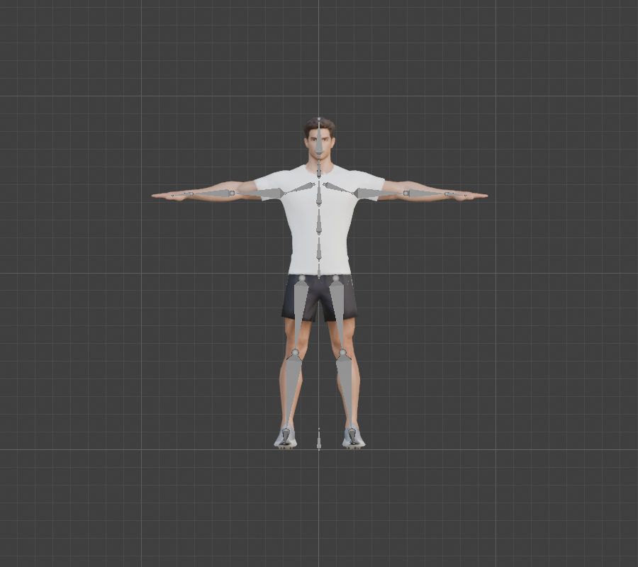
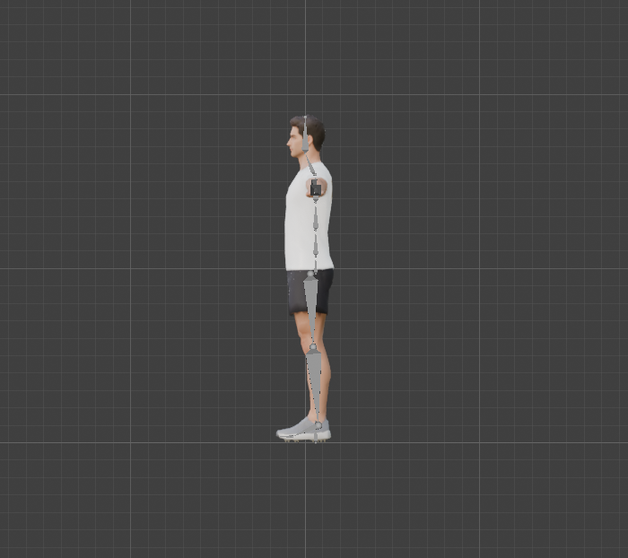

# Step 6: Build the body armature

**Goal:** turn the Step 5 plan into a real armature: the centre line, both arms and both legs. The fingers come in [Step 7](07-build-the-hands.md).

**Method:** build the centre line and the **left** side only, then **Symmetrize** to make the right. That is why the bones have `.L` and `.R` names. It guarantees an exact mirror (we measured the worst error at 0.000000 m).

**By hand**
1. **Shift+A**, **Armature**, **Single Bone**, then **Tab** into Edit Mode. Move the bone's head and tail to a landmark from [`tools/rig_landmarks.py`](tools/rig_landmarks.py) (sidebar **N**, *Item* tab, Head and Tail fields).
2. Continue the chain: select the tail, press **E** to extrude a new bone, and set its tail. A bone extruded from a tail is automatically *connected*. Rename each bone with **F2**.
3. Parent the bones that are not connected (Thigh to Hips, Clavicle to Spine2, Neck to Spine2): select the child, then the parent last, **Ctrl+P**, **Keep Offset**.
4. Set each bone's roll (see "Bone roll" below): select the bones, **Armature**, **Bone Roll**, **Recalculate Roll** (**Shift+N**), and choose the axis.
5. Select everything (**A**) and choose **Armature**, **Symmetrize**. Blender creates the `.R` bones, renames them and mirrors the roll.

**Python:** [`tools/build_armature.py`](tools/build_armature.py) does all of it, and is safe to re-run.
```python
G = {}                       # G["HANDS"] = True adds the finger bones (Step 7)
exec(open("/Users/chris/blender_tutorial/human_tutorial/tools/build_armature.py").read(), G)
```
The heart of it:
```python
b = eb.new(name); b.head, b.tail = Vector(head), Vector(tail)
b.align_roll(hinge.cross(y_axis).normalized())      # local X axis = the joint's hinge
b.parent = eb[parent]; b.use_connect = (b.head - eb[parent].tail).length < 1e-6
...
bpy.ops.armature.symmetrize(direction='POSITIVE_X')   # copy +X (.L) onto -X (.R)
```





**Result (measured)**

| | |
|---|---|
| Bones | **23**: 7 centre, 8 left, 8 right (fingers will make it 53) |
| Deform bones | 22. `Root` has deform turned **off**: it only moves the whole character, never the mesh |
| Left bones without a right twin | none |
| Worst left/right mirror error | 0.000000 m |
| Not connected to their parent | Root, Hips, Neck, Clavicle.L/R, Thigh.L/R, because their head is not at the parent's tail (the hips and shoulders branch off the spine) |

## Bone roll: deciding which way a joint bends

A bone points along its local **Y** axis. Its **roll** spins it around that axis, and that decides where local **X** and **Z** point. We use the convention that **local X is the joint's hinge**, so *rotating a bone about X bends the joint*:

| Bones | Hinge (local X) |
|---|---|
| Spine, Neck, Head, Thigh, Shin, Foot, Toes | world X (left to right): bending forward and back |
| Clavicle, UpperArm, ForeArm | world Z (up): in a T-pose, the elbow hinge is vertical |
| Hand and fingers | world Y (front-back): a palm-down hand curls its fingers downward. We first set these to world Z and corrected it in [Step 7](07-build-the-hands.md). The thumb uses world Z, so it curls across the palm |

**Tested** by rotating a forearm and a shin by +60 degrees about local X and watching where the tip went:

| Bone | Tip moved | Meaning |
|---|---|---|
| ForeArm.L | (-0.12, **+0.20**, 0) | backward: **elbow extension**, so flexion is **-X** |
| ForeArm.R | (+0.12, **+0.20**, 0) | the mirror image of the left |
| Shin.L / Shin.R | (+/-0.03, **+0.38, +0.25**) | back and up: **knee flexion is +X** |

The useful discovery: after Symmetrize, the right-hand bones have their local X flipped, so **the same rotation values on both sides move the two limbs as mirror images**. A squat can use identical numbers for the left and right knee, and a push-up for both elbows. (For a one-sided motion, rotate one side.)

We only tested the elbow and the knee. The shoulder, hip, wrist and spine are checked when we pose the finished rig in Step 9.

**Concepts**
- **Edit Mode / Pose Mode / Object Mode:** Edit Mode changes the skeleton itself (the rest pose), Pose Mode moves it for animation, Object Mode moves the whole rig.
- **Connected bone:** a child whose head is locked to its parent's tail. Chains (arm, leg, spine) are connected, branches are not.
- **Roll:** the rotation of a bone about its own length. It does not move the bone, only its local axes.
- **Symmetrize:** builds the mirrored half with names flipped (`.L` to `.R`) and the roll mirrored too.

**Not done yet**
- The rig is **not attached to the mesh**. Moving a bone does nothing yet: that is [Step 8](README.md).
- The right-hand finger bones, and a bone group or color scheme for the viewport, come later.

---

[← Previous: Plan the bone layout](05-plan-the-bone-layout.md) · [Contents](README.md) · [Next: Build the hands →](07-build-the-hands.md)
