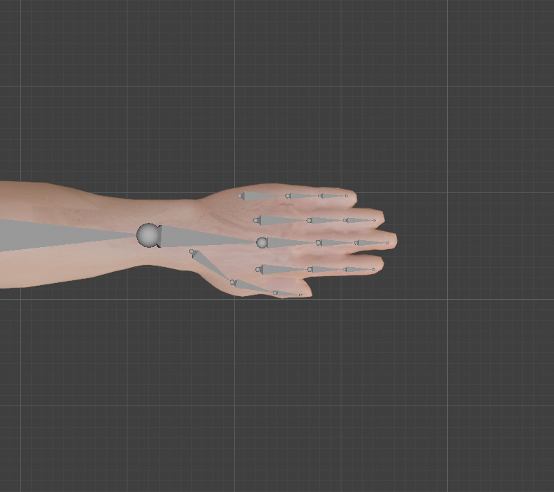
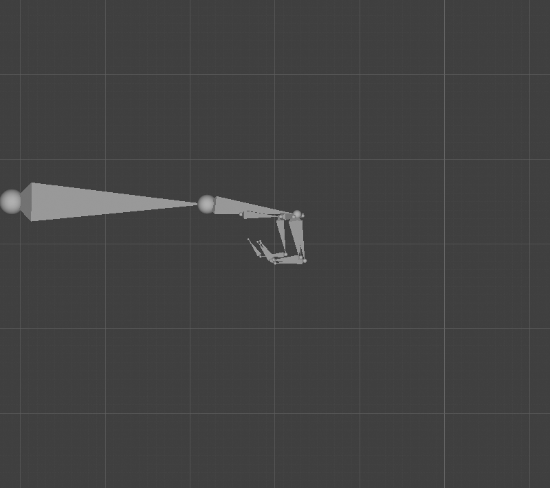
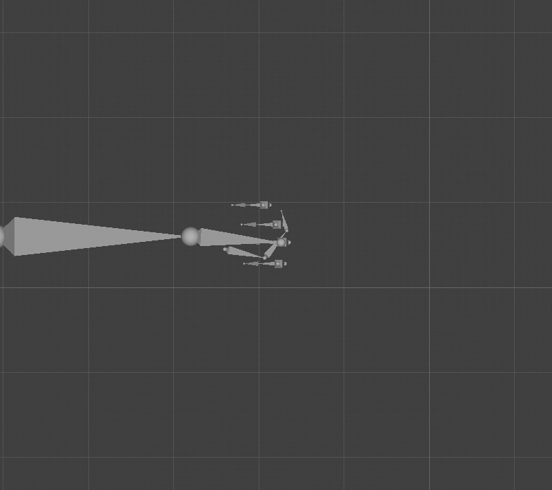

# Step 7: Build the hands

**Goal:** add the finger bones, so every finger can curl on its own. That makes **30 more bones: 15 per hand**, for **53 in all**.

**Method:** the same script as [Step 6](06-build-the-body-armature.md) with the hands switched on. The finger positions were measured in [Step 5](05-plan-the-bone-layout.md).
```python
G = {"HANDS": True}
exec(open("/Users/chris/blender_tutorial/human_tutorial/tools/build_armature.py").read(), G)
```

**By hand**
1. Select the armature, **Tab** into Edit Mode, select the `Hand.L` bone's tail, and press **E** to extrude the first finger bone. Set its head and tail from the table in [`tools/rig_landmarks.py`](tools/rig_landmarks.py).
2. Press **E** from that tail twice more for the middle and last segments. Name them `Index1.L`, `Index2.L`, `Index3.L` (**F2**).
3. Repeat for the other three fingers and the thumb. The first bone of each finger is parented to `Hand.L`, but *not* connected to it (each finger starts at its own knuckle).
4. Roll the bones (see below), then **Armature**, **Symmetrize** for the right hand.

## The bones

Each finger has a **proximal** (1), **middle** (2) and **distal** (3) bone, and so does the thumb. The lengths, in centimetres, come out of the measured knuckle and tip positions:

| Finger | Bone 1 | Bone 2 | Bone 3 | Whole finger |
|---|---|---|---|---|
| Index | 4.9 | 3.2 | 2.7 | 10.8 |
| Middle | 5.3 | 3.5 | 2.9 | 11.7 |
| Ring | 5.0 | 3.3 | 2.8 | 11.1 |
| Pinky | 4.5 | 3.0 | 2.5 | 10.0 |
| Thumb | 4.8 | 4.1 | 2.4 | 11.3 |

The `Hand` bone is 10.7 cm long and ends at the middle finger's knuckle. Each finger's three segments take 45%, 30% and 25% of its length. Real fingers have this rough ratio, and the proximal bone is the longest.



**Result (measured):** 53 bones (23 on each side plus 7 on the centre line), 52 deform, 30 finger bones, 0 left bones without a right twin, mirror error 0.000000 m.

## A correction to Step 6

In Step 6 we gave the hand and fingers the arm's hinge axis (world Z, up). That would have made "curl" a *sideways* swing. A palm-down hand curls its fingers *downward*, which is a rotation about the **front-back axis (world Y)**, so we changed the roll rules:

| Bones | Local X (hinge) | Why |
|---|---|---|
| Clavicle, UpperArm, ForeArm | world Z | the elbow hinge is vertical in a T-pose |
| **Hand, Index, Middle, Ring, Pinky** | **world Y** | wrist and fingers bend down (palm-down hand) |
| **Thumb** | **world Z** | the thumb curls *across* the palm toward the little finger |

The Step 6 table and script were updated to match.

**Tested** by rotating each bone +60 degrees about local X and watching its tip:

| Bone | Tip moved | Meaning |
|---|---|---|
| Hand.L / Hand.R | (-/+0.063, 0.003, **-0.086**) | down: **wrist flexion**. So wrist **extension is -X** (what a push-up needs) |
| Index1.L / Index1.R | (-/+0.024, 0.000, **-0.042**) | down: **finger curl** |
| Pinky1.L | (-0.023, 0.000, -0.039) | down, the same as the index |
| Thumb1.L / Thumb1.R | (+/-0.006, **+0.047**, 0.002) | toward the pinky side: **thumb curl across the palm** |

Left and right agree as mirror images, as in Step 6: **the same rotation values curl both hands the same way**.

## The fist test

We posed every finger of the left hand into a fist (fingers 80, 95 and 60 degrees; thumb 25, 40 and 45), looked at the bones, then cleared the pose.

| From the front | From above |
|---|---|
|  |  |

| Measurement | Result |
|---|---|
| Fingertips to wrist, open hand | 10 to 12 cm |
| Fingertips to wrist, fist (index, middle, pinky) | **8.3, 7.9, 7.4 cm** |
| Fingertip height, fist (index, middle, pinky) | **1.403, 1.401, 1.406 m**, which is about 3 cm *below* the open-hand height of 1.432 m |
| Thumb tip, fist | still at z = 1.434, 11.1 cm from the wrist: it moves *across* the palm, not down |

The skin did **not** move in this test, because the bones are not attached yet. This only proves the bone chains and their axes work.

**Concepts**
- **Proximal, middle, distal:** the three finger bones, counting from the knuckle to the tip. (Anatomically the thumb has only two; we give it three so it has the same structure and a spare joint for the grip.)
- **Knuckle (MCP) and finger joints:** each curls about its own hinge. Every bone in a finger shares the same hinge direction, so one rotation value per joint is enough.
- **Parented, not connected:** each finger's first bone follows the hand but starts at its own knuckle, not at the end of the `Hand` bone.

**Caveats**
- **The thumb is only a hinge.** A real thumb also rotates about its own length (opposition) to meet the fingers. We can add that later as a control if the grip on the kettlebell and mace looks wrong ([Step 11](README.md)).
- **Spreading the fingers** (about local Z, the vertical) is possible but the fingers are fused in the mesh ([Step 4](04-clean-up-the-mesh.md)), so we will not use it.
- **The bones are small** (2.5 to 5 cm), so they are hard to grab in the viewport. Step 11 gives us bigger curl controls.

---

[← Previous: Build the body armature](06-build-the-body-armature.md) · [Contents](README.md) · [Next: Parent and weight →](08-parent-and-weight.md)
