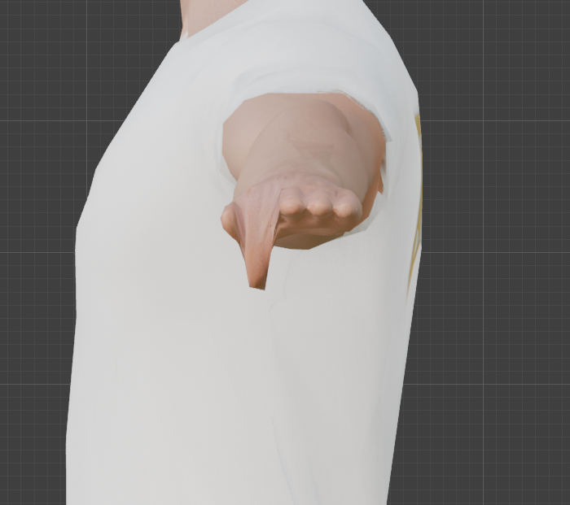
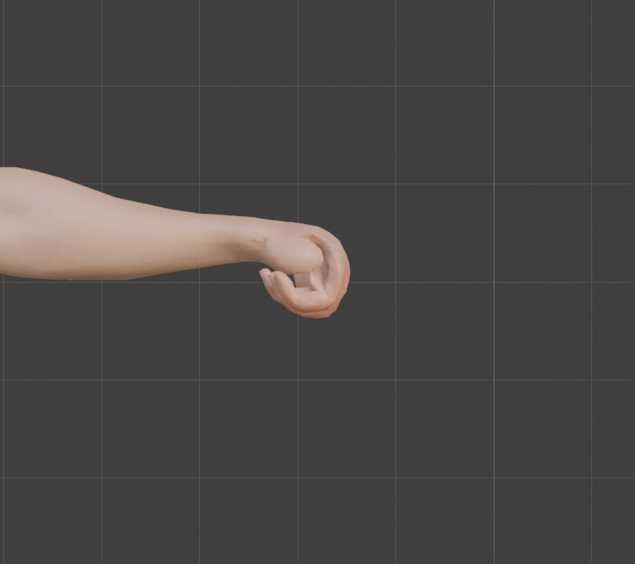
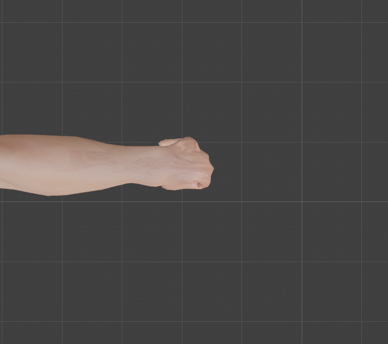

# Step 8: Parent and weight

**Goal:** attach the mesh to the skeleton so that moving a bone moves the skin, and make the weights safe to export.

**Weights** say how much each bone pulls each vertex. A vertex at the elbow might be 50% `UpperArm`, 50% `ForeArm`. Every bone gets a **vertex group** with its own name, holding those numbers.

**By hand**
1. Select the mesh, then **Shift-click the armature** so it is active. **Ctrl+P**, **With Automatic Weights**. Blender adds an **Armature modifier** and one vertex group per deform bone.
2. Look at the result: select the armature, **Ctrl+Tab** into Pose Mode, bend a bone and watch. Or select the mesh, enter **Weight Paint** mode and click a bone to see its weights as a heat map (red is 1, blue is 0).
3. Fix problem areas with the **Draw** brush in Weight Paint mode (paint weight 1 to add, weight 0 to remove, with **Normalize** or **Auto Normalize** on).
4. Prepare for export in Weight Paint mode: **Weights**, **Clean** (removes tiny weights), **Limit Total** (4), **Normalize All**.

**Python:** [`tools/bind_and_weight.py`](tools/bind_and_weight.py) does all four stages and prints a report. Safe to re-run.
```python
exec(open("/Users/chris/blender_tutorial/human_tutorial/tools/bind_and_weight.py").read(), {})
```

## What the automatic weights gave us

| Check | Result |
|---|---|
| Vertices with no weights | 0 of 7,770 |
| Deform bones with no vertices | none |
| Do the weights add up to 1? | **No**: sums from 0.884 to 1.038, mean 0.978 |
| Bones per vertex | up to **7** (glTF allows 4) |

So the bind worked, and the mesh moves. But the weights are **not normalized** and a few vertices have too many bones, so both need fixing before export. Also, we first deleted the leftover `keep_detail` group from [Step 3](03-reduce-the-polygon-count.md): it was a mask for decimation, not a bone, and would otherwise ship in the exported file.

## The hands needed a hand

Automatic weights find the nearest bones, and in this hand the nearest bone is often the *neighbour's*, because the fingers are fused ([Step 4](04-clean-up-the-mesh.md)). So `bind_and_weight.py` replaces the automatic weights beyond the wrist (|x| over 0.76) with its own, **finger by finger**:

1. Find the finger each vertex is closest to.
2. Work out how far along that finger it is, and blend `Hand` into bone 1 across the knuckle, bone 1 into bone 2, bone 2 into bone 3. Each handover is a smooth 2.4 cm blend (1.2 cm each side of the joint).
3. Where two fingers are within **8 mm** of each other, mix their weights, so the skin between them does not tear.

### Measuring it

Our first measurement was misleading. "How much weight sits on the wrong finger" fell from 12.4% to 10.0%, which looked like a poor result. But that number counts the deliberate 8 mm mixing between fingers as an error. The better question is **what moves**: curl only the index finger 80, 95 and 60 degrees, and measure how far the *other* fingers' skin moves, compared with the index's own movement.

| Weights | Neighbour skin follows the moving finger by | Skin between two fingers is stretched (mean, worst) |
|---|---|---|
| Automatic only | 11 to 13% | x2.6, x6.5 |
| **Hand-weighted, 8 mm mix (kept)** | **6 to 9%** | x5.4, x12.5 |
| Hand-weighted, 4 mm mix | 4 to 6% | x8.4, x16.1 |
| Hand-weighted, hard edges | 3% | x10.8, x30.7 |

**There is no free lunch.** The cleaner the separation, the more the skin *between* the fingers stretches, because that skin is a fused web joining two fingers that now move differently. We chose the 8 mm mix as the compromise.

| Automatic weights | Hand-weighted (kept) |
|---|---|
|  |  |

Seen from the fingertip end, the automatic version curls a wide flap of neighbouring skin along with the index. The hand-weighted version reads as one finger bending, at the cost of a stretched strip along its side. All five fingers together look right as a fist:

| From the front | From above |
|---|---|
|  |  |

## Cleaning up for export

| Stage | What it does | Effect |
|---|---|---|
| Clean (below 0.01) | removes weights too small to see | |
| Limit Total 4 | keeps each vertex's 4 strongest bones | 286 weights dropped |
| Normalize All | scales each vertex's weights to add up to 1 | |

**Final result (measured)**

| | |
|---|---|
| Vertices with no weights | 0 |
| Vertices whose weights do not add up to 1 | **0** |
| Bones per vertex: 1 / 2 / 3 / 4 | 1,872 / 3,387 / 1,399 / 1,112 |
| Vertex groups | 52, exactly the 52 deform bones |
| Hand vertices re-weighted | 1,546 |

**Concepts**
- **Armature modifier:** the thing that actually deforms the mesh. It reads the pose and the weights.
- **Normalized weights:** each vertex's weights add up to 1. Without this, a vertex can move less than its bones (sum below 1) or overshoot (sum above 1).
- **Influence limit:** glTF stores 4 bones per vertex, so more are silently lost on export. We choose which to keep instead.
- **Why a proxy metric can mislead:** measure what you care about (how the skin moves), not a number that merely sounds related.

**Caveats**
- **Only the hands were hand-weighted.** The body, arms and legs are Blender's automatic weights, cleaned. Whether the elbows, knees, hips and shoulders bend well is what [Step 9](09-test-the-rig.md) tests.
- **The webbing between fingers stretches** when fingers move independently. The real fix is cutting the fingers apart in the mesh. That is a manual job we have put off; the exercises mostly grip, so it may never matter.
- **The right hand has the same weighting rules** but we only visually checked the left.
- Bones with few vertices (the toes have 46 each) will move little skin: fine for now.

---

[← Previous: Build the hands](07-build-the-hands.md) · [Contents](README.md) · [Next: Test the rig →](09-test-the-rig.md)
