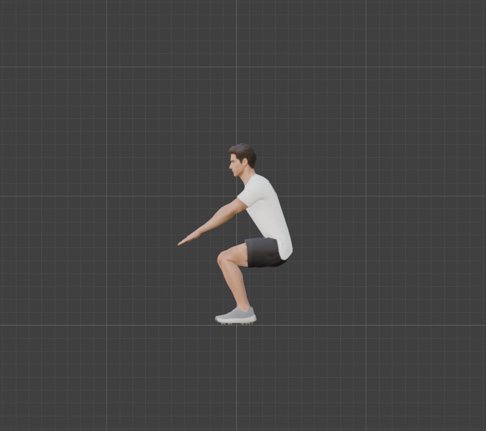
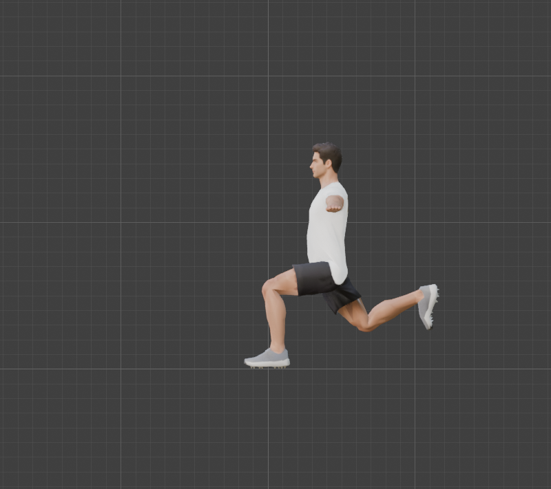
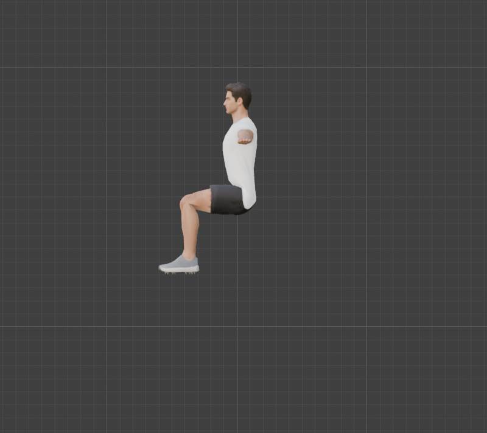
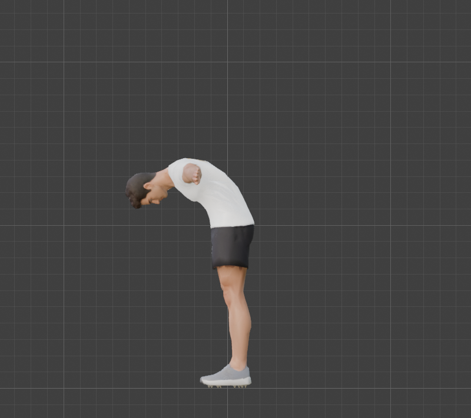
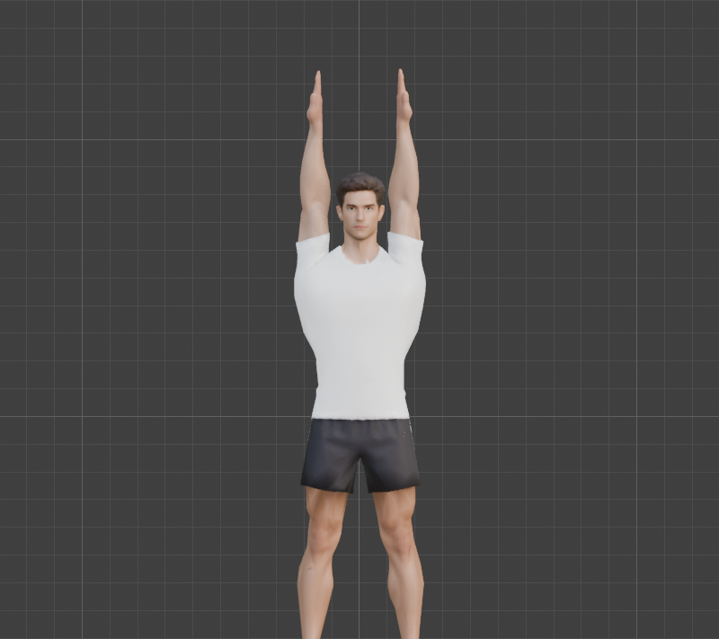
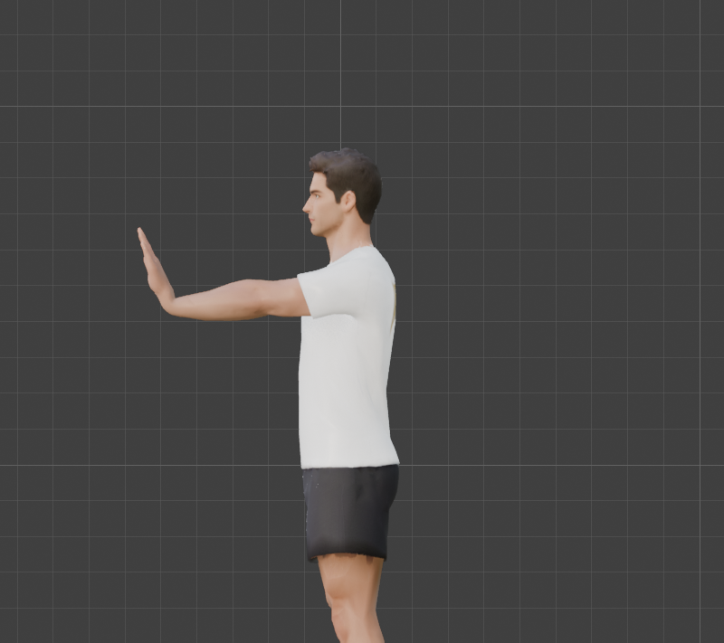
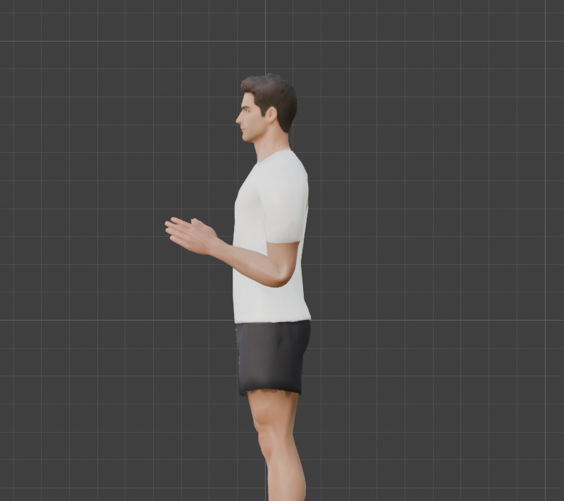
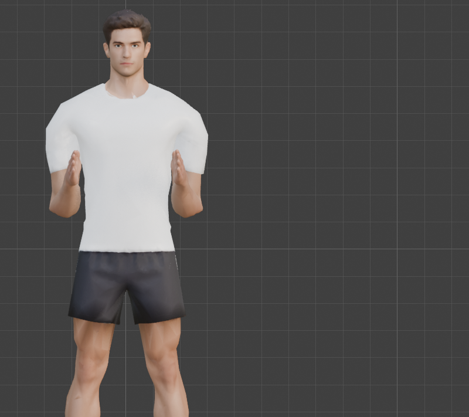
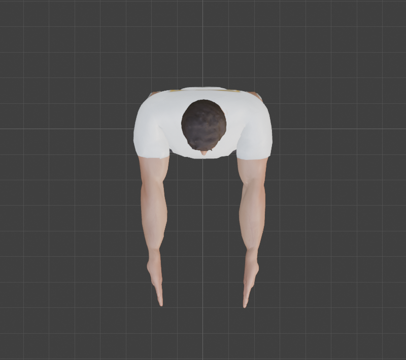
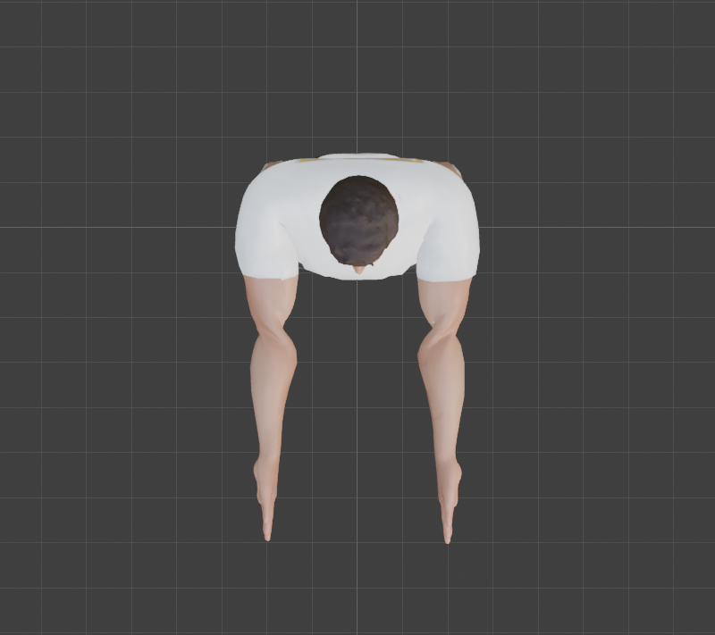

# Step 9: Test the rig

**Goal:** before we animate anything, pose the body the way the exercises will, and find out what the skin does. A rig that looks fine in a T-pose can fall apart the moment a knee bends.

**How we judged it:** two ways, because each misleads on its own.
- **By eye:** render each pose and look.
- **By numbers** ([`tools/pose_tests.py`](tools/pose_tests.py)): the volume change of the whole mesh, and how many skin edges stretch past **1.5x** or shrink below **0.6x** (the mesh has 23,304 edges), with the bone nearest to them.

**By hand:** select the armature, **Ctrl+Tab** for Pose Mode, select a bone, then **R**, **X**, type an angle, **Enter** rotates it about its own X axis. **Alt+R** clears a bone's rotation (select all with **A** first to clear the pose).

**Python**
```python
G = {"POSE": "squat", "ACTION": "measure"}     # ACTION: "measure", "pose", "clear" or "all"
exec(open("/Users/chris/blender_tutorial/human_tutorial/tools/pose_tests.py").read(), G)
```

## Results

All angles are degrees on the bone's own X axis (rotation conventions from [Steps 6](06-build-the-body-armature.md) and [7](07-build-the-hands.md)). Right-hand bones copy the left, mirrored.

| Pose | What moves | Volume | Edges over 1.5x | Worst | Edges under 0.6x |
|---|---|---|---|---|---|
| Squat | thigh -85, shin +105, foot -20, spine leans, arms forward -90 | **-10.3%** | 457 (2.0%) | x2.1 | 316 |
| Lunge | left thigh -80, shin +85; right thigh +35, shin +80 | -5.9% | 218 | **x2.9** | 197 |
| Seated | thighs -90, shins +90 | -7.5% | 318 | x2.1 | 211 |
| Spine curl | spine 25, 30, 25, neck 20, head 10 | -5.9% | **0** | | 18 |
| Arms overhead | upper arm 80 up, clavicle 15 up | 0.0% | 55 | x2.1 | 134 |
| Arms forward, elbows 100 | upper arm -90, forearm -100 | -2.5% | 178 | x2.1 | 169 |
| Biceps curl | arm down at the side, forearm -115 | -0.8% | 79 | x2.2 | 117 |
| Wrist extension | arm forward, hand -70 | -2.4% | 154 | x1.9 | 149 |
| Palm turn 90, at the wrist | arm forward, `Hand` turned 90 | -2.5% | 193 | x1.9 | 134 |
| Palm turn 90, from the elbow | arm forward, `ForeArm` turned 90 | -2.8% | 197 | x1.9 | 148 |

**Where the strain is:** the hips and thighs in every leg pose, and the upper arm and clavicle in every arm pose. Nothing is worse than x2.9. **Nothing tore, collapsed or pinched in the renders.**

## What it looks like

| Squat | Lunge | Seated (hip and knee 90) |
|---|---|---|
|  |  |  |

The squat, lunge and seated poses all read as a real person. The thigh and hip look natural, and the hips of the lunge keep their shape. (The squat needed the hips dropped and shifted back so the feet stay planted: `pose_tests.py` solves that for you.)

| Spine curl | Arms overhead | Wrist extension 70 |
|---|---|---|
|  |  |  |

The back bends in one smooth curve through the shirt. Arms straight overhead keep their shape, which matters for the pull-up. The wrist folds back to 70 degrees with clean skin, which is the hand position of a push-up.

| Biceps curl, side | Biceps curl, front |
|---|---|
|  |  |

**The elbow position is confirmed.** In Step 5 the elbow (x = 0.49) was an estimate from standard proportions, not a measurement. The curl folds at the right place with a clean crease, so the estimate stands.

## Palm twist: pull-up versus chin-up

An overhand grip turns the palm one way and an underhand grip the other, so the forearm has to twist. We turned the palm 90 degrees two ways:

| From the wrist (`Hand` bone) | From the elbow (`ForeArm` bone) |
|---|---|
|  |  |

Twisting **at the wrist is clean**. Twisting **from the elbow kinks the elbow**, because the weights near the elbow turn with the bone. **So turn the `Hand` bone to change grips.** We tested only a 90-degree twist in one direction, so a full underhand-to-overhand swing of 180 is still unproven. If it pinches in [Step 15](README.md) (pull-up and chin-up) we add forearm twist bones then.

## Two fixes we tried, and rejected

| Idea | What it did | Verdict |
|---|---|---|
| **Smooth the weights** (blur them across neighbouring vertices; [`tools/smooth_weights.py`](tools/smooth_weights.py)) | squat volume -10.3% to **-13.4%**, lunge worst stretch x2.9 to **x4.9**, seated -7.5% to **-11.7%** | **Worse.** A few fewer mildly stretched edges, but the blur softens the joints. Reverted. |
| **Preserve Volume** on the Armature modifier (dual-quaternion skinning) | squat volume -10.3% to **-5.2%**, but stretched edges **457 to 953** | **Not used.** It is a trade, and glTF and Babylon.js do not support it, so Blender would look better than the real game. |

After the experiments we re-ran Step 8's script and confirmed the numbers match the baseline exactly.

**Re-run after Step 10.** Adding IK moved the elbow 1.5 cm and rebuilt the weights, so we ran these poses again (with the IK muted: `pose_tests.py` now does that, because FK poses fight IK). The leg poses matched (squat -10.5%, lunge -5.9%, seated -7.6%). The arm poses moved a little, for example the biceps curl now has 51 stretched edges (was 79) and 139 squashed (was 117). Nothing got worse than x2.9. The tables above are the original Step 9 run.

**Concepts**
- **Linear blend skinning:** what glTF and Babylon.js use. Each vertex goes to the weighted average of where its bones put it. Averaging shortens the result, so volume is lost at bent joints (about 10% across a deep squat). This is normal, not a bug.
- **Candy-wrapper:** the pinch you get when a bone twists about its own length and the skin spirals into a point. It is why we test twists.
- **Mirror pose:** the same X rotation on both sides moves the limbs as mirror images, but a rotation about Y or Z needs the opposite sign on the right.

**A mistake worth remembering**
Our first overhead pose used 150 degrees, and the render showed the arms folded back across the shoulders. The T-pose is *already* 90 degrees out, so "overhead" is about 80 degrees more. Looking at the render caught what the numbers (volume -1.2%) did not.

**Not tested, and why it matters**
- **A push-up:** hands on the floor, the whole body rotated. That is [Step 14](README.md).
- **The shoulders and sleeves with the arms hanging:** in the front view of the curl the T-shirt sleeves flare outward at the shoulders. A mild but real artefact of a model built in a T-pose.
- **The neck and head,** and **the toes** (only the lunge's rear foot).
- **A grip on a bar or a handle:** [Steps 11 and 12](README.md).

---

[← Previous: Parent and weight](08-parent-and-weight.md) · [Contents](README.md) · [Next: IK for arms and legs →](10-ik-for-arms-and-legs.md)
