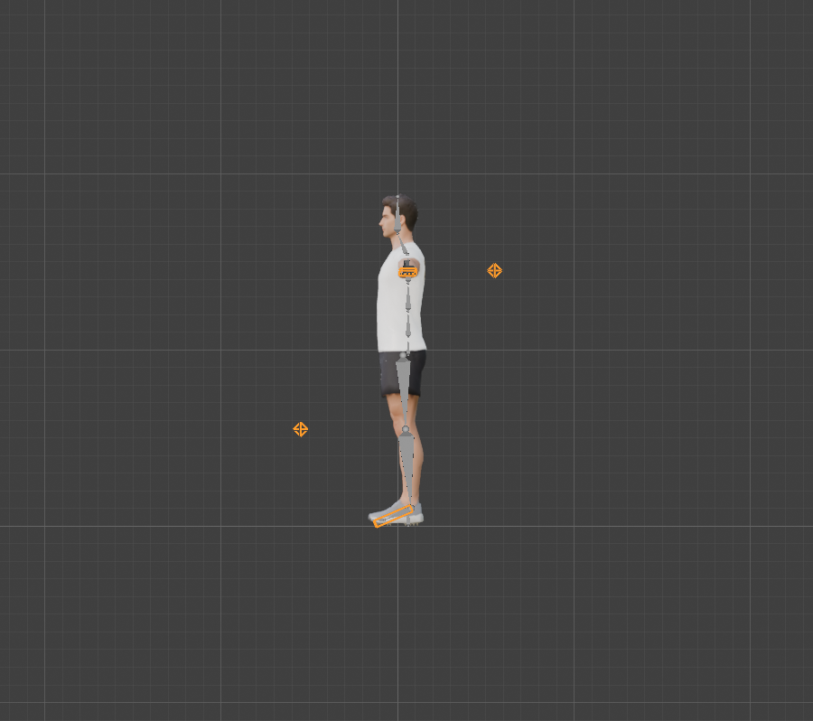
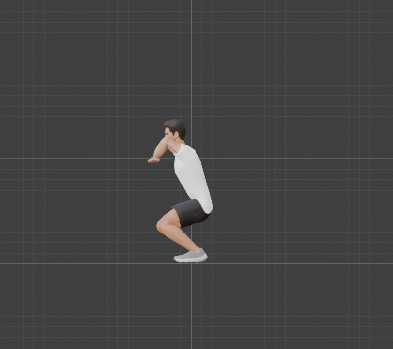
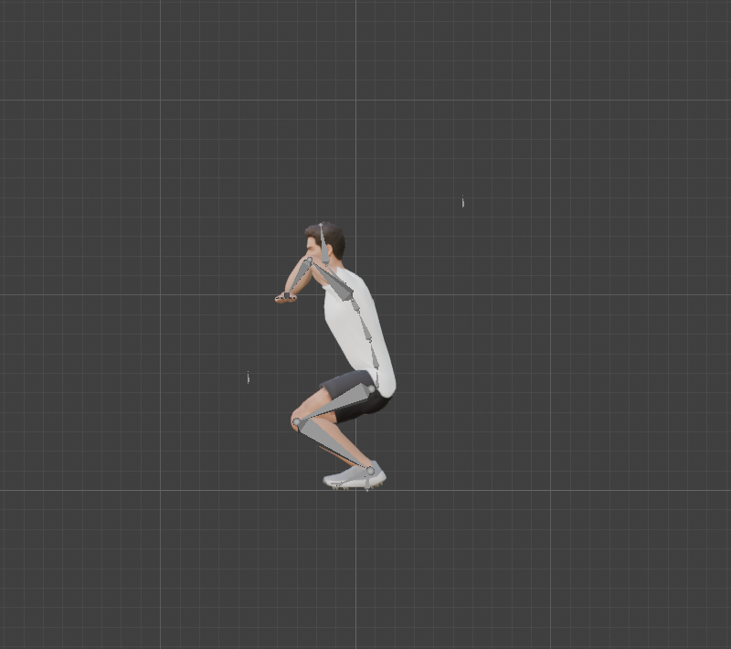
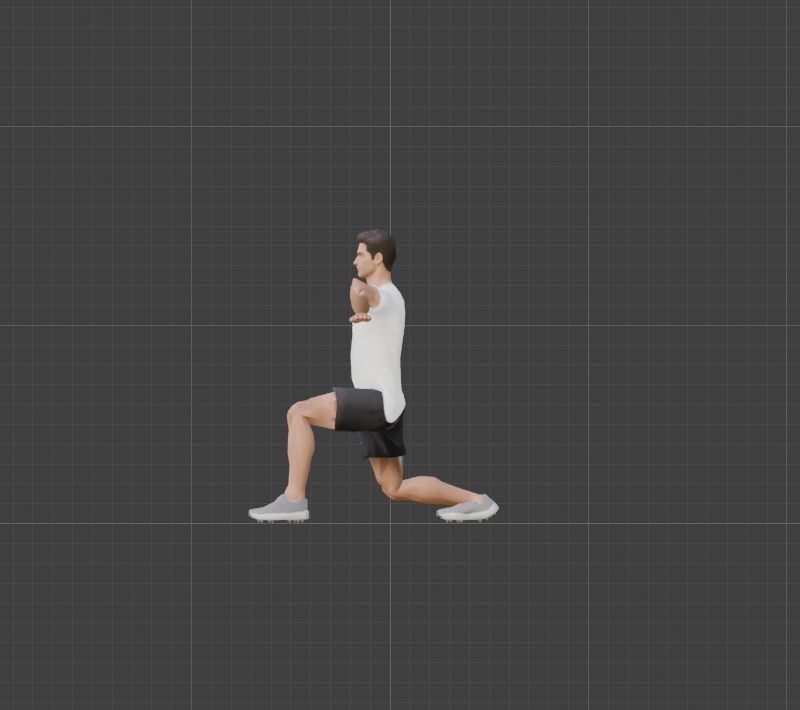
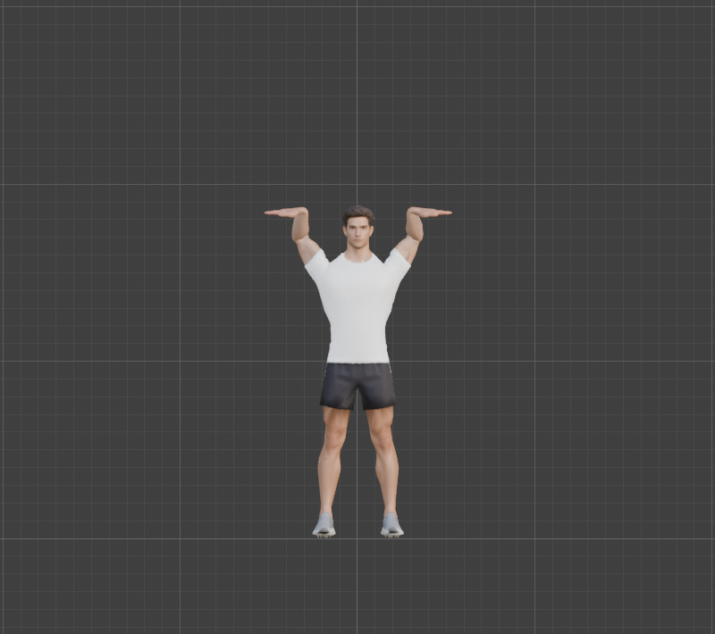

# Step 10: IK for arms and legs

**Goal:** make a hand or a foot stay where we put it while the body moves. With plain bone rotations (**FK**, forward kinematics) a squat means bending the hip, knee and ankle, then moving the hips to keep the feet on the floor, which we solved by hand in [Step 9](09-test-the-rig.md). With **IK** (inverse kinematics) we place the foot, and the knee works itself out.

**What we added:** 8 *control* bones that do not deform the mesh, and 8 constraints.

| Control | Where | What it does |
|---|---|---|
| `Foot_IK.L/R` | at the ankle, same orientation as the foot | the foot is pinned to it, in position and rotation |
| `Hand_IK.L/R` | at the wrist, same orientation as the hand | the hand is pinned to it, in position and rotation |
| `Knee_Pole.L/R` | 55 cm in front of the knee | tells the knee which way to point |
| `Elbow_Pole.L/R` | 55 cm behind the elbow | tells the elbow which way to point |

| Constraint | On | Settings |
|---|---|---|
| **Inverse Kinematics** | `Shin.L/R` | target `Foot_IK`, pole `Knee_Pole`, chain length 2 (Shin and Thigh), bends about X only, from 0 to 155 degrees |
| **Inverse Kinematics** | `ForeArm.L/R` | target `Hand_IK`, pole `Elbow_Pole`, chain length 2 (ForeArm and UpperArm), bends about X only, from -150 to 0 degrees |
| **Copy Rotation** | `Foot.L/R`, `Hand.L/R` | copy the rotation of their control, so the foot stays flat and the hand stays level |

**By hand:** in Pose Mode select `Shin.L`, then in the **Bone Constraints** tab choose **Add Bone Constraint**, **Inverse Kinematics**. Set *Target* to the armature and *Bone* to `Foot_IK.L`, *Pole Target* and *Bone* to `Knee_Pole.L`, and *Chain Length* to 2. In the **Bone** tab, under **Inverse Kinematics**, lock **Y** and **Z** and set the **X** limits. Then add a **Copy Rotation** to `Foot.L` from `Foot_IK.L`.

**Python:** [`tools/build_controls.py`](tools/build_controls.py), safe to re-run. The pipeline order is now `build_armature.py`, then `bind_and_weight.py`, then `build_controls.py`.

## What IK gives us

| Squat: hips down 0.45 m, hands held at the chest | The same, with the rig showing |
|---|---|
|  |  |

The only things we moved were the hips (down) and the hand targets. The feet stay flat and planted and the knees bend forward, **with no leg angle set by hand**. In Step 9 the same pose took four hand-tuned angles and a solve for the hip position.

| Lunge: only the two foot targets and the hips moved | Hand targets overhead |
|---|---|
|  |  |

The hands overhead keep their rest orientation (palms down). A bar grip needs the hand target rotated, which comes with the props in [Step 12](README.md).

## Results (measured)

**Legs**, hips dropped with the feet pinned:

| Hips down | Ankle drift | Knee bend | Knee forward of the hip-ankle line | Off the X hinge | Bone length change |
|---|---|---|---|---|---|
| 0.1 m | 0.01 mm | 55 deg | 20 cm | 0.0 deg | 0.00 mm |
| 0.3 m | 0.02 mm | 97 deg | 33 cm | 0.0 deg | 0.00 mm |
| 0.5 m | 0.03 mm | 128 deg | 39 cm | 0.0 deg | 0.01 mm |

**Arms**, hand targets moved to five reachable places (left and right are identical):

| Target | Hand error | Elbow bend | Elbow behind the shoulder-wrist line | Off the hinge |
|---|---|---|---|---|
| Hands in front of the chest | 0.0 mm | 104 deg | 7 cm | 0.0 deg |
| Overhead bar | 0.0 mm | 73 deg | 13 cm | 0.0 deg |
| Across the chest | 0.0 mm | 88 deg | -0.5 cm | 0.0 deg |
| By the thighs | 0.0 mm | 78 deg | 14 cm | 0.0 deg |
| Wide overhead | 0.0 mm | 36 deg | 7 cm | 0.0 deg |

The pole angles came out symmetric: **-90 degrees for both knees, +90 for both elbows**, every joint within 0.5 degrees of its pole and exactly on its hinge.

## The arms did not work first time

This step took four attempts, and each failure taught something.

**1. A test with unreachable targets.** Three of our five arm tests showed errors of 3 to 10 cm. The cause was our test: the targets were farther from the shoulder than the 0.53 m arm. The arm stretched straight toward them, which is correct. Fixing the test targets fixed the test.

**2. The solution was right and the anatomy was wrong.** Even with reachable targets the elbow "bent about the wrong axis" by up to 103 degrees. Reading the actual rotation showed what happened: the solver **rolled the upper arm 90 degrees about its own length** (a twist at the shoulder), so the forearm's other axis became vertical, then bent the elbow about that. The hand lands in the right place, but the shoulder skin would be badly twisted. Our pole-angle scan had missed it because it only checked that the elbow pointed at the pole. A twisted arm does that equally well. We changed the scan to need **both** the pole direction and a pure hinge.

**3. Even that was not enough, so we tested nine ways of constraining the elbow.** A hard lock on Y and Z jammed the arm completely, and limiting X, adding stiffness, or leaving X free all still twisted the shoulder:

| Elbow constraint (straight arm) | Result |
|---|---|
| Limit X only, X free, or stiffness 0.9 on Y and Z | solver twists the shoulder, 100 degrees off the hinge |
| Lock Y, or lock Y and Z | twisted, or cannot reach (197 mm off) |

**4. The real cause: the arm was perfectly straight.** The legs worked all along because they have a slight natural bend at rest (2 degrees). The arm had 0.7. **A perfectly straight chain gives IK no bend direction**, so the solver picks whichever axis it likes. Production rigs build in a slight pre-bend for this reason. We moved the elbow backward in the rest pose, and every variant that allows X now bends the elbow about X, including the hard lock that jammed before. (We compared the nine variants with a 3 cm offset, because our experiment accidentally moved the joint twice. The final rig uses **1.5 cm**, a 6-degree bend the mesh does not show, and we verified only the hard lock at that size: 0.0 degrees off the hinge, 0 mm hand error.) The wrong-signed limit (0 to +150) still fails, which confirms elbow flexion is -X.

| After the pre-bend (3 cm test) | Result |
|---|---|
| Lock Y and Z, lock Z only, stiffness 0.99, stiffness 0.9 | pure hinge, 0.0 to 0.6 degrees off, hand error 0 mm |
| Limit X only, lock Y only, X free | 3.3 degrees off the hinge |
| Limit X with the wrong sign | fails |

We used the hard lock. The elbow pre-bend is in [`tools/rig_landmarks.py`](tools/rig_landmarks.py) (elbow y = 0.075, was 0.06), so we **re-ran the whole pipeline**: armature, weights, controls. This also confirms the scripts are re-runnable. A re-run of the Step 9 poses matched the earlier numbers (squat -10.5%, was -10.3%; lunge -5.9%, same; seated -7.6%, was -7.5%).

## FK and IK fight each other

After this step, posing a thigh or shin by hand does nothing visible: the IK pulls the leg back to the foot target. Our Step 9 test script suddenly reported a lunge with 0.0% volume change, which is how we noticed. [`tools/pose_tests.py`](tools/pose_tests.py) now **mutes the IK while it poses** and turns it back on afterwards.

For animating, the usual answer is an **IK/FK switch**: a slider that sets the constraints' influence from 0 (FK) to 1 (IK). We have not built one yet. A pull-up needs it, because the legs dangle freely while the hands hold the bar.

**Concepts**
- **FK and IK:** FK rotates each joint from the root outward. IK starts from where the end (hand or foot) should be and solves the joints backward.
- **Pole target:** a point that decides which way the middle joint (knee, elbow) points, so the limb does not flip.
- **Chain length:** how many bones the IK solver may move. 2 means the shin and thigh (or forearm and upper arm), and stops there.
- **IK lock and limit:** turn a joint into a hinge by locking its other axes, and stop it bending backward by limiting X.
- **Pre-bend:** a slight bend in the rest pose so the IK solver knows which way to bend.
- **Custom shape:** an ordinary mesh object drawn instead of the bone's octahedron. Ours are stored in a hidden `Widgets` collection.
- **Controls versus deform bones:** the 8 controls have *Deform* turned off, so they are left out of the skin weights and the export. They sit in their own `Controls` bone collection.

**Caveats**
- **IK is solved only inside Blender.** glTF has no IK, so before exporting for the web we **bake** the animation onto the deform bones ([Step 21](README.md)).
- **The hands keep their rest orientation** unless a `grab` slider snaps them to a grip ([Step 12](12-props.md)).
- **No heel roll.** In the lunge the rear heel stays flat instead of lifting. A foot-roll control would fix it.
- **The elbow moved 1.5 cm,** so the [Step 5](05-plan-the-bone-layout.md) elbow position is now x = 0.49, y = 0.075.

---

[← Previous: Test the rig](09-test-the-rig.md) · [Contents](README.md) · [Next: Finger controls →](11-finger-controls.md)
