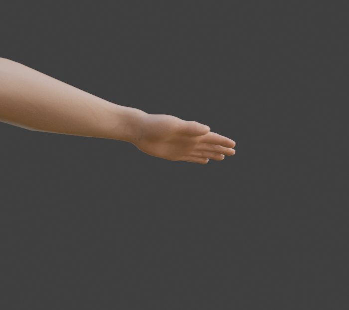
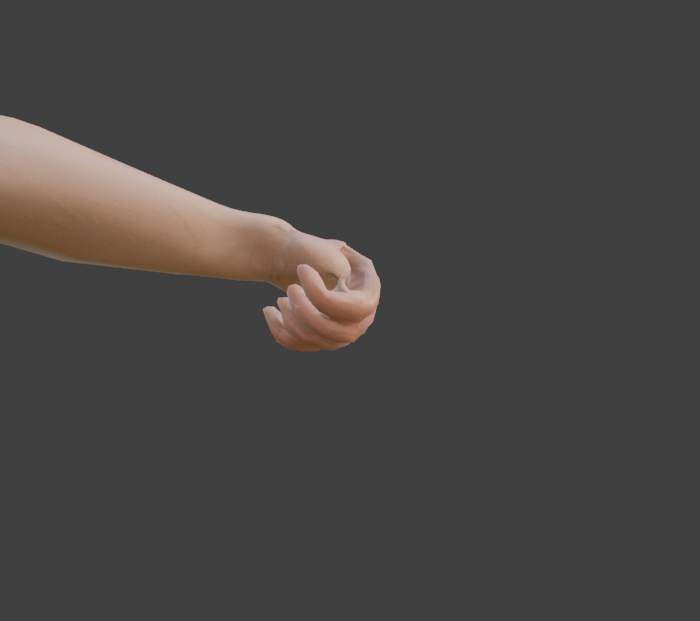
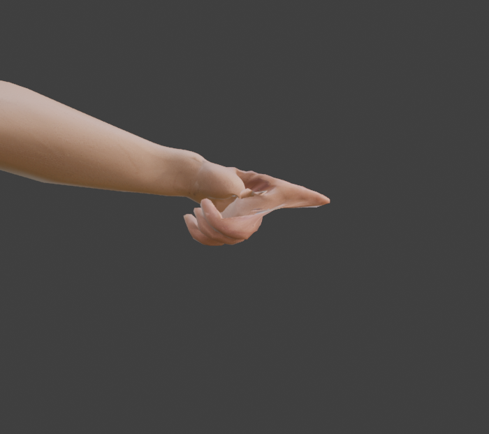
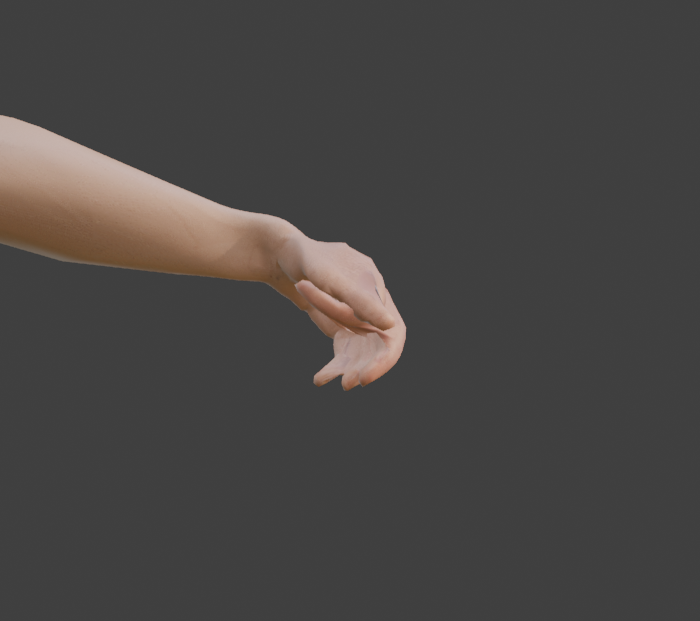

# Step 11: Finger controls

**Goal:** close a hand with one slider instead of rotating 15 bones. A kettlebell grip, a pull-up bar and a mace handle all need a closed hand, and an animation will change it constantly.

**What we added:** 7 sliders on each hand control (`Hand_IK.L` and `Hand_IK.R`), and a driver on every finger bone.

| Slider | Range | What it does |
|---|---|---|
| `fist` | 0 to 1 | closes all four fingers and the thumb together |
| `index`, `middle`, `ring`, `pinky` | -1 to 1 | that finger's own curl, **added to the fist** |
| `thumb` | -1 to 1 | the thumb's own curl, added to the fist |
| `thumb_oppose` | 0 to 1 | swings the thumb toward the palm to meet the fingers |

**How the numbers combine:** each finger's curl is `clamp(fist + its own slider, 0, 1)`, then multiplied by the angle that finger bone turns at full curl.

| Bone | Angle at full curl |
|---|---|
| Finger bone 1, 2, 3 (proximal, middle, distal) | 80, 95, 60 degrees |
| Thumb bone 1, 2, 3 | 25, 40, 45 degrees |
| `thumb_oppose` on `Thumb1` | 35 degrees, about a different axis |

A negative own value *cancels* a fist: **fist 1 with index -1 is a pointing finger.** One slider closes the hand, and one more opens a single finger.

**By hand:** in Pose Mode select `Hand_IK.L`. The sliders are under **Bone properties**, **Custom Properties** (the viewport sidebar's *Item* tab shows them too). Drag a slider, or hover over it and press **I** to keyframe it. To build one yourself: add a custom property on the bone, then right-click a finger bone's **Rotation X** field and choose **Add Driver**, set the type to *Scripted Expression* with an expression like `max(0, min(1, fist + own)) * 1.396`, and add variables that point at the properties.

**Python:** [`tools/build_finger_controls.py`](tools/build_finger_controls.py), safe to re-run.
```python
exec(open("/Users/chris/blender_tutorial/human_tutorial/tools/build_finger_controls.py").read(), {})
```

## What it looks like

All from below, so the palm is visible:

| Open hand (all sliders 0) | `fist` 1 |
|---|---|
|  |  |

| Pointing: `fist` 1, `index` -1 | A grip: `fist` 0.55, `index` 0.35, `thumb` -0.55, `thumb_oppose` 1 |
|---|---|
|  |  |

**The pointing hand shows the fused-finger problem.** A thin sheet of skin stretches between the straight index finger and the curled fingers, the web we found in [Step 4](04-clean-up-the-mesh.md) and measured in [Step 8](08-parent-and-weight.md). The skin has to go somewhere. A grip, where all the fingers close together, looks right. **If you need independent finger poses, the mesh needs its fingers cut apart first.** We have put that off, and our exercises mostly grip.

## Tested (measured)

| Test | Result |
|---|---|
| `fist` 1 | fingertips 8.3, 7.9, 7.6, 7.4 cm from the wrist (index, middle, ring, pinky) and the thumb 11.1 cm: **identical to the Step 7 fist** |
| `index` 1, nothing else | the three index bones turn 80, 95, 60; every other finger bone **0.0 degrees**; the thumb unmoved |
| `fist` 1, `index` -1 | the index bones are at 0, 0, 0 and its tip is back at its open-hand distance (21.3 cm); the middle finger stays fully curled |
| `fist` 0.5 | the index bones at 40, 47.5, 30: exactly half |
| Both hands, the same values | the left and right fingertips mirror each other with **0.0 mm** error |
| `thumb_oppose` 1 | the thumb tip moves 60 mm toward the palm (and 17 mm inward toward the body, 13 mm backward) |

**Opposition needed opposite signs on the two hands.** We never guessed: the script tries one sign, measures which way the thumb moves, and flips it if the thumb went *away* from the palm. The left needs +1 and the right needs -1, the same mirror rule as in Step 6: rotation about local X mirrors with the same value, about Z it needs the opposite sign.

## Two traps we hit

1. **Setting a property from Python does not run the drivers.** Our first test said the thumb tip moved **0.0 mm** for `thumb_oppose` 1, with every driver reporting valid. Dragging a slider in the interface tells Blender something changed, but assigning `bone["fist"] = 1.0` from a script does not. The fix is one line, `rig.update_tag()`, after setting the values. Scripts that set sliders (including the baking script in [Step 21](README.md)) need it.
2. **The finger bones are driven, so you cannot rotate them by hand any more.** A manual rotation snaps back to the driver's value. Pose fingers with the sliders. (To pose a finger bone directly, mute its driver.)

**Concepts**
- **Driver:** a formula that sets one property from another. Here, a bone's rotation from a slider's value.
- **Custom property:** a named value you add to a bone or object. Sliders, keyframes and drivers can all use it.
- **Additive control:** the finger's own slider is added to the master `fist`, so one master and several small tweaks make many hand shapes.
- **Clamp:** `max(0, min(1, x))` keeps a value between 0 and 1, so `fist` 1 plus `index` 1 does not curl the finger twice.

**Not tested, and why it matters**
- **Keyframing the sliders and baking them.** glTF cannot store drivers, so they must be baked into plain rotation keyframes before export. We have not tried that yet ([Step 21](README.md)).
- **Spreading the fingers apart:** the fingers are fused, so we left it out.
- **A tight grip on a real handle:** done in [Step 12](12-props.md), which measures the grip and lets a `grab` slider close the hand around a prop. It extends this script (`GRABS`).

---

[← Previous: IK for arms and legs](10-ik-for-arms-and-legs.md) · [Contents](README.md) · [Next: Props →](12-props.md)
