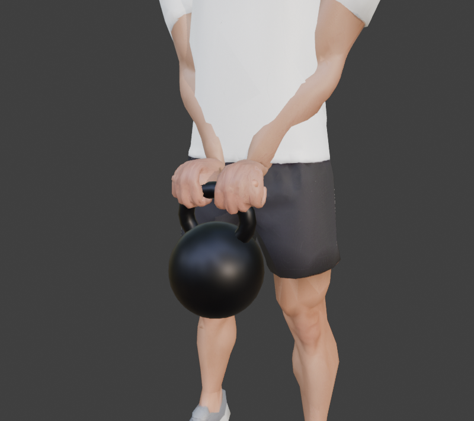
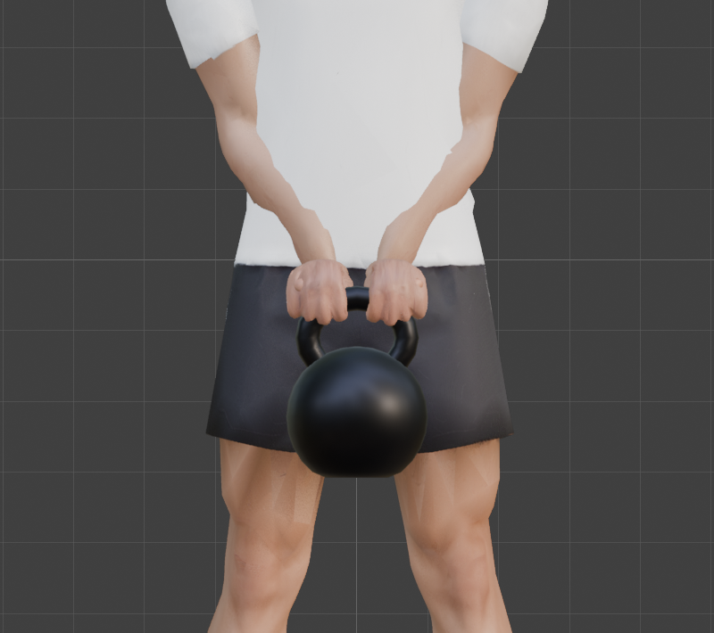
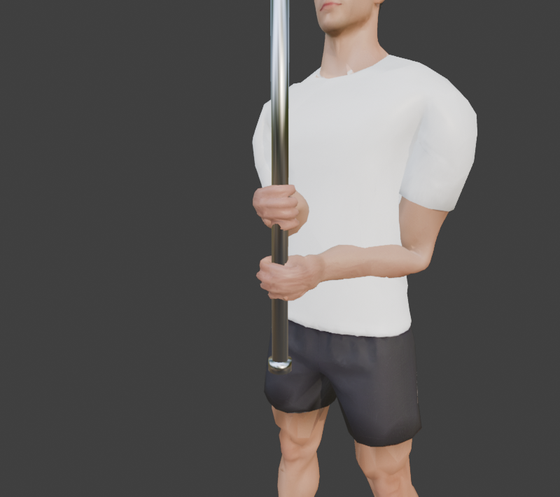
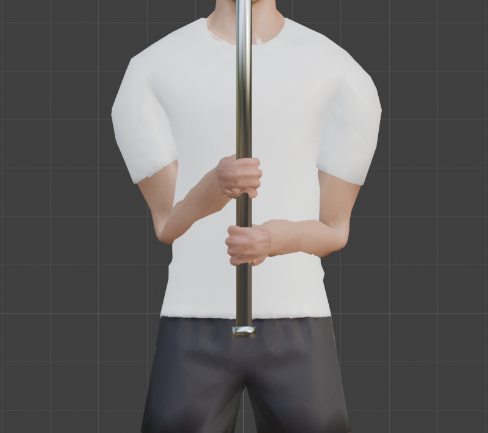
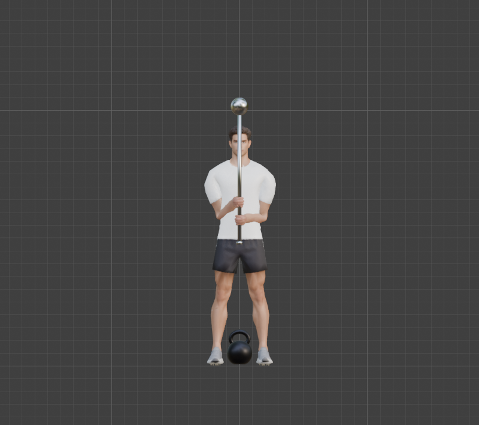

# Step 12: Props: a kettlebell and a steel mace

**Goal:** two props that the hands can grip and move with, so the exercises have something to hold.

**The design:** the *prop is the master*. You move the prop and the hands follow, which is how real lifts work: the bar goes up and the hands go with it.

| Part | What it is |
|---|---|
| Prop meshes | `Kettlebell` and `Mace`, low-poly, with simple metal materials |
| Prop control bones | `Kettlebell` and `Mace`: move these to move the prop (the meshes are parented to them) |
| Grip bones | `KB_Grip.L/R` and `Mace_Grip.L/R`: children of the prop bones. Each is the exact frame of the hand that holds it |
| Grab sliders | `grab_kettlebell` and `grab_mace` on each `Hand_IK` (0 to 1) |
| Constraints | a **Copy Transforms** on each `Hand_IK` per prop, whose influence is the slider |

At 0 a hand is free. At 1 its IK target snaps to the grip bone **and the fingers close around the handle**, because the same slider also drives the finger bones from [Step 11](11-finger-controls.md). One slider both attaches and grips.

**By hand:** to model a kettlebell, add a **UV Sphere**, flatten the bottom in Edit Mode, then add a **Torus**, squash it and sit it on top. For the mace, a **Cylinder** (shaft), a smaller one (knob) and a **UV Sphere** (head). To attach: add a bone to the armature, then select the mesh, **Shift-click the armature**, enter Pose Mode, select the bone, and **Ctrl+P**, **Bone**. For a grab: add a **Copy Transforms** constraint on the hand's IK control, target the grip bone, and keyframe the **Influence**.

**Python:** [`tools/build_props.py`](tools/build_props.py) models them and [`tools/build_prop_rig.py`](tools/build_prop_rig.py) does the rest (it also re-runs `build_finger_controls.py`).

| Prop | Size | Triangles | Grip |
|---|---|---|---|
| Kettlebell | 28.5 cm tall, body 20 cm wide, flat base | 944 | handle bar radius 17.5 mm, runs side to side |
| Steel mace | 1.15 m, shaft 33 mm across, head 14 cm | 560 | shaft radius 16.5 mm, runs up and down |

## Measuring the grip

The hardest part was not the props, it was making a hand wrap a handle convincingly. A hand frame has local Y along the fingers and **local +Z on the palm side** (we checked both hands: the left and right frames are mirror images, with the thumb on opposite local sides, so one world-space grip works for both). The handle runs along the hand's X. What we needed to find: *where in the palm the handle sits, and how closed the hand should be.*

**Our first guess was wrong.** We put the handle 6 cm from the wrist and tuned the fist against it: even a full fist left the finger joints **21 mm** (rms) from where they should be. The knuckles are about 10.6 cm from the wrist, so the handle belongs much nearer them.

**Then we measured instead.** For every fist value we recorded where each finger joint sits in the hand's own coordinates, then searched all handle positions for the one where the finger bones lie one finger-radius (9.5 mm) outside the handle's surface:

| | Kettlebell handle | Mace shaft |
|---|---|---|
| Handle centre in the hand | 9.1 cm along the fingers, 3.3 cm into the palm | 9.1 cm, 3.4 cm |
| Best fist | 1.00 (the fullest closure) | 1.00 |
| Finger joints from the ideal wrap | **6.6 mm** (rms) | **6.8 mm** (rms) |
| Thumb: opposition / distance from ideal | 0.4 / 0.9 mm | 0.5 / 0.2 mm |

The two props fit almost the same position (their radii differ by 1 mm), so we use one shared position, which keeps the grips consistent. The hand's own coordinates mean the measurement does not depend on where the hand is: it matters, because the props start on the floor, out of reach of a standing character.

## The results (measured)

| Test | Result |
|---|---|
| Kettlebell, both hands, at hip height | hand control to grip bone **0.00 mm**, wrist reaches the control (0.00 mm), elbow bend 23 degrees, finger wrap 6.1 mm rms |
| Mace, both hands, upright in front of the chest | hand control to grip bone **0.00 mm** (wrist 0.01 mm), elbow bends 82 and 109 degrees, finger wrap 6.3 mm rms |
| Mace, right hand only | the right hand holds it, the left stays free |
| Step 11's sliders, re-run | **identical** to before (fist, independence, point, half, symmetry) |

| Kettlebell, both hands on the handle | Same, from the front |
|---|---|
|  |  |

| Mace, one hand above the other | Same, from the front |
|---|---|
|  |  |

| The whole pose: mace in both hands, the kettlebell waiting on the floor |
|---|
|  |

**What to look for:** the fists close around the handle and the shaft, the handle is visible between the knuckles, and the forearms line up behind the hands.

**The grips are placed by us.** The kettlebell is gripped overhand with the hands side by side, the mace with the palms facing the shaft, one hand above the other. That suits a swing or a mace hold, but a goblet squat holds the kettlebell by its sides and needs different grip bones.

**Concepts**
- **Prop as master:** the hands are constrained to the prop, not the other way round, so animating the prop animates the grip.
- **Copy Transforms:** copies a target's position, rotation and scale. Its influence blends between free (0) and snapped (1).
- **Grip bone:** a bone that exists only to mark a hand frame on a prop. They live in their own `Grips` bone collection, hidden by default.
- **Parent to bone:** Blender positions bone children relative to the bone's *tail*, not its head. The script compensates, so the props stay where they were built.

**Caveats**
- **Export:** glTF will not export the prop bones if we export deform bones only, and then the props would not move with them. We must keep the prop bones, or bake the prop motion onto the objects ([Step 19](README.md)).
- **Reach:** a standing character cannot reach a prop on the floor. A deadlift or a kettlebell swing needs the hips and spine to move, which the movement tutorials ([Steps 13 to 16](README.md)) will do.
- **A kettlebell held low at the hips** overlaps the thighs slightly. There is no collision between the props and the body.
- **The mace swing** needs the grip to slide along the shaft and the hands to change roles. We only built a fixed two-hand hold.
- **Re-grab sliding:** blending a hand from 0 to 1 slides it between where it was and the grip over the keyframes you choose.

---

[← Previous: Finger controls](11-finger-controls.md) · [Contents](README.md) · [Next: Legs driven by IK, the squat →](13-legs-driven-by-ik.md)
