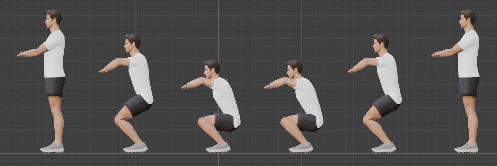
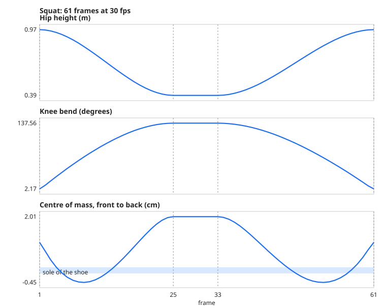

# Step 13: Legs driven by IK: the squat

**Goal:** the first real animation, and the pattern for every exercise where the feet stay planted and the hips move. We teach it with the **squat**. The same technique covers the lunge, the goblet squat, the deadlift hinge and step-ups.

**The idea:** do not *move* the legs. The `Foot_IK` controls stay at their rest position, so the feet cannot slide. We move only the **hips** (down and back), the **spine** (a forward lean), the **head** (keep the eyes level) and the **hands**. The IK from [Step 10](10-ik-for-arms-and-legs.md) works out the knees.

**Every action keys every control.** The library keys the *complete* set of controls (115 curves; 105 when this step was written, before later steps added sliders and a prop bone) in every action, at their rest values unless the table says otherwise. This is not optional: see "A flaw found later" below.

## A motion is a table

Instead of clicking keyframes one at a time, each motion is a small table of keys, which a library turns into an animation action ([`tools/anim_core.py`](tools/anim_core.py)). The squat ([`tools/exercises/squat.py`](tools/exercises/squat.py)):

```python
STAND  = {"Hips": {"move": (0, 0, 0)},
          "Spine": {"rot": (0, 0, 0)}, "Spine1": {"rot": (0, 0, 0)}, "Spine2": {"rot": (0, 0, 0)},
          "Neck": {"rot": (0, 0, 0)}, "Head": {"rot": (0, 0, 0)},
          "Hand_IK.L": {"at": (0.12, -0.40, 1.30)}}
BOTTOM = {"Hips": {"move": (0, 0.14, -0.58)},                      # down 58 cm and back 14 cm
          "Spine": {"rot": (14, 0, 0)}, "Spine1": {"rot": (10, 0, 0)}, "Spine2": {"rot": (6, 0, 0)},   # 30 degrees of lean
          "Neck": {"rot": (-8, 0, 0)}, "Head": {"rot": (-14, 0, 0)},                                   # eyes stay forward
          "Hand_IK.L": {"at": (0.12, -0.42, 0.88)}}
SQUAT = [(1, STAND), (25, BOTTOM), (33, BOTTOM), (61, STAND)]
```

| Entry | Meaning |
|---|---|
| `"move": (x, y, z)` | world-space offset from rest, in metres (for bones whose parent is not posed: the hips and the controls) |
| `"at": (x, y, z)` | absolute world position of a control |
| `"rot": (x, y, z)` | degrees on the bone's own axes, using the conventions from [Steps 6 and 7](06-build-the-body-armature.md) |
| `"props": {...}` | slider values (the finger and grab sliders) |

A key only lists what **changes**. Anything it leaves out keeps its previous value. Write the **left** side and the library mirrors it: positions flip x, rotations become (x, -y, -z), sliders are copied.

**Python**
```python
G = {}
exec(open("/Users/chris/blender_tutorial/human_tutorial/tools/anim_core.py").read(), G)
exec(open("/Users/chris/blender_tutorial/human_tutorial/tools/exercises/squat.py").read(), G)
action = G["build_action"]("Squat", G["SQUAT"])        # keys, eases, loops, sets 30 fps
D = G["measure"]("Squat")                              # plays it and records the numbers below
```

**By hand:** in Pose Mode, move the **Hips** down with **G**, **Z** and press **I** to key it. Rotate the spine bones with **R**, **X** and key them. Set the frame range and **30 fps** in the Output properties. Open the **Graph Editor** to see the curves and add a **Cycles** modifier (**Channel**, **Add F-Curve Modifier**) so the motion loops.

## Timing

30 frames per second, a 60-frame (2.0 s) loop:

| Frames | What happens | Seconds |
|---|---|---|
| 1 | standing | |
| 1 to 25 | down | 0.8 |
| 25 to 33 | pause at the bottom | 0.27 |
| 33 to 61 | back up | 0.93 |

Going up is slower than going down, which is how a controlled squat looks. The curves **ease in and out** (Bezier with auto-clamped handles), so the hips start and stop gently. The last key equals the first, and a **Cycles** modifier plus the action's *cyclic* flag make it a loop.



Frames 1, 13, 25, 33, 47 and 61. The feet are in the same place in every frame and the heels stay flat.

## What we measured

`measure()` plays all 61 frames and records the numbers that decide whether a motion is usable:



| Check | Result |
|---|---|
| Foot sliding (the ankles, worst frame) | **0.092 mm** |
| Foot rotation (heels stay flat) | **0.0 degrees** |
| Hand reach error | **0.03 mm** |
| Hip height | 0.97 m down to **0.39 m** |
| Knee bend | 2 degrees to **138 degrees** |
| Thigh at the bottom | **3.3 degrees below horizontal** (just past parallel) |
| Spine lean at the bottom | 22.9 degrees (measured along the spine bones; the keys add up to 30) |
| Centre of mass, front to back | **-0.4 to +2.0 cm**; the sole of the shoe runs from -11.2 to +11.8 cm |
| Frames with the centre of mass over the feet | **61 of 61** |
| Loop seam | **0.0 mm** between the last frame and the first |
| Speed either side of the seam | 88 and 65 mm/s (the same gentle ease; the ascent is a little longer) |
| Fastest the hips move | 1.08 m/s |

**The centre of mass** is the volume centroid of the deformed body mesh, assuming even density. Balance is the test that a squat looks like a person who will not fall over: the centre must stay above the feet. Ours stays within 2 cm of the middle of the shoe.

**The skin, compared with standing:**

| Frame | Volume | Edges stretched past 1.5x (worst) | Edges squashed below 0.6x |
|---|---|---|---|
| 13 (going down) | -6.5% | 272 (x3.2) | 207 |
| 25 and 33 (the bottom) | **-10.4%** | 543 (x3.8) | 453 |

Out of 23,240 edges, 2.3% stretch badly at the bottom. The volume loss matches [Step 9](09-test-the-rig.md)'s shallower squat. The worst stretch is larger (x3.8, up from x2.2) because this squat is much deeper (knee 138 degrees against 105). It is not visible in the frames above.

## Problems we hit

1. **We mislabelled our own result.** The first measurement said the bottom thigh was "14 degrees below parallel". It was **14 degrees above it**: the hips were still higher than the knees. A squat that stops short of parallel is not a proper squat. We deepened it from 0.46 m to 0.58 m, which put the thigh 3.3 degrees below horizontal.
2. **Deepening it broke the hands.** With the shoulders lower, the hand target was out of reach and the arm stretched, **41 mm** short. Pulling the target in (to 0.42 m in front of the body, 0.88 m high) brought it back to 0.03 mm. Any change to the hips can move something else out of reach, which is why every run measures reach.
3. **Blender 5 changed the animation API.** There is no `action.fcurves` any more: curves live in layers, strips and channelbags. `anim_core.py` has a helper for it.
4. **Props in the way.** Our contact sheet showed the mace and the kettlebell standing next to the character. We hide them for the picture.

## A flaw found later: actions leaked into each other

This step's first version left the feet, the toes and the knee poles **unkeyed**, because "unkeyed means they cannot slide". It looked right, and it was right, until the three animations of this part were played one after another in a loop. The **second time round, the squat was wrong.**

**Why:** an action only controls the channels it keys. Anything it leaves out keeps whatever the *previous* action left there. The squat never keyed the hips' *rotation*, the feet, the toes or the poles, so after the sit-up it inherited the sit-up's pelvis angle, and after the push-up the push-up's foot positions. We measured the damage: the same squat frame differed from a clean one by **up to 1.1 m** (the elbow poles), with the head 0.6 to 0.9 m out.

**The fix:** `build_action()` now merges a **base pose**, every control at its rest value, under the first key, so every action keys the same set of curves (115 now). It is a rule for every action we build, not a detail of the squat.

**The test:** every action after every other action, at three frames each, compared bone by bone with the same action played from a clean pose:

| Action | After a different action | Worst difference of any bone |
|---|---|---|
| Squat | after Push-up, after Sit-up | **0.000 mm** |
| Push-up | after Squat, after Sit-up | **0.000 mm** |
| Sit-up | after Squat, after Push-up | **0.000 mm** |

The squat's own measurements did not change (ankle drift 0.092 mm, reach 0.03 mm). Playing the loop live confirmed it: on later passes the squat's hips matched the clean squat at every frame, including the bottom (0.39 m), with the ankle fixed.

**Why it matters beyond Blender:** a game engine has the same problem. When Babylon.js switches from one animation to another, a bone the new animation does not touch keeps whatever the old one left. Every exported animation must therefore carry the whole set ([Step 19](19-export-for-babylon.md): all eight animations carry the same 165 channels).

**We found this because the person following the tutorial played the animations in a loop.** Each action had passed all its own checks.

## Closing an open question from Step 11

[Step 11](11-finger-controls.md) asked whether a **keyed slider** really drives the finger bones. We tested it with a two-key action: with `fist` keyed 0 to 1, the index bone went 0, 40 and 80 degrees at frames 1, 6 and 11 (the thumb opposition 0, 17.5 and 35), and the right hand matched. Keyframing sliders works. Baking the drivers for export worked ([Step 19](19-export-for-babylon.md)).

## The same technique, other exercises

| Exercise | What changes from the squat | Status |
|---|---|---|
| **Lunge** | key the two `Foot_IK` targets (one forward, one back) and drop the hips; the Step 10 lunge did this as a pose | not built yet |
| **Goblet squat** | the same, with the kettlebell held at the chest: `grab_kettlebell` keyed on, and a grip on the kettlebell's sides | needs new grip bones |
| **Deadlift hinge** | the hips move **back** much more than down, and the spine leans far forward | not built yet |
| **Step-up** | one foot target is keyed up onto a step | not built yet |

These will be built from tables once [Step 17](README.md) sets out the recipe.

## The checks, as a recipe

Everything above can be turned into a checklist that every exercise has to pass:

- **an action plays identically after any other action** (the test above);
- the ankles move less than 0.5 mm unless a foot is meant to move;
- the hand targets are always reached (error under 1 mm);
- the centre of mass stays inside the support area in every frame;
- the loop seam is under 0.5 mm, with similar speeds either side;
- the joint angles stay inside the IK limits (knee 0 to 155 degrees).

**Concepts**
- **Keyframe:** a value pinned to a frame. Between two keys Blender calculates the rest.
- **Interpolation and easing:** the shape of that calculation. Bezier with auto-clamped handles eases in and out.
- **Action:** a stored animation. It can be assigned to the rig, kept with a **fake user** so it survives a save, and exported.
- **Cyclic action:** one that repeats. The first and last keys match, and a Cycles modifier extends the curves forever.
- **Centre of mass and base of support:** a person stays balanced while the centre of mass is over the area between their feet.
- **Channelbag:** where Blender 5 keeps an action's curves (an action has layers, which have strips, which have channelbags).

**Caveats**
- **The saved `.blend` has no action assigned**, so the rig opens in the T-pose and the earlier test scripts still work. Assign it with `rig.animation_data.action = bpy.data.actions["Squat"]`.
- **The balance test uses the body alone.** A held kettlebell or a mace moves the centre of mass, so those exercises need the prop included.
- **The squat is symmetrical,** with the feet straight. Real squatters often turn the toes out a little.
- **Export:** the IK is baked by the exporter ([Step 19](19-export-for-babylon.md)).
- **The loop has no toes or heel lift,** which a deeper or faster squat would show.

---

[← Previous: Props](12-props.md) · [Contents](README.md) · [Next: Floor work →](14-floor-work.md)
