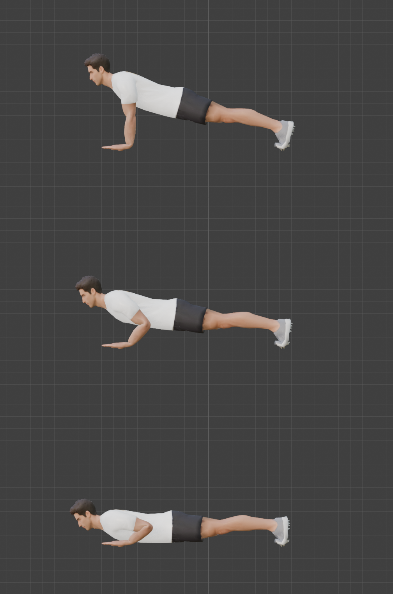
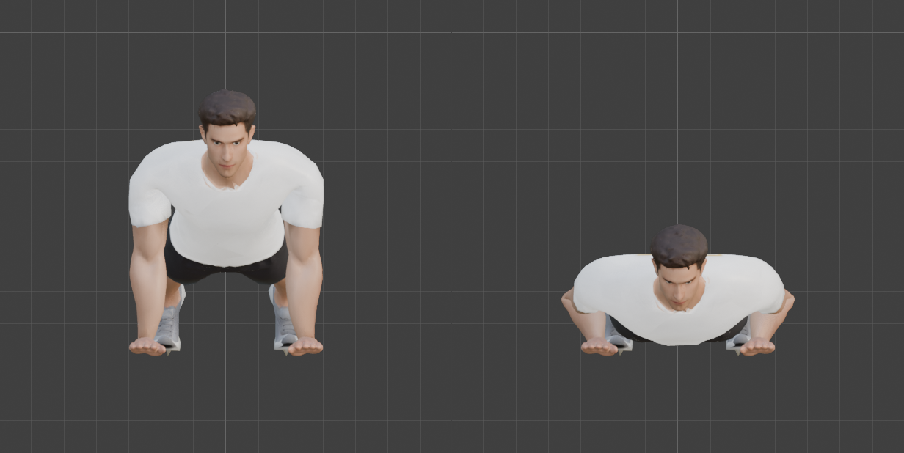
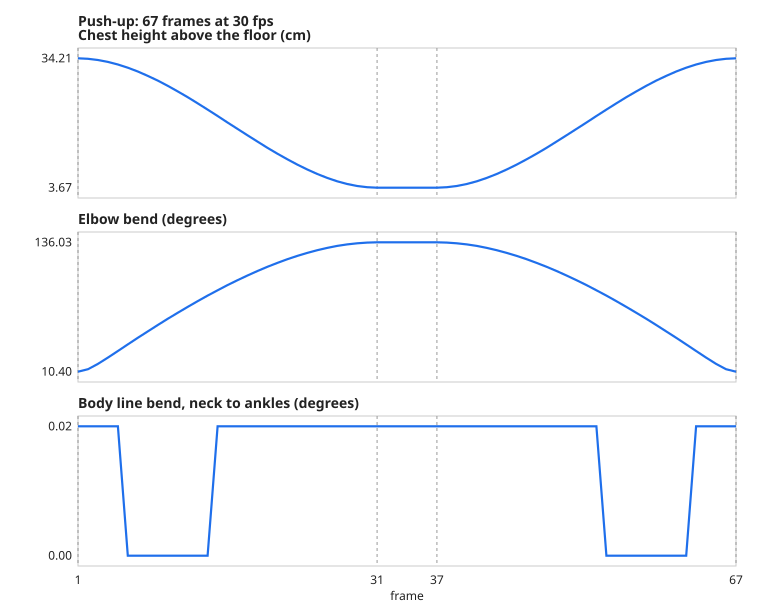
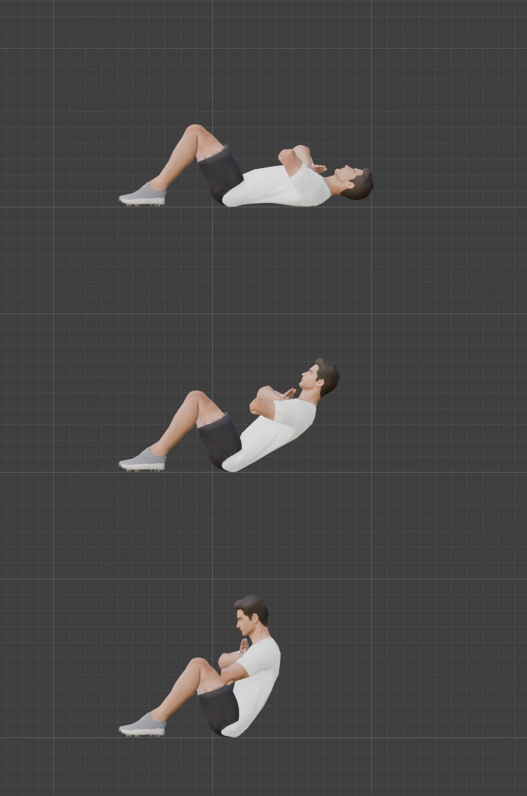
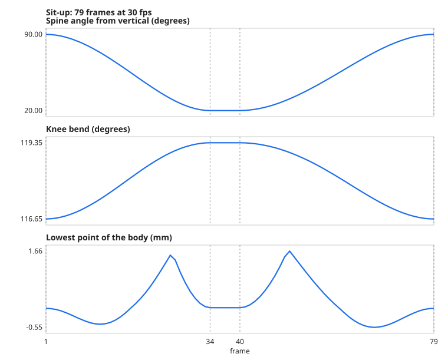

# Step 14: Floor work: the push-up and the sit-up

**Goal:** the techniques for exercises where the body is on the floor and the hands, feet or back stay in contact with it. Two different mechanics, one tutorial each half:

| | The idea | Exercises it covers |
|---|---|---|
| **Push-up** | the body is **one stiff piece that pivots on its toes**, with the hands planted | push-up, plank, incline and decline push-ups |
| **Sit-up** | the pelvis is **settled onto the floor by measurement**, the spine curls, and the hands **ride on the torso** | sit-up, crunch |

Both use the keyframe tables from [Step 13](13-legs-driven-by-ik.md), plus three additions to [`tools/anim_core.py`](tools/anim_core.py): `"wrot"` (rotate a control in the *world*), `rigid()` (a stiff body pivoting about a contact point) and floor measurements.

## Part 1: the push-up

### Why not just rotate the Root?

Every control in the rig (the hand and foot targets, the poles) is a *child of the Root bone*. Turn the Root and the hand targets lift off the floor with everything else. So we turn the **Hips** instead, which carries the spine, head and legs but not the controls, and we move the foot targets ourselves.

### The key idea: one rigid motion

A straight body that pivots on its toes moves all its points by the same rule: the pivot goes to the floor, and everything else turns by the angle φ about the line through it.

```python
M(P) = pivot_target + Rx(φ) · (P − pivot_rest)          # anim_core.rigid(pivot_rest, pivot_target, φ)
```

Apply `M` to every part of the body that must stay rigid and the legs keep their shape automatically:

| Control | Where it goes |
|---|---|
| `Hips` | moves to `M(hips)` and turns φ |
| `Foot_IK` (the ankle target) | moves to `M(ankle)` and turns φ in the *world* (`"wrot"`), so the foot keeps its angle to the leg |
| `Knee_Pole` | moves to `M(pole)`, so the knees keep pointing the same way relative to the body |
| `Toes` | bend back by exactly φ (`"rot": (-φ, 0, 0)`), which lays them flat on the floor |
| Hands | **planted**: palms flat, fingers forward, 25 cm apart. They never move |

The arms are not in that list: the IK solves them, because the hands stay where they are and the shoulders move.

[`tools/exercises/pushup.py`](tools/exercises/pushup.py) writes the whole table. The pivot is the ball of the foot; the push-up runs between **φ = 73.5** (the top, about 17 degrees above horizontal) and **φ = 88** (the bottom, about 2 degrees).

### Calibrated against the mesh, not guessed

| Value | How we found it | Result |
|---|---|---|
| Toe pivot height | measured the lowest foot vertex | **3.5 cm**: the toes land at -0.001 m |
| Hand height | first tried 3 cm, the lowest hand vertex was **11 mm below the floor** | **4.1 cm** puts the palm exactly on it |
| Top angle | scanned 72 to 74 degrees: at 72 the shoulders are too high and the hands are **33 mm short** of the floor; at 74 the elbow is already bent 26 degrees | **73.5**: reach 0.0 mm, elbow 10 degrees (almost locked out) |
| Bottom angle | scanned 74 to 88: the chest is 33 cm up at 74, 14 cm at 83, 3.7 cm at 88 | **88**: chest 3.7 cm off the floor, elbow bend 136 degrees (limit 150) |

The elbow is very sensitive near a straight arm: at 74 degrees, raising the hands by 1.1 cm moved the elbow bend from 15 to 28 degrees. That is why these were found by scanning.



Frames 1, 16 and 31. The hands stay flat with the fingers forward, the toes stay planted with the heels up, and the body stays straight.





### Results (measured over all 67 frames)

| Check | Result |
|---|---|
| Hands planted (the wrist, worst drift) | **0.01 mm** sideways, **0.05 mm** vertically |
| Toes planted (the ball of the foot) | **0.04 mm** |
| Body line, neck to hips to ankles | **0.0 degrees** (a perfectly straight body) |
| Knee bend | 2.2 to 3.3 degrees (the legs keep their shape) |
| Elbow bend | 10.4 degrees at the top, **136** at the bottom |
| Hand reach error | 0.05 mm |
| Chest above the floor | 34.2 cm at the top, **3.7 cm** at the bottom |
| Head above the floor | 55 cm at the top, 13.8 cm at the bottom |
| Pelvis and thighs above the floor, bottom | 3.2 cm |
| Lowest vertices | hands -0.000 m, feet -0.001 m: **nothing below the floor** |
| Vertices within 1 cm of the floor, every frame | **184 on the hands, 4 on the feet, none anywhere else** |
| Loop seam | 0.00 mm |

**The "ankle drift" is not sliding.** The ankles travel about 41 mm along an arc as the heels lift, while the toes stay fixed. The right check for a pivot is the ball of the foot, which moves 0.04 mm.

## Part 2: the sit-up

The sit-up cannot use a rigid body: the pelvis stays down while the spine curls. [`tools/exercises/situp.py`](tools/exercises/situp.py) does three different things.

**1. Settle the pelvis onto the floor.** After posing the body, the script finds the lowest vertex and moves the pelvis until that vertex is on the floor, three times over, at every key. No pelvis height is guessed:

| Pose | Hip joint height that puts the body on the floor |
|---|---|
| Lying | 9.8 cm |
| Half-way | 8.6 cm |
| Sitting up | 6.8 cm |

**2. Roll the pelvis and curl the spine.** The Hips turn backwards from 90 degrees (lying flat) to 55 (sitting), and the spine bends forward 20, 16 and 12 degrees (48 in all). The feet stay planted at one position and the knees bend 117 to 119 degrees.

**3. The hands ride on the torso.** With the arms crossed on the chest, a hand target fixed in the world would be left behind as the chest rises. So the build is **two passes**: pose the body, read where the chest is in that pose, then place each hand and each elbow pole relative to the chest and key it. The hand's orientation is built from the chest's frame (palm into the chest, fingers toward the opposite shoulder).





### Results (measured over all 79 frames)

| Check | Result |
|---|---|
| Foot sliding (the ankles, worst frame) | **0.024 mm**; foot rotation 0.0 degrees |
| Knee bend | 116.6 to 119.3 degrees |
| Hand reach error | 0.06 mm |
| Spine from vertical | **90 degrees lying, 20 sitting up** (about 70 degrees up) |
| Lowest body vertex | **-0.0006 to +0.0017 m**: always on the floor, never through it |
| Body vertices within 1 cm of the floor | 59 lying, 56 half-way, 92 sitting |
| Loop seam | 0.00 mm |

**One flag:** the elbow bend reaches **148 to 151 degrees**, against the 150 degree IK limit. The crossed arms are folded as tight as the rig allows. The hands still reach their targets, but a tighter pose would not.

## Skin

Compared with the T-pose (the same baseline as [Step 9](09-test-the-rig.md)):

| Pose | Volume | Edges stretched past 1.5x (worst) | Edges squashed below 0.6x |
|---|---|---|---|
| Push-up, top | -4.8% | 154 (x2.1) | 255 |
| Push-up, bottom | **-3.6%** | 67 (x1.9) | 188 |
| Sit-up, lying | -7.5% | 367 (x2.1) | 355 |
| Sit-up, sitting up | -11.7% | 536 (x2.5) | 451 |
| (Squat, bottom, for reference) | -12.0% | 468 (x2.3) | 463 |

Out of 23,304 edges. The push-up is the gentlest movement we have measured and the sit-up and squat the hardest. Nothing is worse than x2.5. (The Step 13 squat numbers were measured against the standing pose, not the T-pose, so they are not directly comparable.)

## Things that went wrong, or nearly did

1. **A picture misled us.** From the front, the push-up's elbows looked flared out to the sides. Measured from above, the upper arm is only **16 degrees** from straight back. The "flare" was perspective. We tried pole positions that tucked them further (9 and 5 degrees) and rejected them as overdone.
2. **The floor measure picked up the wrong thing.** Our first "lowest body point" for the push-up was the forearm, next to the planted hand. To check the chest we added separate chest and head measurements to the library, and they are now part of `measure()`.
3. **The elbow limit is a real constraint.** The sit-up arms sit at the IK limit. A rig that silently bends past its limits would hide it, so `measure()` records the elbow every frame.
4. **The props were in the way.** The kettlebell and mace stand where the body lies. We hide them for the pictures. They would need moving in a real scene.
5. **A stray image** (a leftover from our contact-sheet script) was removed from the saved file.
6. **The actions were leaking into each other.** Played in a loop, the squat from [Step 13](13-legs-driven-by-ik.md) went wrong on the second pass, because it did not key channels (the hips' rotation, the feet) that the push-up and sit-up had changed. The push-up and sit-up already keyed those, which is why they looked right. The library now keys every control in every action; see Step 13.

## Other exercises, from the same techniques

| Exercise | What changes | Status |
|---|---|---|
| **Plank** | hold the push-up's top pose (φ = 73.5), no motion | not built |
| **Incline / decline push-up** | raise or lower the pivot and hand heights | not built |
| **Knee push-up** | the pivot is the knee, not the toe | not built |
| **Diamond / wide push-up** | change `HAND_X` and the hand frame | not built |
| **Crunch** | the sit-up with a small spine curl and the pelvis flat | not built |
| **V-up, leg raise** | feet keyed off the floor | not built |

These come from [Step 17](README.md)'s recipe.

## Checks added to the recipe

- an action plays **identically after any other action** (order independence, Step 13);
- no part of the body goes below the floor (the lowest vertex stays above -2 mm);
- the contact points (hands, toes, pelvis) do not drift;
- the chest and head clearance is measured, so a push-up neither floats nor lies on the floor;
- the body line stays straight where the exercise needs it;
- any joint that reaches its IK limit is reported.

**Concepts**
- **Rigid transform:** moving every point of a body by the same rotation and shift, so its shape does not change.
- **Pivot / contact point:** the part that stays fixed while the rest turns (the toes in a push-up).
- **World rotation (`"wrot"`):** a rotation about the world's axes, converted into the bone's own. It lets a table say "palm flat on the floor" without knowing the bone's axes.
- **Settling:** adjusting a pose after measuring it, here to put the body on the floor.
- **Two-pass build:** pose the body, read its state, then use that to place things that depend on it (the hands on the chest).

**Caveats**
- **The hands are flat and the fingers are not spread:** the fingers are fused ([Step 4](04-clean-up-the-mesh.md)).
- **The shoe front bends only a little:** the toe bones have few vertices (46 each), so the push-up's foot shows a stiff shoe, not a flexing one.
- **In the sit-up the head hovers 4 cm above the floor** when lying (the neck is neutral).
- **The sit-up arms are crossed on the chest** and nothing else is built (hands behind the head, arms forward).
- **No weight shift or breathing,** and the push-up's body stays perfectly stiff.
- **The actions are stored, not assigned:** `Squat`, `Pushup` and `Situp` each sit on a fake user. Assign one with `rig.animation_data.action = bpy.data.actions["Pushup"]`.
- **Nothing is exported yet.** The IK, the drivers and the prop bones must be baked ([Step 19](README.md)).

---

[← Previous: Legs driven by IK](13-legs-driven-by-ik.md) · [Contents](README.md) · [Next: Hanging and pulling →](15-hanging-and-pulling.md)
