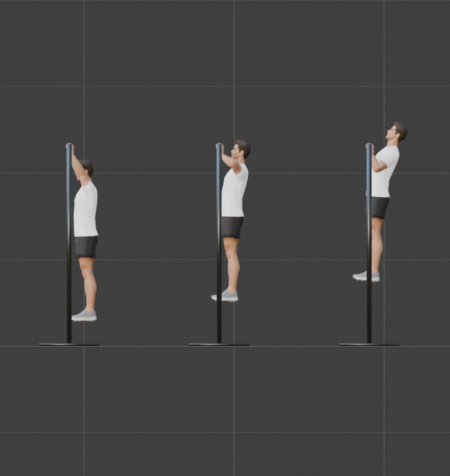
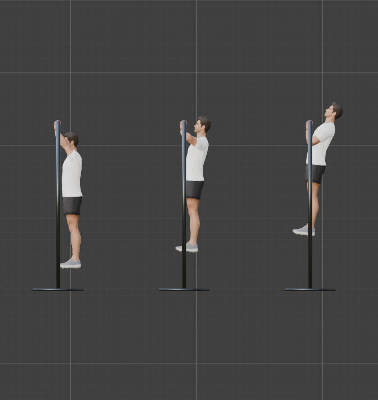
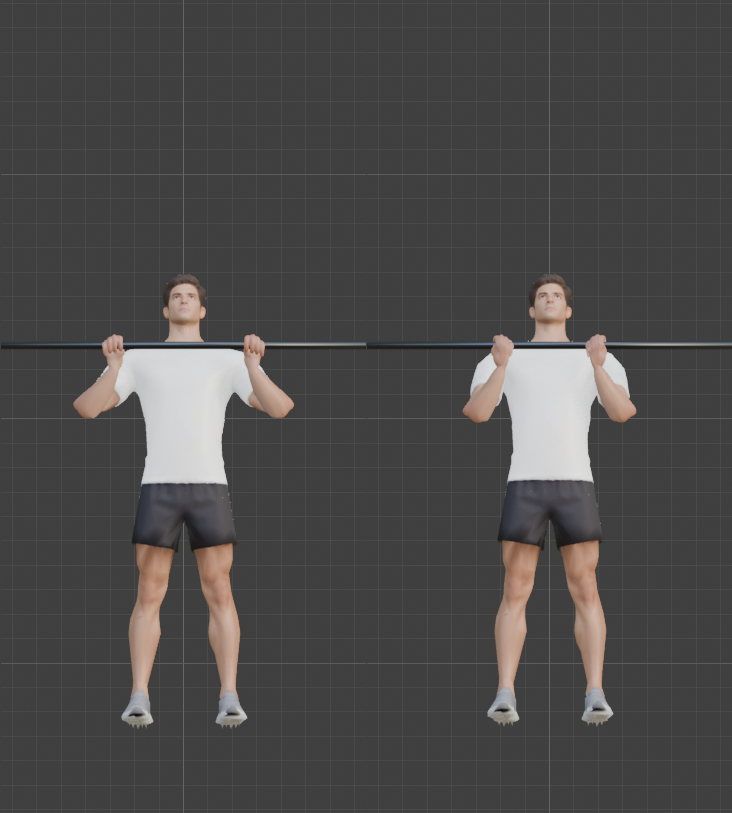
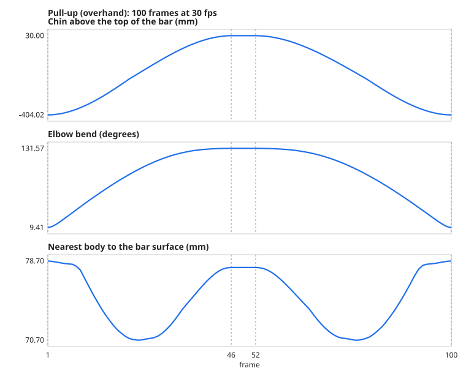
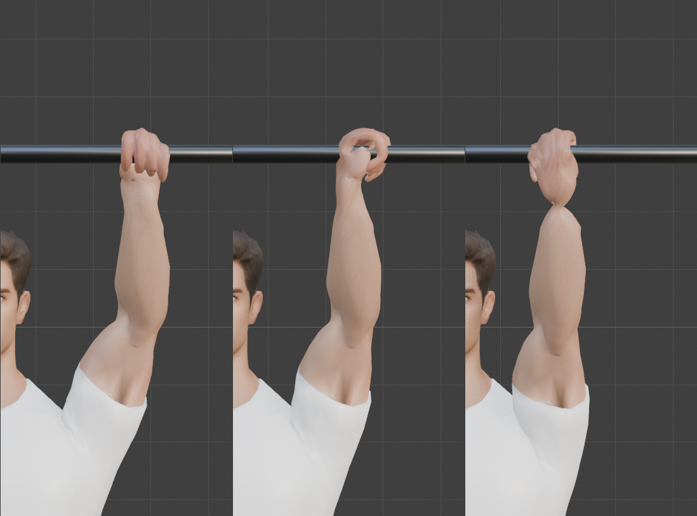

# Step 15: Hanging and pulling: the pull-up and the chin-up

**Goal:** the technique for exercises where the **hands are fixed to something and the body moves**. It is the reverse of the squat and push-up, where the hands or feet were planted on the floor. We teach it with the **pull-up** (overhand grip) and the **chin-up** (underhand grip). The same technique covers the dead hang, the negative pull-up, and hanging leg raises.

**Yes, we need a pull-up bar, and it is built in this step.** It follows the same *prop is the master* design as the kettlebell and mace in [Step 12](12-props.md).

## The pull-up bar

| Part | What it is |
|---|---|
| Mesh `PullupBar` | a freestanding frame: two posts 1.6 m apart on base plates, and a **32 mm** bar at **2.30 m** (172 triangles) |
| Control bone `PullupBar` | stands 17 cm in front of the origin; the frame is parented to it |
| Grip bones | `BarOver_Grip.L/R` and `BarUnder_Grip.L/R`: the exact hand frames for each grip |
| Sliders (on each `Hand_IK`) | `grab_bar_over` and `grab_bar_under` (0 to 1) |

Both grips use the hand frame from Step 12 (local Y along the fingers, local +Z the palm side). Here the **fingers point up**, and the grips differ only in which way the palm faces:

| | Overhand (pull-up) | Underhand (chin-up) |
|---|---|---|
| Palm faces | away from the body (-Y) | the body (+Y) |
| Thumbs | toward each other | pointing outward |
| Hands | 56 cm apart (wider than the shoulders) | 40 cm apart (shoulder width) |
| `grab_...` slider | `grab_bar_over` | `grab_bar_under` |

The two grips are a **180 degree twist of the hand about its own length** apart. That twist is the question [Step 9](09-test-the-rig.md) left open. We answer it below.

The finger closure around the 32 mm bar was measured the same way as in Step 12, with the shared handle position (9.1 cm along the fingers, 3.4 cm into the palm): the finger joints land **7.0 mm** (rms) from the ideal wrap, and the thumb **0.4 mm** (full fist, thumb opposition 0.5). The kettlebell and mace grips did not change.

**By hand:** model a cylinder along X for the bar, two posts and two base plates. Add a control bone, parent the mesh to it (**Ctrl+P**, **Bone**), and add the grip bones as children. Place a grip bone so its Y axis points up the fingers and its Z axis points from the hand toward the bar. A hand control gets a **Copy Transforms** constraint to each grip bone.

**Python:** [`tools/build_props.py`](tools/build_props.py) (the frame) and [`tools/build_prop_rig.py`](tools/build_prop_rig.py) (bones, grips, sliders).

## We did not need an IK/FK switch

In [Step 10](10-ik-for-arms-and-legs.md) I expected hanging to need a switch that turns the leg IK off, so the legs could dangle. That was wrong. If the **foot targets and knee poles are keyed to travel with the hips**, the legs hang by themselves:

| Hips lifted by | Ankle error | Knee bend |
|---|---|---|
| 0.20 to 0.32 m | **0.00 mm** at every height | 2.2 degrees (its resting bend) |

At the top the hips lean back, so the targets ride the same rigid motion as in the push-up (`anim_core.rigid`). A real kip or a swing would need the legs keyed apart, but the hang does not.

## Finding the two heights

[`tools/exercises/pullup.py`](tools/exercises/pullup.py) does not hard-code how high the body goes. It **solves** two heights against the rig and the mesh, by bisection:

| Height | The question | Pull-up | Chin-up |
|---|---|---|---|
| **Dead hang** | the lowest lift at which the straight arm still reaches the bar | 0.276 m | 0.300 m |
| **Top** | the lift that puts the chin **30 mm** above the bar | 0.729 m | 0.737 m |

The chin-up hangs higher because the underhand grip puts the wrists further forward, so the arms reach further.

Finding the top position took some searching. With the hips leaning back 8 degrees and no forward shift, the elbows only bent about 100 degrees at the top, because the shoulders sat 12 cm further from the bar. Moving the body forward and leaning less brought it to 130 degrees or more:

| Body at the top | Elbow bend | Nearest body to the bar |
|---|---|---|
| no shift, lean 8 | 103 degrees | 79 mm |
| 8 cm forward, lean 3 | 133 | 78 mm |
| 14 cm forward, lean 3 | 146 (at the limit) | 57 mm |

We chose 10 cm forward and 6 degrees of lean (pull-up), 12 cm and 8 degrees (chin-up). **A first version tilted the head back to look at the ceiling** (10 degrees of neck and 15 of head extension on top of the spine's), so we cut it to 6 and 8, and the solver found the extra lift needed.

## The motion

30 fps, a 100-frame (3.3 s) loop: 1.5 s up, 0.2 s at the top, 1.6 s down. Every key is built from one rise parameter `t` (0 = hanging, 1 = top). The hands are not keyed at all: the grab slider holds them to the bar.

From the front, the pull-up (left) has the wide overhand grip with the elbows out, and the chin-up (right) the narrow underhand grip with the elbows in.

## Results (measured)

| Check | Pull-up | Chin-up |
|---|---|---|
| Hand control to its grip bone (worst) | **0.000 mm** | **0.000 mm** |
| Wrist drift on the bar | 0.04 mm | 0.04 mm |
| Wrist reach error | 0.056 mm | 0.048 mm |
| Elbow bend | 9.4 to **131.6** degrees | 9.3 to **120.6** degrees |
| Knee bend (the legs hang) | 2.2 to 2.5 | 2.2 to 2.7 |
| Chin against the top of the bar | -404 mm hanging, **+30 mm** at the top | -380 mm, **+30 mm** |
| Nearest part of the body to the bar's surface | **71 mm** (never closer) | **65 mm** |
| Feet above the floor | 27.6 cm hanging, 72.9 cm at the top | 30.0 cm, 73.9 cm |
| Spine from vertical at the top | 15.8 degrees | 17.8 degrees |
| Fastest hips | 0.45 m/s | 0.44 m/s |
| Loop seam | 0.00 mm | 0.00 mm |

**Nothing touches the bar except the hands:** the nearest the body or head comes to the bar's surface is 65 mm.

## The grip swap: the open question from Step 9

[Step 9](09-test-the-rig.md) tested a 90 degree twist in one direction and said a full overhand-to-underhand swing was unproven. We cross-faded between the two grips while hanging and measured the twist of the hand against the forearm, and the forearm's radius in slabs next to the wrist (against the rest pose):

| Overhand share | Hand twist | Forearm radius, 2-4 cm from the wrist | 4-7 cm | 7-12 cm |
|---|---|---|---|---|
| 1.00 (overhand) | -129 degrees | 0.98 | 1.00 | 1.00 |
| 0.75 | -84 | 0.99 | 1.00 | 1.00 |
| 0.50 | -39 | 0.97 | 1.00 | 1.00 |
| 0.25 | +5 | 0.93 | 1.00 | 1.00 |
| 0.00 (underhand) | **+49** | **0.89** | 1.00 | 1.00 |

**The swing is 178 degrees and it is smooth,** with no collapse or flip. The forearm is unchanged beyond 4 cm from the wrist. **But there is a mild pinch:** at the underhand end the radius just next to the wrist falls to 0.89 of its rest value, and in the close-up (right) the forearm tapers into a narrow neck before the hand. That is the cost of putting the whole twist in the `Hand` bone. A true candy-wrapper pinch would be far below 0.5, so it is not a failure. It is visible up close, and not at normal viewing distance. (This mesh has few vertices near the wrist: 33, 14 and 9 per slab, so the numbers are coarse and the picture matters.)

**What we would do if it matters:** add a forearm twist bone that takes half the hand's twist, so it is shared along the forearm. Step 9 showed that twisting from the elbow kinks it, so the twist must be weighted toward the wrist. We have not built it.

## A rig bug the grip swap found

The first cross-fade picture was wrong: at 50/50 the arm flew out to the side instead of holding the bar half-way between the grips. The cause is how Blender **stacks** constraints. Each **Copy Transforms** blends the *result of the one before it*, so two partial grabs do not average. At 0.5 and 0.5 the **original hand position** (the T-pose wrist, 72 cm out) kept a quarter of the weight. This affected every partial overlap of grabs, including a hand-off between props.

**The fix:** the slider values are turned into weights (`w = slider x min(1, sum) / sum`, with the remainder staying with the animated hand), and each constraint's influence is its weight divided by what the later constraints leave over. It is a driver on each influence ([`tools/build_prop_rig.py`](tools/build_prop_rig.py)).

| Test | Result |
|---|---|
| Cross-fade overhand to underhand, 5 steps | the hand is on the **straight average** of the two grips: error **0.0000 mm** |
| One partial grab (kettlebell 0.25, 0.5, 1.0) | half-way between the animated hand and the grip: **0.0001 mm** |
| Kettlebell and mace grips (Step 12 tests) | unchanged |

## A bug we introduced, and caught

After the blending fix, the **chin-up's reach error jumped to 12.3 mm**. The solver for the chin-up runs right after the pull-up's, which had left `grab_bar_over` at 1. Under the old stacked constraints a stale overhand grab was harmless (the underhand one came last and won). Under the correct blend, both at 1 means a 50/50 average of the two grips, so the chin-up's heights were solved against the wrong target. **The pose now sets both bar sliders explicitly.** A stale value that "didn't matter" mattered as soon as the blending became correct.

## Skin

Against the T-pose, split into **the hands** and **everything else**:

| Frame | Volume | Hands: edges over 1.5x (worst) | Rest of the body: edges over 1.5x (worst) |
|---|---|---|---|
| Pull-up, hanging | -3.3% | 530 (x8.5) | **40 (x1.9)** |
| Pull-up, half-way | -1.9% | 546 (x8.5) | 31 (x1.9) |
| Pull-up, top | 0.0% | 560 (x8.5) | 38 (x2.0) |
| Chin-up, hanging | -3.6% | 626 (x8.5) | 74 (x2.0) |
| Chin-up, half-way | -2.2% | 618 (x8.5) | 93 (x1.9) |
| Chin-up, top | -0.5% | 595 (x8.5) | 77 (x2.0) |

Out of 23,304 edges (5,498 touch a hand). **The body is the gentlest we have measured** (worst x2.0). **The x8.5 is the hands,** every frame: both hands are in a closed fist, and the fused-finger web ([Step 4](04-clean-up-the-mesh.md)) stretches when the fingers curl. Our first reading of "x8.5 everywhere" looked like a shoulder problem. It was constant from the hang to the top, which pointed at the hands, and splitting the measurement confirmed it. The fists look right in the close-ups.

## Rebuilding every action: `build_all_actions.py`

Adding two actions and new sliders meant every action had to be rebuilt, and the [order test](13-legs-driven-by-ik.md) had to cover all of them. [`tools/build_all_actions.py`](tools/build_all_actions.py) now does it in one run. It rebuilds each exercise, prints the numbers each one is checked on, saves the measurement files, and plays every action after every other:

| | Result |
|---|---|
| Actions | Squat, Pushup, Situp, Pullup, Chinup |
| Curves per action | **115** (every control, so no action leaks into another; 117 after [Step 16](16-loaded-movement.md) adds a slider) |
| Order test, worst difference of any bone | **0.0000 mm** |

To add an exercise, write its table in `tools/exercises/` and add one line to the list in that script.

## Other exercises from this technique

| Exercise | What changes | Status |
|---|---|---|
| **Dead hang** | hold the first key | not built |
| **Negative pull-up** | start at the top, lower slowly | not built |
| **Hanging knee raise, leg raise** | key the foot targets up and forward | not built |
| **Scapular pull-up** | small lift with the arms straight; shoulders shrug (needs the clavicle keyed) | not built |
| **Wide / close / neutral grip** | other grip bones on the same bar | not built |
| **Muscle-up** | needs the body to go *over* the bar | not feasible yet |

These come from [Step 17](README.md)'s recipe.

## Checks added to the recipe

- no body part (other than the hands) comes within a few millimetres of the prop, measured against its surface;
- the chin, or whatever must clear a bar, is measured against it;
- every grab slider a pose does not use is set to 0 explicitly (a stale grab bends the result);
- split the skin check into the hands and the rest of the body, so one does not hide the other.

**Concepts**
- **Prop as master, again:** the hands hold the bar, so the *body* is what we animate.
- **Pronated and supinated:** overhand and underhand grips. They differ by a 180 degree twist of the hand about its length.
- **Constraint stack:** constraints run in order, each acting on the previous result, so partial influences do not add the way they look.
- **Bisection:** solving "find the value where this crosses a threshold" by repeatedly halving the range.
- **Normalizing weights:** scaling a set of weights so they add up to one.

**Caveats**
- **Mild wrist pinch** in the underhand grip (above). Forearm twist bones are the fix.
- **The bar does not move,** and there is no swing, kip or sway.
- **The legs hang rigid and together.** Real pull-ups often cross the ankles or tuck the knees.
- **The shoulders do not shrug** (the clavicles are not keyed), so the shoulder blades do not move.
- **The hand closure is fixed** at the measured full fist. A thicker bar would need re-measuring.
- **The bar frame stands 17 cm in front of the origin** in every scene, so it may be in the way of other exercises: hide it.
- **Export:** the IK, the drivers and the prop bones are baked into the GLB and checked ([Step 19](19-export-for-babylon.md)).

---

[← Previous: Floor work](14-floor-work.md) · [Contents](README.md) · [Next: Loaded movement →](16-loaded-movement.md)
