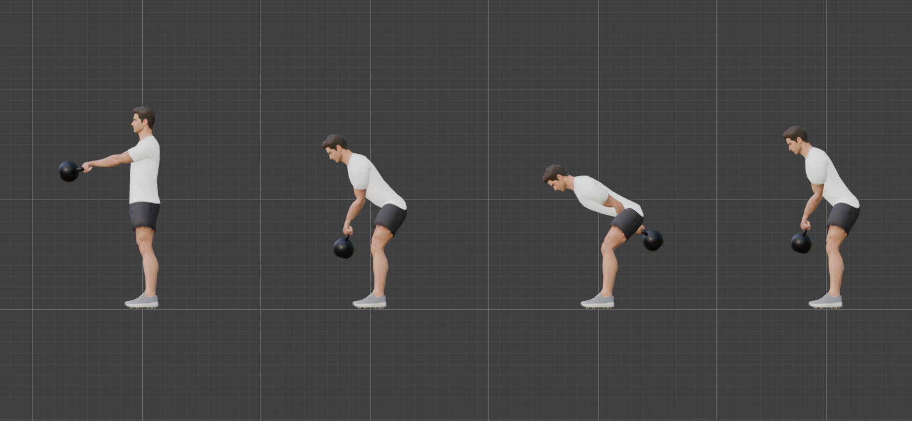
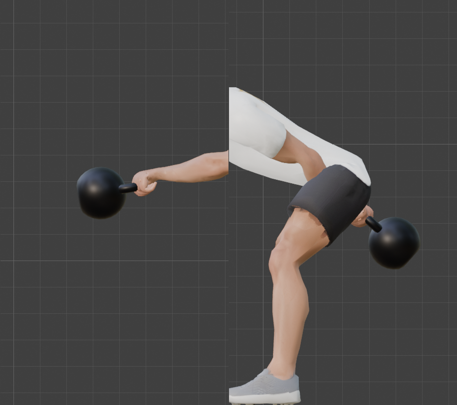
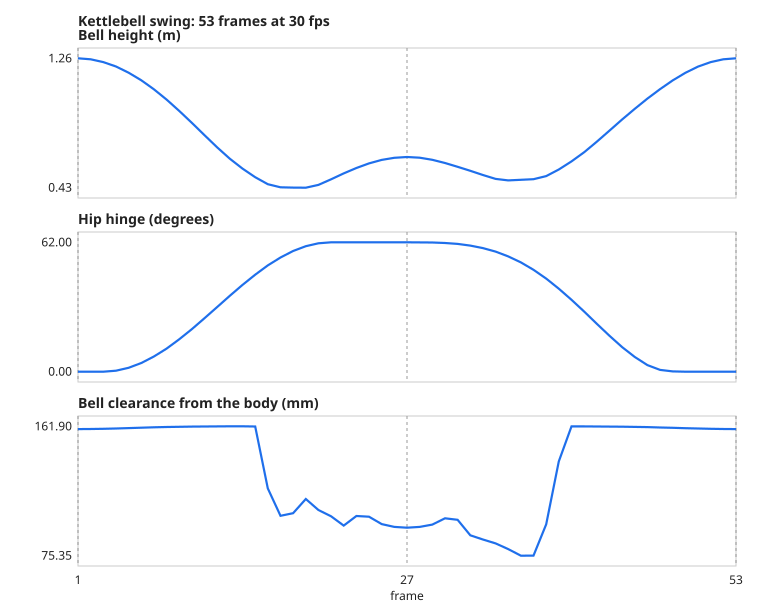
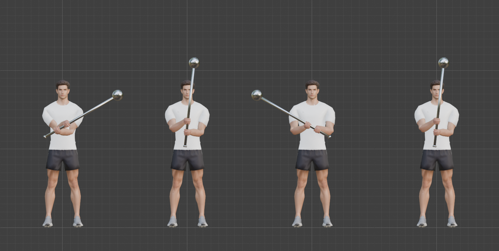
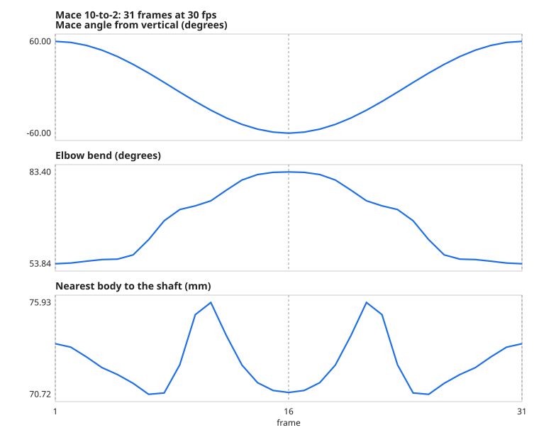

# Step 16: Loaded movement: the kettlebell swing and the mace 10-to-2

> **Correction (later):** a real mace 10-to-2 is done with the head of the mace swinging *behind* the back (hanging down behind you, then up behind each shoulder to 10 and 2 o'clock), not held in front of the chest as this step built it. The action in the Blender file is now the behind-the-back version (`tools/exercises/mace_10_to_2.toml`); the front-of-chest swing described below is kept as `MACE_10_TO_2` in `mace.py`. The measurements below are for the front version.

**Goal:** the last technique: exercises where **the prop leads and the hands follow**. In [Step 15](15-hanging-and-pulling.md) the bar was fixed and the body moved. Here the prop *moves*, on a path we choose, and the body is choreographed around it. We teach it with two exercises that show different things:

| | What it teaches | Exercises it covers |
|---|---|---|
| **Kettlebell swing** | a prop on a pendulum arc about the shoulders, with a hip hinge timed to it | swing, and (with changes) the clean, snatch, one-arm swing |
| **Mace 10-to-2** | a prop turning about the point between the hands, which follow it | 10-to-2, and (with changes) the 360 and other mace drills |

Both use the keyframe tables of [Step 13](13-legs-driven-by-ik.md) and the grab sliders of [Step 12](12-props.md).

## Part 1: the kettlebell swing

### A new grip

The Step 12 kettlebell grip had the fingers pointing *forward* with the palms down, like holding a handle from above. A swing is held with the arms hanging, like a deadlift: **the fingers point down and the palms face the body**. That needs its own grip bones, `KBSwing_Grip.L/R`, and its own slider, `grab_kb_swing` ([`tools/build_prop_rig.py`](tools/build_prop_rig.py)). The finger closure is the one measured in Step 12 for the same handle (6.6 mm rms).

### The bell on a pendulum

[`tools/exercises/kbswing.py`](tools/exercises/kbswing.py) places the bell, not the hands. The arms hang from the shoulders, so the wrists sit on a circle about them:

```
alpha                  the arm's angle:  0 = hanging straight down,  +90 = horizontal in front,  negative = swung back
wrist midpoint  =  shoulders + 0.49 m · (0, -sin alpha, -cos alpha)
bell turned by  -alpha  about X, so the hand frame still lies along the arm
bell origin     =  wrist midpoint  -  (turn applied to the wrists' position in the bell's own frame)
```

The radius 0.49 m is a little under the 0.53 m arm, so the arms stay just off straight (28 to 37 degrees of elbow bend all swing).

### The body, solved to match

The bell goes where the shoulders are, so for every key the script builds the body first, **reads the shoulders, then places the bell** (the two-pass idea from the sit-up). The body is a hip hinge:

| Control | What it does |
|---|---|
| Hips turn forward by `phi` (0 to 62 degrees) | the hinge |
| Hips travel back by `dy` (0 to 28 cm) | the hips sit back |
| Knee bend `kappa` (6 to 38 degrees) | the **hip height is solved for it** by bisection, so the knees bend by exactly the angle asked |
| Feet | planted in a **wider stance** (34 cm either side of the centre, knees pushed out 8 cm) |

### Timing: the hips lead the bell

The motion is written as **smooth functions of the frame** and keyed every 2 frames (27 keys over a 53-frame, 1.77 s loop):

| Phase | Bell | Hips |
|---|---|---|
| **Down** (frames 1 to 27) | falls from the top (80 degrees) to the bottom (-48 degrees) with an ease | **hinge early**, between frames 3 and 21, so they are already back when the bell passes under them |
| **Up** (frames 27 to 53) | rises from -48 to 80 degrees | **hold back, then snap forward**, finishing the extension at frame 48 |

We measured the lead: on the way up the hips are 95% extended at **frame 47** and the bell is 95% risen at **frame 50**. **The hips lead the bell by 3 frames (0.10 s).**





Frames 1, 14, 27 and 40. At the top the bell floats in line with the arms. At the bottom the chest is forward and the bell has gone back behind the thighs. The right-hand picture of the grip shows the handle in the fingers with the bell trailing.



### Results (measured over all 53 frames)

| Check | Result |
|---|---|
| Hand reach error (worst frame) | **0.006 mm** |
| Feet planted (the ankles) | **0.039 mm**; foot rotation 0.0 degrees; lowest foot vertex -0.0016 m (on the floor) |
| Elbow bend | 27.8 to 36.6 degrees |
| Knee bend | 6.0 to 38.0 degrees |
| Hip hinge | 0 to 62 degrees |
| Arm angle | -48 to +80 degrees |
| Bell height | 0.43 m (the bottom) to 1.26 m (the top) |
| Bell travels from y = | -0.67 m (in front) to +0.50 m (behind) |
| **Bell clearance from the body (closest, any frame)** | **75 mm** |
| Fastest the bell moves | 3.2 m/s (frame 14) |
| Hips up and down | 0.88 to 0.94 m |
| Centre of mass, front to back (body only) | +0.4 to +6.4 cm, inside the 23 cm sole |
| Loop seam | 0.00 mm |

### Two things went wrong

**1. Five keys cut across a curve (reach error 27.6 mm).** The first version keyed the five postures that looked right. At the keys the reach was perfect. Between them, **the hands were 27.6 mm out of reach**. A pendulum arc and the hip hinge are curved, and a few widely spaced keys cut straight across them. Writing the motion as functions and **keying every 2 frames** brought it to 0.006 mm.

**2. The bell went through the body (-17 mm).** At the keys the bell was 90 mm or more from the body, so the measurement looked fine. **Between** the keys, at frames 16 to 19 (going down) and 35 to 37 (coming up), the bell passes under the hips at mid-thigh height, where the gap between the thighs is narrowest, and it **penetrated the body by up to 17 mm**. We only found it because the clearance is measured on every frame. Two things fixed it, and we tried them in turn:

| Change | Worst clearance |
|---|---|
| Stance 30 cm, original timing | **-17 mm** (through the body) |
| Stance 34, 38, 42 cm, original timing | -6, +4, +14 mm |
| **New timing** (hinge early on the way down, hold back then snap on the way up), stance 30, 34, 38 | **+48, +75, +90 mm** |

The timing fixed most of it, and it is also how a swing actually moves: the hips are back before the bell arrives. We kept a stance of 34 cm (a moderate width) for a 75 mm margin. A stance of 42 cm would have fixed it on its own, but it looks like a sumo stance.

## Part 2: the mace 10-to-2

The mace is held in front of the chest with the hammer grip from [Step 12](12-props.md) (one hand above the other). It swings like a windscreen wiper in the frontal plane: its **head sweeps from 10 o'clock** (to the character's left) **to 2 o'clock** (to his right), turning about the point between the hands. [`tools/exercises/mace.py`](tools/exercises/mace.py):

```
gamma             the shaft's angle from vertical about the front-back axis:  +60 = 10 o'clock,  -60 = 2 o'clock
mace origin   =   pivot  -  (turn by gamma applied to the hands' midpoint in the mace's own frame)
pivot             a point 28 cm in front of the chest, at 1.28 m
```

The body stays upright and the hands **turn with the shaft**: each hand twists about 60 degrees either way, the same twist as the grip swap in [Step 15](15-hanging-and-pulling.md).





**The same curve problem appeared here.** With only the two extremes keyed, the point between the hands is linearly interpolated between two positions on an arc, so it **rises mid-swing**: by calculation, the hands' midpoint would sit 0.27 m x (1 - cos 60 degrees) = **13.5 cm above** where it should be at the vertical position (we worked this out; we did not play the five-key version to measure it, and the reach check could not have caught it, because the arms still reach). The shaft angle `gamma` now follows a cosine and is keyed **every 3 frames**, which keeps the pivot where it should be.

### Results (measured over all 31 frames)

| Check | Result |
|---|---|
| Hand reach error | **0.037 mm** |
| Shaft angle | **-60.0 to +60.0 degrees** |
| Elbow bend | 53.8 to 83.4 degrees |
| Nearest the body gets to the **shaft** | **71 mm** |
| Nearest the body gets to the **head** | **309 mm** |
| Head's travel | x from -0.70 to +0.70 m, height 1.68 to 2.10 m |
| Feet | do not move (ankle drift 0.000 mm); knees at rest |
| Loop seam | 0.00 mm |

## Skin

Against the T-pose, split into the hands and the rest of the body:

| Frame | Volume | Hands: edges over 1.5x (worst) | Rest of the body: edges over 1.5x (worst) |
|---|---|---|---|
| Swing, top | -1.5% | 518 (x8.5) | 163 (x2.2) |
| Swing, falling | -6.2% | 552 (x8.5) | 276 (x2.3) |
| **Swing, bottom** | **-8.8%** | 543 (x8.5) | **352 (x2.6)** |
| Swing, rising | -5.0% | 551 (x8.5) | 205 (x2.3) |
| Mace, 10 o'clock | -2.5% | 558 (x8.5) | 85 (x2.3) |
| Mace, vertical | -2.0% | 529 (x8.5) | 110 (x2.3) |
| Mace, 2 o'clock | -1.7% | 557 (x8.5) | 101 (x2.2) |

The **swing's bottom is the hardest pose of any exercise on the body** (x2.6), because the hips hinge deeply. It is still modest. The x8.5 on the hands is the closed fists, as before ([Step 15](15-hanging-and-pulling.md)).

## Rebuilding and the order test

Both exercises are in [`tools/build_all_actions.py`](tools/build_all_actions.py). All **seven** actions pass the order test (every action after every other, compared with a clean pose), with a worst difference of **0.0000 mm**. Each action now has **117** curves (the new `grab_kb_swing` slider added two).

## Other exercises from this technique

| Exercise | What changes | Status |
|---|---|---|
| **One-arm swing** | one hand on the handle, the other free | not built |
| **Kettlebell clean** | the bell goes from the swing to the **rack** (resting on the forearm at the chest): a grip change and a hand path | not built |
| **Goblet squat** | the squat table with the bell held at the chest by its sides (needs new grip bones) | not built |
| **Mace 360** | the head circles the shoulders and the head: the hands and the mace pass close to the body and head, so it needs a hand path and many clearance checks | not built |
| **Barbarian squat** | the mace rests across the back of the shoulders, held with both hands: the prop **rides the torso** (like the hands in the sit-up) | not built |

The clean and the 360 are the hardest, because the grip changes or the prop passes near the body. These come from [Step 17](README.md)'s recipe.

## Checks added to the recipe

- **key a curved path densely:** a few keys cut straight across an arc or a hinge. Reach, clearance and the like must be measured on **every frame**, not just the keys;
- **prop clearance:** the prop's body must stay clear of the character's body on every frame (the swing failed this between its keys);
- **timing relationships are measured too:** "the hips lead the bell" became a number (3 frames).

**Concepts**
- **Prop-led motion:** the prop's path is chosen first, and the body and hands are derived from it.
- **Pendulum:** a weight swinging on a fixed-length arm about a pivot (the shoulders).
- **Chord and arc:** the straight line between two points on a circle lies inside it. Interpolating between two widely spaced keys follows the chord.
- **Smooth functions of time:** writing a motion as a formula and keying it densely, instead of placing a few keys.
- **Ease function:** a curve from 0 to 1 with a gentle start and finish (here, half a cosine).
- **Lead and lag:** one part of the body moving a moment before another, which is what makes a motion look driven.

**Caveats**
- **There is no physics.** The bell is placed on a perfect arc and turns rigidly with the arm. A real bell floats and tilts at the top and flops in the hands.
- **The arms stay at a constant bend** (28 to 37 degrees) and the wrists do not hinge.
- **The centre-of-mass check uses the body only.** A 16 kg bell shifts it, and this swing would need to be re-checked with the bell's weight included.
- **Only the 10-to-2 is built for the mace.** The 360, the barbarian squat and the clean are listed above.
- **The swing's stance is wide** (68 cm between the feet).
- **No breathing, no head movement,** and the spine stays neutral.
- **Export:** the IK, the drivers and the prop bones are baked into the GLB and checked ([Step 19](19-export-for-babylon.md)).

---

[← Previous: Hanging and pulling](15-hanging-and-pulling.md) · [Contents](README.md) · [Next: The exercise recipe →](17-the-exercise-recipe.md)
