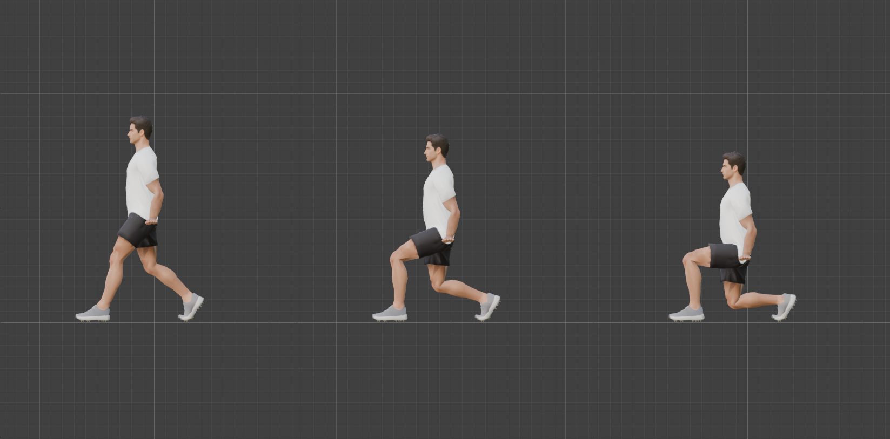
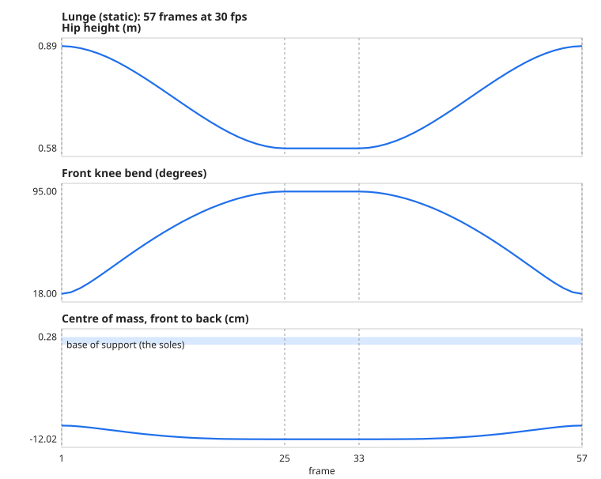

# Step 17: The exercise recipe

**Goal:** after this step, a new exercise is a table, not a tutorial. We turn what Steps 13 to 16 taught into **a procedure, a template, and an automatic checklist**, and prove it by building a new exercise (the lunge) and by testing the checklist itself.

The most useful lesson of those four steps is that **a motion can pass every check we remembered to run and still be wrong**: the squat that leaked into the next action, the swing that was out of reach between its keys, the bell inside the body. So the recipe is **executable**. You do not remember a list; you run a script.

## The recipe

| | | |
|---|---|---|
| 1 | **Choose the technique** | the table below |
| 2 | **Copy the template** | `tools/exercises/_template.py` to `tools/exercises/<name>.py` |
| 3 | **Write the table** | a pose (a dict) and a list of `(frame, pose)`; the last key equals the first for a loop |
| 4 | **Register it** | one entry in `tools/exercise_registry.py` |
| 5 | **Build** | run `tools/build_all_actions.py` in Blender: rebuilds and measures every action, and runs the order test |
| 6 | **Check** | `python3 -I tools/check_actions.py` (no Blender needed) |
| 7 | **Look** | assign the action and play it. The checks cannot tell you it looks right |

| If the exercise is... | Technique | Copy the pattern from |
|---|---|---|
| feet planted, the hips move | legs driven by IK ([13](13-legs-driven-by-ik.md)) | `squat.py`, `lunge.py` |
| the body on the floor | floor work ([14](14-floor-work.md)) | `pushup.py` (a stiff body pivoting on the toes), `situp.py` (settle onto the floor, hands ride the chest) |
| hands fixed, the body moves | hanging and pulling ([15](15-hanging-and-pulling.md)) | `pullup.py` |
| a prop leads and the hands follow | loaded movement ([16](16-loaded-movement.md)) | `kbswing.py`, `mace.py` |

## The registry

[`tools/exercise_registry.py`](tools/exercise_registry.py) is the one list of exercises. Both the Blender rebuild script and the checker read it, so you edit one place:

```python
dict(name="Lunge", module="lunge", table="LUNGE", keys=[1, 25, 33, 57], extra=None,
     checks=["ankles", "balance"], clearance=[],
     notes="a static lunge (split squat): the feet stay put. A walking lunge needs the feet keyed from step to step")
```

`checks` lists the optional checks that apply (`ankles`, `contacts`, `balance`); `clearance` lists `(measurement, minimum mm)` for any prop; `extra` points to a function that records extra measurements for the exercise.

## The checks

[`tools/check_actions.py`](tools/check_actions.py) applies these. **PASS** means met, **WARN** means met but at or near a limit (look at it), **FAIL** means not met.

| Check | Applies to | PASS if | Where we learned it |
|---|---|---|---|
| **reach** | all | every wrist is within 1 mm of its target (WARN within 3) | Step 16: the swing was 27.6 mm out of reach *between* keys |
| **floor** | all | the lowest vertex is above -2 mm (WARN above -5) | Step 14, and the lunge below |
| **loop** | all | the first and last frames differ by under 0.5 mm; WARN if the speeds either side of the seam differ by over 25% of the top speed | Step 13 |
| **limits** | all | no elbow bend over 149 and no knee bend over 154 degrees (the IK limits are 150 and 155) | Step 14: the sit-up's arms |
| **skin** | all | the body (hands excluded) stretches at most x3 and loses under 15% volume | Steps 8, 15 |
| **order** | all | the action plays identically after any other action (under 0.01 mm) | Step 13: the squat that leaked |
| **ankles** | registry | the ankles move under 0.5 mm | Step 13 |
| **contacts** | registry | the planted contacts (the ball of the foot and the wrist) move under 0.5 mm | Step 14: the ankles travel on an arc in a push-up |
| **balance** | registry | the centre of mass stays over the base of support (WARN within 2 cm of its edge) | Step 13 |
| **clearance** | registry | a prop stays at least the given distance from the body **on every frame** | Steps 15, 16: the bell went into the body |

For this step `measure()` records the skin and volume on every frame (against the T-pose), which the earlier steps measured by separate scripts.

## Testing the checker

A checker that has only ever said PASS has not shown it can say FAIL. [`tools/test_checker.py`](tools/test_checker.py) feeds it data with a known defect and confirms it catches each one. Four are **real bugs from this project, replayed with the numbers they actually had**:

| What we broke | Check | Result |
|---|---|---|
| the squat leaked into the next action (1,127 mm out) | order | FAIL, as expected |
| the swing's hands 27.6 mm out of reach between keys | reach | FAIL |
| the swing's bell 17 mm *inside* the body | clearance | FAIL |
| the chin-up's reach after the stale slider (12.3 mm) | reach | FAIL |

Nine more cover every other check, including the warnings (a planted foot that slides, a contact that drifts, a foot 1 cm and 3 mm through the floor, a loop that does not close, an elbow at its limit, skin stretched x5, the centre of mass off the foot, a prop closer than allowed but not touching). **All 13 are caught as expected, and the unmodified data gives 0 FAIL across all eight exercises.**

**The limit of this test:** it proves the *thresholds* catch those numbers. It does not prove that the measurement code in Blender would produce those numbers for those bugs (we saw that it did, at the time).

## Proving the recipe: the lunge

We built a **static lunge (split squat)** from the template, as someone following the recipe would. [`tools/exercises/lunge.py`](tools/exercises/lunge.py) is a short file (53 lines, including its comments). It combines two earlier techniques: legs driven by IK (Step 13) and a rear foot that pivots on its toes (the push-up's trick, Step 14):

| Decision | How it was made |
|---|---|
| Front knee bends 18 to 95 degrees | **solved**: the script finds the hip height that gives each (the swing's method) |
| Rear heel lifted 55 degrees | the rear ankle target rides a rigid motion about the ball of the foot; the toes bend back by the same angle |
| Hands | hang at hip height, following the hips |
| Both feet | planted (not keyed) |





**It built first time, and the checker found something I had not seen.** The front knee came out at exactly 18 and 95 degrees, the reach was 0.01 mm, and it looked right. The checker said **WARN floor: lowest vertex -2.7 mm**. Looking into it:

| Where | What | Fix |
|---|---|---|
| Front foot, at the top | one heel vertex 2.7 mm below the floor, pulled down by the shin's weights when the knee is nearly straight | raise the front ankle target 2.8 mm (10.28 cm) |
| Rear toes, at the bottom | 1.6 mm below the floor. I had reused the push-up's 3.5 cm pivot height without re-checking it for this heel angle | raise the pivot by 3 mm (3.8 cm) |

Both are invisible to the eye, which is exactly why a number catches them. It is the Step 14 lesson again: **a planted contact's height has to be calibrated against the mesh**, not copied from another exercise. After the fix the lowest foot vertex is +0.09 mm: on the floor, not through it.

| Check | Lunge |
|---|---|
| Front knee | 18 to 95 degrees |
| Hand reach | 0.012 mm |
| Ankle drift | 0.077 mm |
| Lowest foot vertex | +0.09 mm |
| Centre of mass, front to back | -12.0 to -10.4 cm, inside a base of support spanning both feet (-64 to +28 cm) |
| Hips | 0.58 to 0.89 m |
| Skin (body) | worst x2.5, volume -7.4% |
| Loop seam | 0.00 mm |

## Every exercise, checked

All eight, after a full rebuild (`build_all_actions.py`, then `check_actions.py`):

| Exercise | reach | floor | loop | limits | skin | order | ankles | contacts | balance | clearance |
|---|---|---|---|---|---|---|---|---|---|---|
| Squat | PASS | PASS | PASS | PASS | PASS | PASS | PASS | - | PASS | - |
| Push-up | PASS | PASS | PASS | PASS | PASS | PASS | - | PASS | - | - |
| Sit-up | PASS | PASS | PASS | **WARN** | PASS | PASS | PASS | - | - | - |
| Pull-up | PASS | PASS | PASS | PASS | PASS | PASS | - | - | - | PASS |
| Chin-up | PASS | PASS | PASS | PASS | PASS | PASS | - | - | - | PASS |
| Lunge | PASS | PASS | PASS | PASS | PASS | PASS | PASS | - | PASS | - |
| Kettlebell swing | PASS | PASS | PASS | PASS | PASS | PASS | PASS | - | PASS | PASS |
| Mace 10-to-2 | PASS | PASS | PASS | PASS | PASS | PASS | PASS | - | PASS | PASS |

**8 exercises, 0 FAIL, 1 WARN:** the sit-up's elbow reaches 150.8 degrees against the 150 degree limit, which we already knew from [Step 14](14-floor-work.md). The order test covers all **eight** actions at **0.0000 mm**, each with 117 curves.

## Your exercises: what is built and what is next

| Exercise | Technique | Status | What a new one needs |
|---|---|---|---|
| **Squat** | legs driven by IK | **built** ([13](13-legs-driven-by-ik.md)) | |
| **Lunge** | legs driven by IK | **built** (static, this step) | a **walking lunge** keys the feet from step to step, with the rear foot swinging through |
| **Push-up** | floor work | **built** ([14](14-floor-work.md)) | variants: change the pivot and hand heights (incline, decline), the hand position (diamond, wide), or pivot on the knees |
| **Sit-up** | floor work | **built** ([14](14-floor-work.md)) | hands behind the head, or a crunch (a smaller curl) |
| **Pull-up** | hanging and pulling | **built** ([15](15-hanging-and-pulling.md)) | |
| **Chin-up** | hanging and pulling | **built** ([15](15-hanging-and-pulling.md)) | |
| **Kettlebell swing** | loaded movement | **built** ([16](16-loaded-movement.md)) | a one-arm swing is one hand on the handle |
| **Kettlebell goblet squat** | legs driven by IK, with a prop riding the torso | **not built** | the squat table, plus **new grip bones** (hands on the handle's sides, held at the chest). The bell rides the chest: a two-pass build like the sit-up's hands |
| **Kettlebell clean** | loaded movement | **not built** | the swing, then the bell goes to the **rack** (resting on the forearm at the chest): a grip change, a hand path, and rack grip bones. The hardest of the kettlebell exercises |
| **Mace 10-to-2** | loaded movement | **built** ([16](16-loaded-movement.md)) | |
| **Mace 360** | loaded movement | **not built** | the head circles the shoulders and the head, so the hands and the shaft pass close to the body and head: needs a hand path and the clearance check on every frame |
| **Barbarian squat** | legs driven by IK, with a prop riding the torso | **not built** | the squat table, with the mace across the back of the shoulders held by both hands: the prop **rides the torso**, as in the goblet squat |

The goblet squat and the barbarian squat are the same new idea: **a prop that rides the torso**, which the sit-up's hands already do. The clean and the 360 are the hard ones.

## What the checks do not cover

- **Whether it looks right.** Step 7 of the recipe is to look. At the top of the pull-up the head was tilted back to look at the ceiling, and every number was fine: the chin was over the bar, the hands reached, nothing collided. We saw it only in the picture.
- **The body passing through itself** (a hand through the chest, a knee through an arm). Only props are checked against the body. This is the most useful check we do not have.
- **Physics.** Props are placed on paths, not simulated, and the balance check uses the body alone, without a prop's weight.
- **Timing that looks natural.** We measured one timing relationship (the hips leading the swing) because we thought of it. Others need your eye.
- **Stale measurements.** The checker reads the files `build_all_actions.py` writes. If you change something and do not rebuild, it checks the old data.
- **The thresholds are judgements,** not laws.

**Concepts**
- **Executable checklist:** a procedure written as a program, so that it runs the same way every time and cannot be forgotten.
- **Registry:** a single list that other programs read, so a new item is added in one place.
- **Mutation test:** deliberately breaking something to confirm the test notices.
- **Regression:** a bug that comes back. Each check is a bug we have already had, written down so it cannot return unnoticed.

**Caveats**
- **Nothing is exported yet.** The IK, the drivers and the prop bones must be baked ([Step 19](README.md)).
- **The skin check covers the body only;** the closed fists stretch x8.5 in every grip ([Step 15](15-hanging-and-pulling.md)).

---

[← Previous: Loaded movement](16-loaded-movement.md) · [Contents](README.md) · [Next: Shrink the textures →](18-shrink-the-textures.md)
