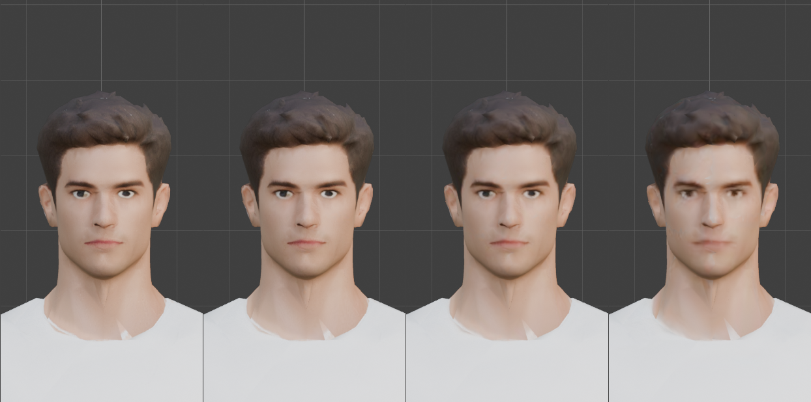
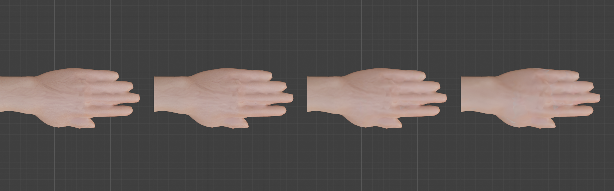
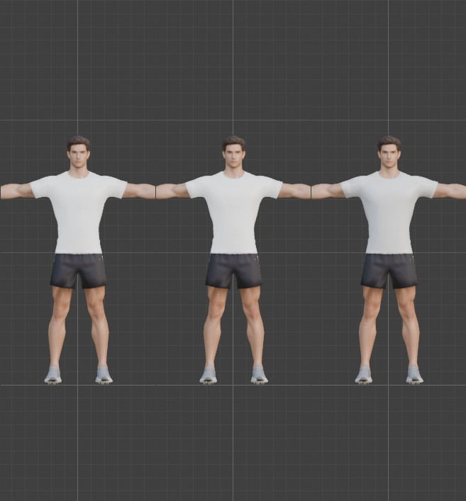
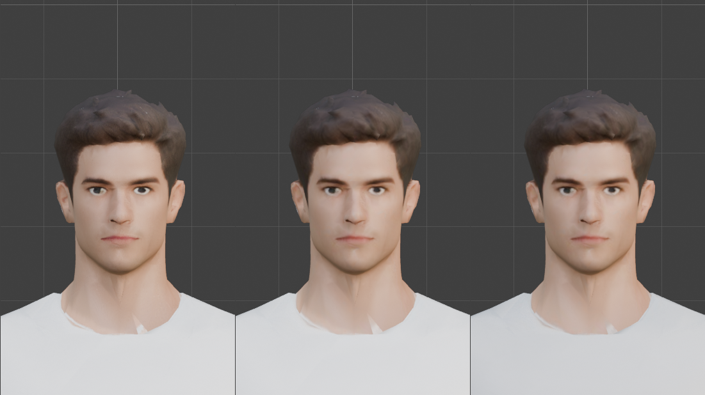

# Step 18: Shrink the textures for the web

**Goal:** make the model cheap to download and to hold in graphics memory, without visibly hurting it. The geometry is already small (15.5k triangles); the **textures are almost all of the 20 MB**.

## What is in the material

Read from the node graph (not from file names), the material has four textures:

| Image | Size | Role | On disk | Graphics memory\* | What we found |
|---|---|---|---|---|---|
| base | 4096² | Base Color | 10.19 MB | 89.5 MB | where all the visible detail lives |
| normal | 4096² | Normal Map | 7.32 MB | 89.5 MB | nearly flat: lots of space, almost no information |
| orm | 2048² | green = roughness, blue = metallic, red unused | 1.07 MB | 22.4 MB | **metallic averages 0.002**: the model has no metal. The unused red channel is 1.0 everywhere |
| emission | 2048² | Emission Color, strength 1.0 | 0.84 MB | 22.4 MB | a **grey** layer that makes every pixel glow by about 22% of a mid-grey |
| | | **Total** | **19.43 MB** | **223.7 MB** | |

\* *Uncompressed RGBA at 8 bits, with a full mip chain: width x height x 4 bytes x 4/3. A browser holds the texture like this whether the file was a small JPEG or not.*

**The emission layer is the odd one.** It correlates only 0.71 with the base colour's brightness, so it is not a copy. It adds the same glow whatever the scene's lighting, so the character is never quite dark. Dropping it makes the render about 3% darker on average, and a little more contrasty (see below). It is a look decision, so we **kept it by default** and flag it as yours.

## How much detail do the textures hold?

**Texel density**, the texels per metre of actual surface (from the UVs), is nearly uniform at 4096:

| Region | Share of the surface | 4096 | 2048 | 1024 | 512 |
|---|---|---|---|---|---|
| Body | 88.8% | 2,029 | 1,014 | 507 | 254 |
| Head | 6.9% | 2,311 | 1,156 | 578 | 289 |
| Hands | 4.3% | 2,321 | 1,160 | 580 | 290 |

For scale, a 1.9 m figure shown 800 pixels tall needs about **420 texels per metre**, and a face filling a 400 pixel head needs about **2,000**. So 1024 is plenty for a full-body view and not for a face close-up. **Only 55% of the UV square is used,** so 45% of every texture is empty. Repacking the UVs could recover that, but it means re-baking the textures, so we left it.

**Detail kept after shrinking and enlarging again** (RMSE out of 255, area-averaged; lower is better):

| Texture | 2048 | 1024 | 512 | 256 |
|---|---|---|---|---|
| Base colour (from 4096) | 6.05 | 8.40 | 11.37 | 15.73 |
| Normal map (from 4096) | 1.54 | 2.24 | 2.61 | 2.82 |
| Metal / rough (from 2048) | | 1.30 | 2.21 | 3.37 |
| Emission (from 2048) | | 5.64 | 9.61 | 14.62 |

The base colour loses detail steadily; the other three hardly lose any, because they hold little. **That is the plan: spend resolution on the base colour, and shrink the rest hard.**

## The tool

[`tools/shrink_textures.py`](tools/shrink_textures.py) finds each texture from the node graph, builds candidate sets, measures them, and applies one:

```python
G = {"ACTION": "report"}                          # build the sets and print the table (changes nothing)
exec(open("/Users/chris/blender_tutorial/human_tutorial/tools/shrink_textures.py").read(), G)
G = {"ACTION": "apply", "SET": "web", "EMISSION": "keep"}      # relink the material ("drop" leaves the glow layer out)
exec(open("/Users/chris/blender_tutorial/human_tutorial/tools/shrink_textures.py").read(), G)
```

**By hand:** open an image in the **Image Editor**, choose **Image**, **Resize**, then **Image**, **Save As** with a JPEG format and a quality, and point the Image Texture node at the new file. Doing this for four images and keeping them consistent (and renormalizing the normal map) is what the script is for.

Three design points:
- **The originals are kept** (renamed `orig_base` and so on, on a fake user), so it is reversible and can be re-run at any size.
- **Shrinking is an area average:** each output pixel is the mean of the block of source pixels it replaces.
- **The normal map is renormalized after averaging.** A normal map stores directions; averaging four unit vectors gives a vector *shorter* than one, and that flattens the shading. We measured it: a plain average gives vectors **98.9% of unit length on average and as short as 87.5%**. The tool averages the vectors, then restores their length.

### The normal map: PNG or JPEG?

At 1024, measured as the **angle** between the stored and the true normal:

| Encoding | Size | Mean error | Worst 0.1% | Max |
|---|---|---|---|---|
| **PNG (lossless)** | 0.98 MB | 0.15 degrees | 0.32 | 0.35 |
| JPEG, quality 95 | 0.10 MB | 0.60 degrees | 9.2 | 17.7 |
| JPEG, quality 90 | 0.05 MB | 0.68 degrees | 10.7 | 17.8 |

JPEG is ten times smaller, but a few pixels (0.1%) are wrong by up to 18 degrees, which can show as sparkles at sharp edges. **We kept the normal map lossless.** JPEG would save 0.9 MB, if the sparkle risk is acceptable.

## The sets, and what they cost

Real numbers: the sizes on disk, the graphics memory, and the size of an actual exported GLB (the skinned body, no animation):

| Set | Base | Normal | Metal/rough, emission | Textures on disk | Graphics memory | **GLB** |
|---|---|---|---|---|---|---|
| **original** | 4096 | 4096 | 2048, 2048 | 19.43 MB | 223.7 MB | **20.08 MB** |
| `max` | 2048 | 2048 PNG | 1024, 1024 | 5.24 MB | 55.9 MB | 5.90 MB |
| **`web` (chosen)** | **2048** | **1024 PNG** | **512, 512** | **1.66 MB** | **30.8 MB** | **2.31 MB** |
| `small` | 1024 | 1024 PNG | 512, 512 | 1.22 MB | 14.0 MB | 1.87 MB |
| `light` | 512 | 512 PNG | 256, 256 | 0.28 MB | 3.5 MB | 0.93 MB |

The geometry, skin and the rest of the file cost about **0.65 MB**.

## What it looks like

We rendered the same views with each set (Material Preview) and compared them with the original.

| Set | Whole body | Face close-up | Hand close-up |
|---|---|---|---|
| `max` | 64.8 dB | 54.8 dB | 55.4 dB |
| **`web`** | **64.0** | **54.0** | **55.2** |
| `small` | 61.7 | 49.9 | 52.9 |
| `light` | 56.6 | 43.9 | 49.6 |

*(PSNR: higher is closer to the original. Above about 50 dB is normally invisible.)*

**The numbers undersold the loss, so look at the pictures.** The face at 1024 scores 49.9 dB, which looks excellent, but in the close-up **the eyes visibly soften**. A whole-picture average is dominated by flat skin and cannot see small detail: an eye is only about 17 texels across at 1024.



Left to right: the original, `web`, `small`, `light`. `web` keeps the eyes close to the original; `small` is visibly softer; `light` is blurred.



The veins survive in `web` and `small` and are lost in `light`.

**The 2048 normal map is not worth it:** `max` against `web` differs by under 1 dB in every view, for **3.6 MB more**. The normal map has almost nothing to say.

## The emission layer

Same textures, with the glow layer kept and dropped (original, `small` with emission kept, `small` with it dropped):





| | Result |
|---|---|
| Brightness of the model's pixels | dropping the emission leaves **97%** of the original |
| Difference from the original | RMSE 3.5 (body) and 6.6 (face) out of 255, against 0.2 and 0.8 for the shrink itself |
| What changes | slightly darker shading and a little more contrast in the legs and shorts |
| Cost of keeping it | 0.03 MB and 1.4 MB of graphics memory |

Keeping it costs almost nothing, so the only reason to drop it is the **lighting**: a character with a constant glow will not go properly dark in a dark scene. **If you plan dynamic lighting, drop it** (`"EMISSION": "drop"`). We kept it to preserve the look of the model you gave us.

## What was in the exported file

We exported the `web` set as a GLB and read it back ([`cat_tutorial/tools/inspect_glb.py`](../cat_tutorial/tools/inspect_glb.py)):

| Image | Format | Size |
|---|---|---|
| base colour | JPEG, 2048² | 0.612 MB |
| normal | PNG, 1024² | 0.978 MB |
| metal / rough | JPEG, 512² | 0.035 MB |
| emission | JPEG, 512² | 0.033 MB |

The file has one mesh, one skin, and the emissive texture. **It also showed a problem for [Step 19](README.md): the skin has 74 joints.** The default export keeps every bone, including the controls, the grip bones and the prop bones. A game file needs the 52 deform bones plus whatever the props need.

## Not done (and not tested)

- **GPU-compressed textures (KTX2 / Basis, or WebP).** A JPEG or PNG is small to *download*, but the browser expands it to the full RGBA size in memory (the "graphics memory" column). KTX2 stays compressed on the GPU, roughly 4 to 8 times smaller in memory. It needs separate tooling and an engine that supports it, so we did not try it.
- **Repacking the UVs** to use the empty 45% of each texture.
- **A separate material for the head** at 4096, if face close-ups matter. It means splitting the mesh.
- **Dropping the metallic channel,** which is 0.002 on average. It would save almost nothing.
- **Checking it in a web engine.** All the pictures are from Blender's Material Preview. Babylon.js will filter and mip-map differently.

**Concepts**
- **Texel density:** texture pixels per metre of surface. It decides how sharp a texture looks, not its file size.
- **Mip map:** a chain of half-size copies of a texture, used when it is far away. It adds a third to the memory.
- **Area average:** shrinking by replacing each block of pixels with their mean. It does not alias the way dropping pixels does.
- **PSNR:** a number for how close two pictures are. It averages over the whole picture, so it can hide a local loss.
- **Lossless and lossy:** PNG keeps every value; JPEG throws some away, which is invisible in colour and risky in a normal map.

**Caveats**
- **Face close-ups soften** at `web` (and more so at `small`). A full-body view is fine.
- **The numbers assume 8-bit RGBA with mips** and no GPU compression.
- **The originals stay in the `.blend`** (19.4 MB on a fake user), so it is about 30 MB. [Step 20](README.md) can drop them once you are sure.
- **The emission layer is a look decision** (above).
- **Nothing is animated in the test export.** The real export is Step 19.

---

[← Previous: The exercise recipe](17-the-exercise-recipe.md) · [Contents](README.md) · Next: Export for Babylon.js (not written yet)
